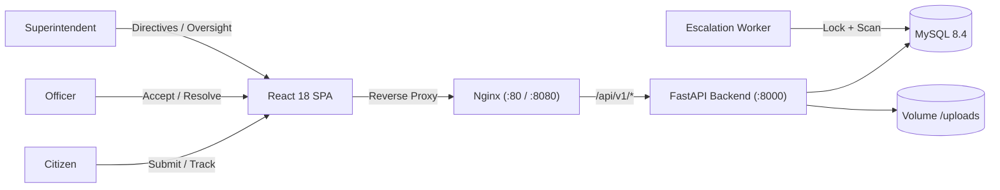

# CivicTrack — Civic Grievance Redressal & Resolution Platform

[](https://github.com/civictrack/civictrack/actions)
[](docs/LICENSES.md)
[](docs/HANDOVER_CHECKLIST.md)

CivicTrack is an enterprise-grade municipal grievance reporting, investigation, and SLA escalation platform. It allows citizens to lodge civic complaints with photos and location data, empowers municipal departments to review and act on issues, provides City Superintendents with supervisory oversight and directive tools, and enforces a deterministic 7-day SLA escalation engine.

---

## 1. Core Capabilities & Architecture

- **Strict Server-Side RBAC:** Enforced role hierarchy for Citizens, Department Officers, Superintendents, and Platform Admins.
- **Deterministic SLA Escalation Engine:** Background worker calculates overdue deadlines strictly from the moment a complaint is accepted (`accepted_at`). Escalations execute with MySQL advisory locking, idempotent state transitions, and audit trails.
- **Superintendent Oversight Queue:** Real-time visibility over all escalated cases with directive and resolution authority.
- **Immutable Append-Only Audit:** Tamper-evident lifecycle tracking (`complaint_status_history`, `audit_logs`, `officer_actions`).
- **Security & Privacy Hardening:** Bcrypt cost $\ge 12$, 8h JWT, magic-byte upload validation, private image streaming, and automatic PII redaction from application logs.



---

## 2. Technology Stack

| Layer | Technologies |
|---|---|
| **Frontend** | React 18.3, Vite, TypeScript Strict, Tailwind CSS, shadcn/ui, TanStack Query v5, React Hook Form, Zod |
| **Backend** | Python 3.12, FastAPI, SQLAlchemy 2.0, Alembic, Pydantic v2, PyMySQL |
| **Escalation Worker** | Python 3.12 Background Service, MySQL Advisory Locks (`GET_LOCK`) |
| **Database** | MySQL 8.4 LTS, InnoDB, `utf8mb4_0900_ai_ci`, UTC timezone enforcement |
| **Infrastructure** | Docker, Docker Compose, Multi-stage builds, Nginx reverse proxy |
| **Quality & Tests** | Pytest, Pytest-Asyncio, Vitest, Ruff, Playwright, Pre-commit |

---

## 3. Quickstart & Deployment

### 3.1 Prerequisites
- Docker Engine 24+ and Docker Compose v2+
- *(Optional for bare-metal dev)* Python 3.12+ and Node.js 20+

### 3.2 Single-Command Production Deployment
```bash
# 1. Clone repository
git clone https://github.com/civictrack/civictrack.git
cd civictrack

# 2. Configure environment
cp .env.example .env

# 3. Boot production stack (includes migration, seed, API, worker, web)
docker compose -f docker-compose.prod.yml up -d
```

### 3.3 Development Deployment
```bash
docker compose up --build -d
```

Verify services are healthy:
```bash
docker compose ps
curl http://localhost:8000/api/v1/health
```

---

## 4. Demo Accounts & Seed Data

CivicTrack includes an idempotent seed script (`python -m app.seed`) that generates test accounts and complaints in every P0 status, including one guaranteed overdue candidate:

| Role | Email | Password | Department Scope |
|---|---|---|---|
| **Platform Admin** | `admin@civictrack.local` | `Admin@12345` | Global Administration & Audit |
| **City Superintendent** | `superintendent@civictrack.local` | `Super@12345` | Oversight & Escalation Queue |
| **Water Officer** | `officer.water@civictrack.local` | `Officer@12345` | Water Supply & Sewage (`WTR`) |
| **Roads Officer** | `officer.roads@civictrack.local` | `Officer@12345` | Roads & Transport (`RDS`) |
| **Citizen Jane** | `citizen.jane@civictrack.local` | `Citizen@12345` | Citizen Workspace |
| **Citizen John** | `citizen.john@civictrack.local` | `Citizen@12345` | Citizen Workspace |

To reset or seed demo data at any time:
```bash
docker compose exec api python -m app.seed
```

---

## 5. Configuration & Environment Variables

| Variable | Description | Default / Dev | Production Rule |
|---|---|---|---|
| `DATABASE_URL` | SQLAlchemy MySQL connection string | `mysql+pymysql://civictrack:civictrack_secret@db:3306/civictrack` | Required |
| `JWT_SECRET_KEY` | Secret key for JWT signature verification | `dev-insecure-secret-key-change-in-prod` | Must be $\ge 32$ bytes |
| `ALLOW_DEMO_ESCALATION` | Guard flag for accelerated demo escalations | `false` | Must be `false` in prod |
| `ESCALATION_WINDOW_MINUTES` | SLA deadline window in minutes | `10080` (7 calendar days) | Reverts to 10080 if demo is false |
| `ESCALATION_INTERVAL_SECONDS` | Background worker loop interval | `60` | 60 |
| `INTERNAL_API_TOKEN` | Token for internal/worker triggers | `dev-internal-token-change-in-prod` | Cryptographic secret |
| `MAX_FILE_SIZE_BYTES` | File upload limit | `5242880` (5 MiB) | 5 MiB (SEC-04) |

---

## 6. Testing & Quality Verification

CivicTrack maintains comprehensive automated test coverage across unit, integration, RBAC matrix, IDOR security, load benchmarks, and frontend accessibility.

### Running Backend Tests (83 / 83 Passing):
```bash
cd backend
pytest tests -v
```

### Running Frontend Tests (6 / 6 Passing):
```bash
cd frontend
npm run test:run
```

### Running Linting & Formatting Checks:
```bash
cd backend
ruff check .
ruff format --check .
```

---

## 7. Documentation Index

Comprehensive technical documentation is available in the [`docs/`](docs/) directory:

- [System Architecture](docs/ARCHITECTURE.md): Component diagrams, RBAC design, worker concurrency.
- [Relational Data Model](docs/DATA_MODEL.md): Schema ER diagram, constraints, table structures, and indexing.
- [API Contract Specification](docs/API_CONTRACT.md): REST endpoints, error envelopes, and payload schemas.
- [Operations & Incident Runbook](docs/RUNBOOK.md): SOPs for startup, backup/restore, secret rotation, and troubleshooting.
- [Security Review](docs/SECURITY_REVIEW.md): IDOR analysis, upload protection, and PII log redaction audits.
- [Performance Report](docs/PERFORMANCE_REPORT.md): Load benchmarks (500 complaints / 100 users, p95 latencies).
- [UAT Report](docs/UAT_REPORT.md): Formal acceptance criteria verification (AC-01 through AC-16).
- [Traceability Audit](docs/TRACEABILITY_AUDIT.md): 100% requirements mapping matrix (50 P0 FRs, 22 NFRs, 20 BRs, 44 Stories).
- [Live Demo Script](docs/DEMO_SCRIPT.md): Step-by-step 5–10 minute live evaluation script.
- [Third-Party Licenses](docs/LICENSES.md): Open-source license inventory and attributions.
- [Handover Checklist](docs/HANDOVER_CHECKLIST.md): Final production delivery sign-off.
