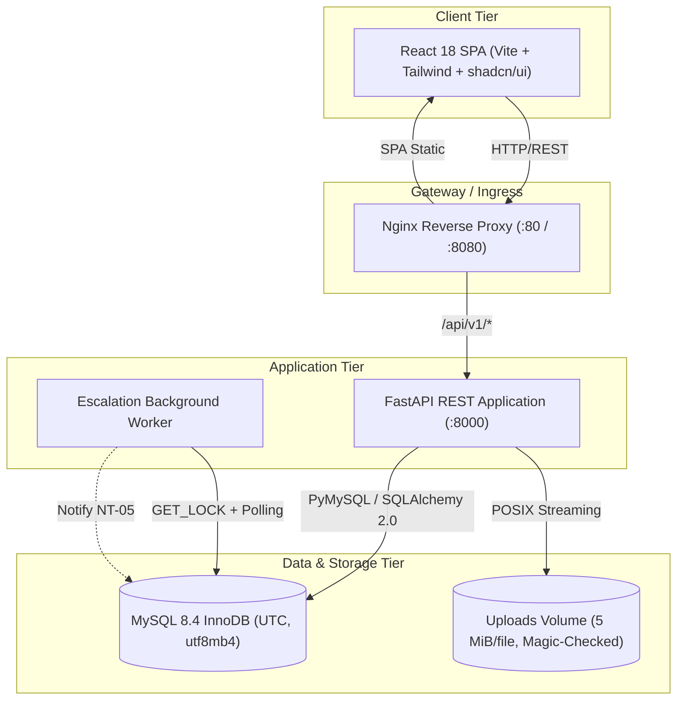

# CivicTrack — System Architecture & Technical Design

> **Document:** `docs/ARCHITECTURE.md`  
> **Target Release:** v1.0.0-p0  
> **Status:** Final Baseline  
> **Source Documents:** `docs/PRD.md`, `docs/TRD.md`, `docs/SRS.md`  

---

## 1. System Overview & Core Philosophy

CivicTrack is an enterprise-grade civic grievance redressal and municipal complaint tracking platform. The system is designed to bridge the trust deficit between citizens and urban municipal administration through:
- **Strict Role-Based Access Control (RBAC):** Distinct functional domains for Citizens, Department Officers, Superintendents, and Platform Admins.
- **Deterministic SLA Escalation Engine:** Background worker that enforces 7-day SLA resolution deadlines strictly measured from department acceptance (`accepted_at`).
- **Superintendent Oversight Queue:** Real-time visibility and directive management over overdue and escalated cases.
- **Append-Only Immutability:** Tamper-evident lifecycle tracking (`complaint_status_history`, `audit_logs`, `officer_actions`).

---

## 2. Component Inventory & Topography

### 2.1 Web Frontend (SPA)
- **Framework:** React 18.3, TypeScript in strict mode, Vite build tool.
- **Styling & Components:** Tailwind CSS, Radix UI primitives, shadcn/ui components, Lucide icons.
- **State Management:** TanStack Query v5 (server-state cache, background revalidation), React Hook Form + Zod schema validation.
- **Accessibility:** WCAG 2.1 AA compliant, semantic landmarks (`banner`, `main`, `contentinfo`), keyboard navigation, screen-reader headings (`h1`..`h4`).

### 2.2 API Server
- **Framework:** FastAPI with Python 3.12, Uvicorn ASGI server.
- **ORM & Data Layer:** SQLAlchemy 2.0 mapped models, Alembic declarative migrations, PyMySQL driver with `READ COMMITTED` isolation.
- **Security Middleware:** CORS allow-list (no wildcards with credentials), rate limiter, log PII redaction filter (`SensitiveDataFilter`).

### 2.3 SLA Escalation Worker
- **Concurrency & Locking:** Runs as an independent daemon. Uses MySQL advisory locks (`GET_LOCK('civictrack_escalation_worker', 5)`) ensuring exactly-once evaluation across multiple container replicas.
- **SLA Calculation:** Deadline is strictly derived as `accepted_at + timedelta(seconds=sla_seconds)`. Never derived from submission time (`submitted_at`).
- **Atomic State Machine:** Status transition `IN_PROGRESS -> ESCALATED`, escalation record creation, status history appending, and `NT-05` notification creation execute within a single atomic database transaction.

### 2.4 Data Tier
- **Engine:** MySQL 8.4 LTS, InnoDB engine, `utf8mb4_0900_ai_ci` collation, UTC time zone enforced at connection level.
- **Storage Subsystem:** Local/mounted Docker volume for complaint evidence images. Files are stored by year/month/complaint/UUID structure without public static pathing; served solely through authorized FastAPI streaming endpoints.

---

## 3. Role-Based Access Control (RBAC) Matrix

CivicTrack enforces authorization strictly at the server boundary. Client route visibility is a convenience; the API authoritative guard (`require_roles` and object-level permissions) validates every incoming request.

| Operation / Endpoint | Citizen | Department Officer | City Superintendent | Platform Admin |
|---|:---:|:---:|:---:|:---:|
| `POST /auth/register` | Open | Admin only | Admin only | Admin only |
| `POST /complaints` (Submit) | Own | 403 | 403 | 403 |
| `GET /complaints` (My List) | Own only | 403 | 403 | 403 |
| `GET /complaints/{id}` | Own only | Assigned Dept | All (Oversight) | 403 |
| `GET /department/queue` | 403 | Assigned Dept | 403 | 403 |
| `POST /complaints/{id}/accept` | 403 | Assigned Dept | 403 | 403 |
| `POST /complaints/{id}/reject` | 403 | Assigned Dept | 403 | 403 |
| `POST /complaints/{id}/resolve` | 403 | Assigned Dept | Escalated Only | 403 |
| `GET /superintendent/escalations`| 403 | 403 | Global Queue | 403 |
| `POST /complaints/{id}/actions` | 403 | 403 | Escalated Only | 403 |
| `GET /admin/users` | 403 | 403 | 403 | Full Read |
| `POST /admin/departments` | 403 | 403 | 403 | Full CRUD |
| `GET /admin/audit-logs` | 403 | 403 | 403 | Read-Only |

---

## 4. Key Architectural Invariants

1. **ESC-01 / ESC-02 (SLA Deadline):** The SLA window defaults to 10,080 minutes (7 calendar days). Deadlines are strictly calculated from `accepted_at`. Shortened demo SLA windows require explicit `ALLOW_DEMO_ESCALATION=true`.
2. **SEC-01 (Password Security):** Bcrypt with minimum 12 salt rounds. Plaintext passwords never stored, returned, or logged.
3. **SEC-04 / SEC-05 (Media Integrity):** Magic-byte verification via Pillow for JPEG, PNG, and WebP. Maximum 5 MiB per file, 3 files per upload request, 10 images per complaint maximum. Direct static URL serving is disabled; all downloads stream via authenticated endpoints checking complaint access scope.
4. **SEC-08 / NFR-021 (Log Privacy):** Continuous sanitization of logs via `SensitiveDataFilter`. Passwords, bearer tokens, email addresses, phone numbers, and GPS coordinates are systematically redacted.
5. **IDEM-01 (Idempotent Escalation):** Worker scans use conditional `UPDATE ... WHERE id = :id AND status = 'IN_PROGRESS'`. Escalation table enforces `UNIQUE(complaint_id)`. Re-running worker 20 times produces zero duplicated rows or notifications.

