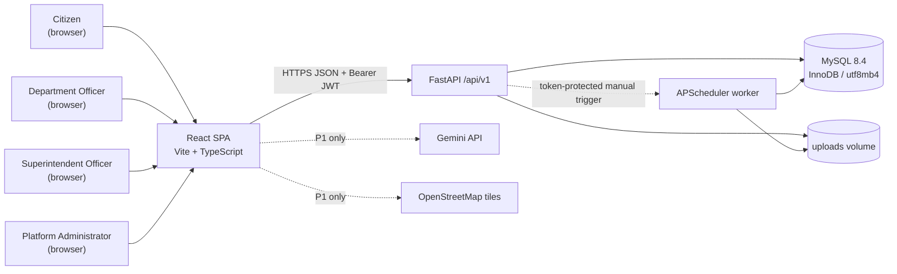
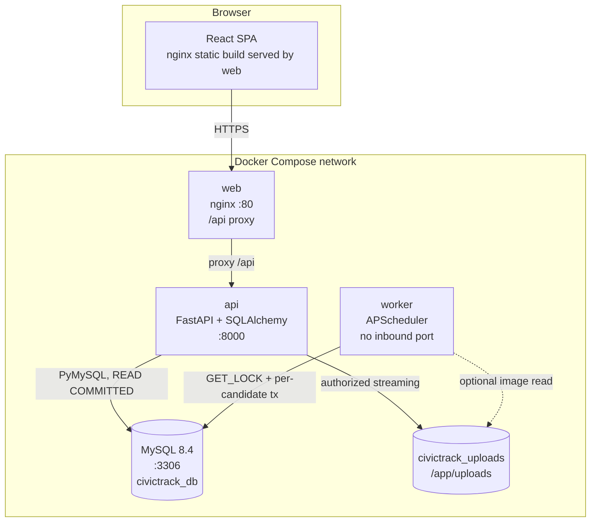
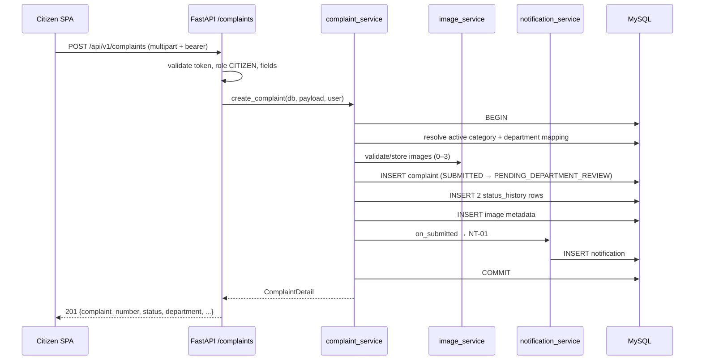

# CivicTrack — Architecture & Technical Design Baseline

> **Document type:** Phase 2 deliverable — frozen architecture and design baseline  
> **Status:** Approved for Phase 3–13 implementation  
> **Version:** 1.0  
> **Date:** 06 November 2026  
> **Owner:** Architecture & Documentation workstream (DOC)  
> **Companions:** [`API_CONTRACT.md`](./API_CONTRACT.md), [`STATE_MACHINE.md`](./STATE_MACHINE.md), [`ADRs/`](./ADRs/README.md), [`TRACEABILITY_BASELINE.md`](./TRACEABILITY_BASELINE.md)  
> **Sources of truth (read-only):** [`PRD.md`](./PRD.md), [`SRS.md`](./SRS.md), [`TRD.md`](./TRD.md), [`USER_STORIES.md`](./USER_STORIES.md), [`PHASES.md`](./PHASES.md)

---

## 1. Purpose and authority

This document freezes the system shape, module boundaries, runtime flows, and design rules that Phases 3–13 implement. It is **derived** from TRD §2–§19 and SRS §10–§18; it does not change scope. Where the TRD is silent, the decision recorded here is normative for implementation and is captured in an ADR.

**Rules**

1. No business logic in routers; no SQL in routers.
2. Services own transactions and invariants; routers never commit.
3. Only the escalation service writes `ESCALATED`; only `resolve()` writes `RESOLVED`.
4. Notification rows are written in the caller's transaction, never after commit.
5. The worker imports the escalation service; no service imports the worker.
6. P1 features stay behind feature flags and imports; no P1 import may appear in P0 submission, acceptance, escalation, or resolution modules.
7. Every P0 requirement has exactly one owning module and at least one endpoint or worker job (§10).

---

## 2. System context and containers

### 2.1 Context diagram



### 2.2 Container diagram



**Hosted variant:** `web` is replaced by Vercel; `VITE_API_BASE_URL` points at the API origin; CORS is restricted to the Vercel origin. The worker always runs on a long-lived host.

**Trust boundaries**

- Browser is untrusted: every authorization decision is re-checked server-side.
- `web`/nginx is a static host and reverse proxy only; it holds no business rules.
- `worker` is an internal process; it exposes no HTTP port.
- `/internal/*` is reachable only with `X-Internal-Token` using constant-time comparison.
- MySQL and the uploads volume are private to the Compose network.

---

## 3. Technology stack (frozen)

| Layer | Choice | Notes |
|---|---|---|
| Frontend | React 18.3, Vite, TypeScript `strict` | SPA, role-based routes |
| UI | Tailwind CSS 3.4, shadcn/ui | design tokens; accessible primitives |
| Client state | TanStack Query 5, react-hook-form, Zod | server state + form state separated |
| Backend | Python 3.12, FastAPI, Pydantic v2 | sync request handlers |
| ORM/DB | SQLAlchemy 2.0 (sync), PyMySQL, MySQL 8.4 InnoDB | `READ COMMITTED`, `DATETIME(6)` UTC |
| Migrations | Alembic | one initial migration + seed |
| Worker | APScheduler interval job | dedicated container, `max_instances=1` |
| Auth | JWT HS256, 8 h, `sessionStorage` | bearer token; no cookies |
| Images | local named volume + authorized streaming endpoint | no public bucket |
| Tests | pytest, httpx, Vitest, Playwright | unit → integration → E2E |
| Deployment | Docker Compose (primary), Vercel + hosted API (variant) | one-command local start |

---

## 4. Backend module map and layering

### 4.1 Layers

```
HTTP        FastAPI routers, request validation, response schemas
Application Services: auth, complaints, department, escalation, superintendent,
            notifications, admin
Domain      State guards, deadline calculation, RBAC scope rules
Persistence SQLAlchemy models, repositories/session, Alembic migrations
Infra       MySQL, local file storage, APScheduler, logging
```

**Dependency direction:** `api → services → models` plus `core` utilities. A service may call another service (for example `department_service → notification_service`), but never a router. Models never import services.

### 4.2 Python packages

| Package / file | Responsibility |
|---|---|
| `app/main.py` | app factory, middleware, exception handlers, router registration, `/api/v1` prefix |
| `app/core/config.py` | Pydantic settings, startup validation, demo guard |
| `app/core/security.py` | bcrypt, JWT encode/decode, current-user dependency |
| `app/core/errors.py` | `AppError` hierarchy, error codes, handlers |
| `app/core/logging.py` | structured logging, request ID, redaction filter |
| `app/core/clock.py` | `utcnow()` and `APP_TIMEZONE` rendering |
| `app/core/pagination.py` | page/page_size parsing and list envelope |
| `app/db/session.py` | engine, `SessionLocal`, `get_db` |
| `app/db/base.py`, `naming.py` | declarative base, constraint naming |
| `app/models/` | users, departments, categories, complaints, images, history, comments, notifications, escalations, officer actions, audit |
| `app/schemas/` | request/response models per domain + `common.py` |
| `app/services/auth_service.py` | register, authenticate, token issue, profile |
| `app/services/complaint_service.py` | create + routing, list/detail, timeline, tracking number |
| `app/services/department_service.py` | queue, summary, accept, reject, assign, progress, resolve |
| `app/services/escalation_service.py` | candidate query, lock, escalation transaction, summary |
| `app/services/superintendent_service.py` | escalation queue/summary, append-only superintendent actions |
| `app/services/notification_service.py` | recipient resolution, NT rows, list/read |
| `app/services/image_service.py` | validation, storage, authorized retrieval |
| `app/services/admin_service.py` | users, departments, categories, activity |
| `app/services/audit_service.py` | append-only audit events, filters |
| `app/api/deps.py` | `get_db`, `get_current_user`, `require_roles`, internal token |
| `app/api/v1/*.py` | auth, complaints, department, superintendent, notifications, admin, internal |
| `app/worker.py` | APScheduler entrypoint and startup run |
| `app/seed.py` | idempotent seed of departments, categories, users, demo data |
| `app/tests/` | unit, integration, conftest |

### 4.3 Router ownership

| Router | Prefix | Auth |
|---|---|---|
| `auth.py` | `/auth` | public for register/login; bearer for me/logout |
| `complaints.py` | `/complaints`, `/categories` | bearer; citizen/dept/superintendent/admin read scopes |
| `department.py` | `/department`, complaint actions | `DEPARTMENT_OFFICER` |
| `superintendent.py` | `/superintendent`, superintendent actions | `SUPERINTENDENT_OFFICER` |
| `notifications.py` | `/notifications` | any authenticated user, own rows only |
| `admin.py` | `/admin` | `PLATFORM_ADMIN` |
| `internal.py` | `/internal` | `X-Internal-Token` |
| health | `/health` | public |

---

## 5. Backend cross-cutting design

### 5.1 Request lifecycle

```
Request
  → RequestID middleware (read or generate X-Request-ID)
  → CORS middleware
  → route dependency: get_db
  → get_current_user (JWT + active-user check)
  → require_roles (role class)
  → Pydantic request validation
  → service call (object scope + transaction)
  → Pydantic response serialization
  → exception handler (AppError → error envelope)
  → response X-Request-ID echo
```

### 5.2 Transaction boundary

- One unit of work per command request. A service either commits all writes or raises; no partial commit.
- `get_db` yields a session and closes it in `finally`; it does **not** commit.
- Command services use `with db.begin():`; state transitions lock the complaint row with `with_for_update()`.
- Notification rows and status-history rows are written inside the same transaction.
- Read endpoints rely on SQLAlchemy autobegin; no explicit commit.
- Temporary uploaded files are removed in `finally` if the transaction fails.
- The worker opens one session/transaction per escalation candidate so one bad row does not roll back the batch.

### 5.3 Configuration and startup validation

Typed `Settings` (`pydantic-settings`) reads the environment and fails fast on missing/invalid values.

| Variable | Default | Validation | Failure behavior |
|---|---|---|---|
| `DATABASE_URL` | — | required, parseable | refuse to start |
| `JWT_SECRET` | — | required, **≥32 bytes** | refuse to start |
| `APP_TIMEZONE` | `Asia/Kolkata` | valid IANA zone | refuse to start |
| `ESCALATION_WINDOW_MINUTES` | `10080` | integer 1–525600 | refuse to start if out of range |
| `ALLOW_DEMO_ESCALATION` | `false` | boolean | — |
| `ESCALATION_CHECK_SECONDS` | `60` | integer 5–3600 | refuse to start if out of range |
| `ESCALATION_BATCH_SIZE` | `100` | integer 1–1000 | refuse to start if out of range |
| `INTERNAL_TRIGGER_TOKEN` | — | required, ≥32 characters | refuse to start |
| `UPLOAD_DIR` | `/app/uploads` | writable directory | refuse to start |
| `CORS_ORIGINS` | localhost origins | comma-separated allowlist | empty allowlist in production is a startup error |

**Demo guard:** if `ESCALATION_WINDOW_MINUTES != 10080` and `ALLOW_DEMO_ESCALATION` is false, the effective window is forced to `10080` and `ESCALATION_WINDOW_OVERRIDE_BLOCKED` is logged. If the guard is true, `DEMO_ESCALATION_MODE` is logged with the effective window. `sla_seconds` is snapshotted at acceptance, so configuration changes never alter existing deadlines.

### 5.4 Clock and time

- `utcnow()` returns naive UTC with microsecond precision; all application code uses it.
- MySQL stores `DATETIME(6)`; API serialization appends `Z`.
- `APP_TIMEZONE` is applied only at rendering/display, never to stored values.
- Tests monkeypatch `utcnow` for boundary cases (−1 s, exact deadline, +1 s).

### 5.5 Logging and redaction

- Structured JSON/key-value logs to stdout.
- Fields: `timestamp`, `level`, `event`, `request_id`, `user_id` (ID only), `route`, `method`, `status`, `duration_ms`.
- Escalation run adds `trigger_source`, `evaluated`, `escalated`, `skipped`, `duration_ms`, `window_minutes`, `demo_mode`, `lock_skipped`.
- A redaction filter removes passwords, tokens, emails, phone numbers, coordinates, location text, and note bodies.
- Stack traces are logged server-side with the request ID and never returned to the client.

### 5.6 Pagination

- Query parameters `page` (≥1, default 1) and `page_size` (1–100, default 20).
- Every list response uses `{items, page, page_size, total, total_pages}`; list-specific extras (for example `counts`, `summary`, `unread_count`) are additive.
- Sorting is server-defined, newest first unless documented.

### 5.7 Health and internal operations

| Endpoint | Purpose | Response |
|---|---|---|
| `GET /health` | liveness | `200 {"status":"ok","version":"1.0.0"}` |
| `GET /health/ready` | readiness (`SELECT 1`) | `200 {"status":"ready","database":"ok"}` or `503 {"status":"not_ready","database":"unavailable"}` |
| `POST /internal/escalations/run` | manual trigger | counts + duration; naturally idempotent |
| `GET /internal/escalation-status` | ops/demo check | effective window, demo flag, last run summary |

`/internal/*` requires `X-Internal-Token`, constant-time compared, rate-limited to 10 calls/minute/token.

---

## 6. Escalation architecture

### 6.1 Candidate predicate

```
accepted_at IS NOT NULL
AND status IN (ACCEPTED, IN_PROGRESS)
AND resolution_due_at IS NOT NULL
AND resolution_due_at <= now_utc
AND NOT EXISTS (SELECT 1 FROM escalations e WHERE e.complaint_id = c.id)
ORDER BY resolution_due_at ASC
LIMIT escalation_batch_size
```

### 6.2 Exactly-once algorithm

```text
run_escalation_check(trigger_source):
  now = utcnow()
  acquire GET_LOCK('civictrack:escalation', 0) on a dedicated connection
  if not acquired: return summary(lock_skipped=true)
  candidate_ids = candidate query (above)
  for each candidate_id:
    BEGIN
      SELECT complaint FOR UPDATE
      if missing or status not in (ACCEPTED, IN_PROGRESS): ROLLBACK; skip
      if resolution_due_at > now: ROLLBACK; skip
      status = ESCALATED; escalated_at = now
      INSERT escalation(complaint_id UNIQUE, previous_status, deadline_at,
                        escalated_at, overdue_seconds, trigger_source, reason_code='SLA_BREACH')
      INSERT status_history(actor=SYSTEM, previous, ESCALATED, note)
      INSERT NT-05 notifications for active superintendents,
             active officers of the responsible department, citizen
    COMMIT
    on IntegrityError: skip (duplicate key is a benign race)
    on any other exception: rollback this candidate, log, continue
  release GET_LOCK in finally
```

### 6.3 Why each guard exists

| Guard | Failure prevented |
|---|---|
| `GET_LOCK` | two scheduler instances processing the same batch |
| conditional status re-check under row lock | complaint resolved between selection and update |
| `NOT EXISTS` in candidate query | re-processing an already escalated complaint |
| `UNIQUE(escalations.complaint_id)` | residual race or rogue process |
| `resolution_due_at <= now` | premature escalation |
| one transaction per candidate | one bad row rolling back the batch |
| `IntegrityError → skip` | duplicate key treated as batch failure |

### 6.4 Configuration and recovery

- Production window `10080` minutes; demo `2` minutes only with `ALLOW_DEMO_ESCALATION=true`.
- Scheduler interval `60` s production / `30` s demo; startup run before the first interval.
- Worker restart escalates every due candidate; `escalated_at` is the actual run time and `overdue_seconds` reflects the full delay.
- Existing `sla_seconds`/`resolution_due_at` never change when configuration changes.
- A complaint resolved during the run is skipped by the row lock + status re-check.
- Notification failure rolls back only that candidate; the next run retries.

---

## 7. Authentication and authorization model

### 7.1 JWT

| Claim | Value |
|---|---|
| `sub` | user ID string |
| `role` | current role code |
| `dept` | department ID or null |
| `iat` / `exp` | issued at / issued at + 8 hours |
| `jti` | random UUID |
| `iss` / `aud` | `civictrack` / `civictrack-web` |

HS256, secret ≥32 bytes, `sessionStorage` key `civictrack.token`, sent as `Authorization: Bearer`. The API loads the user on every request and uses the database role, so role changes and deactivation apply immediately.

### 7.2 Authorization layers

1. **Route role gate** — `require_roles(...)` returns 403 for a wrong role.
2. **Object scope in services** — citizen ownership, officer department, superintendent escalated-only writes.
3. **State guard** — service checks current status and returns 409.
4. **Frontend route guard** — UX only; never authoritative.

| Situation | Status | Code |
|---|---|---|
| missing/expired/invalid token | 401 | `TOKEN_INVALID` |
| inactive user with valid token | 401 | `TOKEN_INVALID` |
| wrong role | 403 | `FORBIDDEN` |
| officer of another department | 403 | `FORBIDDEN` |
| resource absent or outside citizen scope | 404 | `NOT_FOUND` |
| illegal state transition | 409 | `INVALID_TRANSITION` |

Denied requests create `RBAC_DENIED` audit entries (method + path, no PII).

### 7.3 Login protection and CORS

- 5 failed attempts per `(ip, email)` per 60 s → `429 RATE_LIMITED` with `Retry-After`.
- Successful login resets the counter.
- `CORS_ORIGINS` is an explicit allowlist; `allow_credentials=false`.
- Allowed headers: `Authorization`, `Content-Type`, `X-Request-ID`, `X-Internal-Token` (internal only).
- Baseline security headers: `X-Content-Type-Options: nosniff`, `X-Frame-Options: DENY`, `Referrer-Policy: no-referrer`, HSTS at the proxy in production.

---

## 8. Frontend architecture

### 8.1 Structure

```
frontend/src/
├─ api/            client.ts, auth.ts, complaints.ts, department.ts,
│                  superintendent.ts, notifications.ts, admin.ts
├─ app/            router.tsx, providers.tsx
├─ components/     ui/ (shadcn), layout/, guards/
├─ features/       auth/, citizen/, department/, superintendent/, admin/,
│                  notifications/, map/ (P1), analytics/ (P1)
├─ lib/            status.ts, queryKeys.ts, validation.ts, format.ts
└─ types/          api.ts, domain.ts
```

### 8.2 Route tree and guards

| Route | Page | Allowed roles |
|---|---|---|
| `/login` | Login | public (redirect if authenticated) |
| `/register` | Citizen registration | public |
| `/` | redirect to role home | authenticated |
| `/complaints` | My complaints | `CITIZEN` |
| `/complaints/new` | Report a problem | `CITIZEN` |
| `/complaints/:id` | Detail + timeline | owner; scoped officer; superintendent; admin read-only |
| `/department` | Department queue | `DEPARTMENT_OFFICER` |
| `/department/summary` | Department counts | `DEPARTMENT_OFFICER` |
| `/superintendent` | Escalation queue | `SUPERINTENDENT_OFFICER` |
| `/superintendent/summary` | Escalation metrics | `SUPERINTENDENT_OFFICER` |
| `/admin/users` | User/role management | `PLATFORM_ADMIN` |
| `/admin/departments` | Department management | `PLATFORM_ADMIN` |
| `/admin/categories` | Category mapping | `PLATFORM_ADMIN` |
| `/admin/activity` | Activity summary | `PLATFORM_ADMIN` |
| `/admin/audit` | Audit viewer | `PLATFORM_ADMIN` |
| `/notifications` | Notification list | all authenticated |
| `/forbidden` | 403 page | authenticated |
| `*` | not found | public |

Role home: Citizen → `/complaints`; Officer → `/department`; Superintendent → `/superintendent`; Administrator → `/admin/users`. Role comes from `GET /auth/me`, never a decoded token.

### 8.3 Server state and cache

| State | Owner | Persistence |
|---|---|---|
| session token | `AuthProvider` | `sessionStorage` (`civictrack.token`) |
| current user | `AuthProvider` | memory, refetched on reload |
| lists/details | TanStack Query | in-memory cache |
| forms | react-hook-form | memory |
| unread count | `useNotifications` | polled |

**Query keys:** `['me']`, `['complaints', filters]`, `['complaint', id]`, `['timeline', id]`, `['department', filters]`, `['department-summary']`, `['escalations']`, `['notifications']`, `['unread-count']`, `['admin', resource]`.

**Invalidation map**

| Mutation | Invalidates |
|---|---|
| submit complaint | `['complaints']`, `['unread-count']` |
| accept / reject | `['complaint', id]`, `['timeline', id]`, `['department']`, `['department-summary']`, `['unread-count']` |
| assign | `['complaint', id]`, `['department']` |
| progress / upload | `['complaint', id]`, `['timeline', id]`, `['department']`, `['unread-count']` |
| resolve | `['complaint', id]`, `['timeline', id]`, `['department']`, `['escalations']`, `['unread-count']` |
| superintendent action | `['complaint', id]`, `['timeline', id]`, `['escalations']`, `['unread-count']` |
| mark read | `['notifications']`, `['unread-count']` |
| admin mutation | `['admin', resource]`, `['complaint']` scope after mapping change |

Notification polling: `GET /notifications/unread-count` every 30 s while the tab is visible and on focus; list fetched on demand. No websocket/SSE/push in P0.

### 8.4 Presentation and validation

- Single `src/lib/status.ts` map supplies badge color and citizen label for every status.
- Zod mirrors server constraints: title 5–150, description 20–2,000, reject reason 10–1,000, note 5–2,000, resolution 10–2,000, password 8–72 with a letter and a digit.
- Submit disabled while pending; no optimistic status changes.
- Image selection validates type/size client-side, previews, caps at 3 per submission.
- `422` maps `error.details` keys to field errors; `409` shows a conflict banner.
- P1 features (`AiSuggest`, `IssueMap`, `Analytics`, feedback/reopen) are lazy-loaded behind `VITE_ENABLE_*` flags and must not be imported by P0 modules.

---

## 9. Runtime sequence diagrams

### 9.1 Submit complaint



### 9.2 Accept complaint

```mermaid
sequenceDiagram
    participant O as Officer SPA
    participant A as FastAPI
    participant S as department_service
    participant N as notification_service
    participant D as MySQL

    O->>A: POST /complaints/{id}/accept
    A->>A: require_roles(DEPARTMENT_OFFICER)
    A->>S: accept_complaint(db, id, officer)
    S->>D: BEGIN; SELECT complaint FOR UPDATE
    alt not found or other department
        S-->>A: 404 / 403
    else status != PENDING_DEPARTMENT_REVIEW
        S-->>A: 409 INVALID_TRANSITION
    else valid
        S->>D: status=ACCEPTED, accepted_at, sla_seconds, resolution_due_at
        S->>D: INSERT status_history
        S->>N: on_accepted → NT-02
        N->>D: INSERT notification
        S->>D: COMMIT
        S-->>A: accepted complaint
        A-->>O: 200 {status, accepted_at, resolution_due_at, notifications_created}
    end
```

### 9.3 Escalation run

```mermaid
sequenceDiagram
    participant W as Worker / internal trigger
    participant E as escalation_service
    participant D as MySQL
    participant N as notification_service

    W->>E: run_escalation_check(trigger_source)
    E->>D: SELECT GET_LOCK('civictrack:escalation', 0)
    alt lock not acquired
        E-->>W: summary {lock_skipped: true}
    else lock acquired
        E->>D: SELECT candidate ids
        loop each candidate
            E->>D: BEGIN; SELECT complaint FOR UPDATE
            alt no longer eligible
                E->>D: ROLLBACK; skipped++
            else eligible
                E->>D: UPDATE status=ESCALATED, escalated_at
                E->>D: INSERT escalation (UNIQUE complaint_id)
                E->>D: INSERT status_history (SYSTEM, SLA_BREACH)
                E->>N: on_escalated → NT-05
                N->>D: INSERT notifications (superintendents, dept officers, citizen)
                E->>D: COMMIT; escalated++
            end
        end
        E->>D: RELEASE_LOCK
        E-->>W: {evaluated, escalated, skipped, duration_ms}
    end
```

### 9.4 Resolve complaint

```mermaid
sequenceDiagram
    participant O as Officer / Superintendent SPA
    participant A as FastAPI
    participant S as department_service
    participant N as notification_service
    participant D as MySQL

    O->>A: POST /complaints/{id}/resolve
    A->>A: require_roles(DEPARTMENT_OFFICER, SUPERINTENDENT_OFFICER)
    A->>S: resolve_complaint(db, id, actor, note, evidence_ids)
    S->>D: BEGIN; SELECT complaint FOR UPDATE
    alt status not ACCEPTED/IN_PROGRESS (officer) or not ESCALATED (superintendent)
        S-->>A: 409 INVALID_TRANSITION
    else valid
        S->>D: status=RESOLVED, resolved_at, resolved_by, resolution_note
        S->>D: link resolution evidence; INSERT history
        S->>N: on_resolved → NT-07
        N->>D: INSERT notification
        S->>D: COMMIT
        A-->>O: 200 {status, resolved_at, resolved_by, notifications_created}
    end
```

### 9.5 Superintendent action

```mermaid
sequenceDiagram
    participant S as Superintendent SPA
    participant A as FastAPI
    participant U as superintendent_service
    participant N as notification_service
    participant D as MySQL

    S->>A: POST /complaints/{id}/superintendent-actions
    A->>A: require_roles(SUPERINTENDENT_OFFICER)
    A->>U: record_action(db, id, actor, action_type, note, directed_dept)
    U->>D: BEGIN; SELECT complaint FOR UPDATE
    alt status != ESCALATED
        U-->>A: 409 INVALID_TRANSITION
    else valid
        U->>D: INSERT officer_actions (append-only)
        U->>D: INSERT status_history/timeline event
        U->>N: on_supervisory_action → NT-06
        N->>D: INSERT notifications (dept officers + citizen)
        U->>D: COMMIT
        A-->>S: 201 action
    end
```

---

## 10. P0 requirement ownership matrix

Every P0 FR maps to one owning service and at least one P0 endpoint or worker job.

| FR | Owning module | Endpoint / job |
|---|---|---|
| FR-001 | `auth_service` | `POST /auth/register` |
| FR-002 | `auth_service` | `POST /auth/login` |
| FR-003 | `auth_service` | `POST /auth/register`, `POST /auth/login` |
| FR-004 | `api/deps` + `auth_service` | all protected routes (`require_roles`) |
| FR-005 | `auth_service` | `GET /auth/me` |
| FR-006 | `admin_service` | `GET/POST /admin/users`, `PATCH /admin/users/{id}` |
| FR-007 | `complaint_service` | `GET /categories` |
| FR-008 | `complaint_service` | `POST /complaints` |
| FR-009 | `complaint_service` | `POST /complaints`, all complaint representations |
| FR-010 | `image_service` | `POST /complaints`, `POST /complaints/{id}/images` |
| FR-011 | `complaint_service` | `POST /complaints` |
| FR-012 | `complaint_service` | `POST /complaints`, `GET /categories` |
| FR-013 | `complaint_service` | `POST /complaints` |
| FR-014 | `complaint_service` | `GET /complaints` |
| FR-015 | `complaint_service` | `GET /complaints/{id}` |
| FR-016 | `complaint_service` | `GET /complaints/{id}/timeline` |
| FR-017 | `department_service` | `GET /department/complaints` |
| FR-018 | `department_service` | `GET /complaints/{id}` |
| FR-019 | `department_service` | `POST /complaints/{id}/accept` |
| FR-020 | `department_service` | `POST /complaints/{id}/reject` |
| FR-021 | `department_service` | `POST /complaints/{id}/assign` |
| FR-022 | `department_service` | `POST /complaints/{id}/progress` |
| FR-023 | `image_service` | `POST /complaints/{id}/images` |
| FR-024 | `department_service` | `POST /complaints/{id}/resolve` |
| FR-025 | `department_service` | `GET /department/summary` |
| FR-026 | `department_service` | `POST /complaints/{id}/progress`, `POST /complaints/{id}/images` |
| FR-027 | `department_service` + `clock` | `POST /complaints/{id}/accept` |
| FR-028 | `worker` + `escalation_service` | APScheduler interval + `POST /internal/escalations/run` |
| FR-029 | `escalation_service` | worker job; unique `escalations.complaint_id` |
| FR-030 | `escalation_service` | worker job |
| FR-031 | `escalation_service` | worker job |
| FR-032 | `notification_service` | worker job (escalation transaction) |
| FR-033 | `core/config` + `escalation_service` | worker startup + `GET /internal/escalation-status` |
| FR-034 | `internal` router | `POST /internal/escalations/run` |
| FR-035 | `escalation_service` | `GET /superintendent/escalations` |
| FR-036 | `complaint_service` | `GET /complaints/{id}`, `GET /superintendent/escalations` |
| FR-037 | `complaint_service` | `GET /complaints/{id}`, `/timeline`, image file |
| FR-038 | `superintendent_service` | `POST /complaints/{id}/superintendent-actions` |
| FR-039 | `superintendent_service` + `notification_service` | `POST /complaints/{id}/superintendent-actions` |
| FR-040 | `escalation_service` + `complaint_service` | `GET /superintendent/escalations`, `GET /complaints/{id}` |
| FR-041 | `department_service` | `POST /complaints/{id}/resolve` (Superintendent role) |
| FR-042 | `notification_service` | all mutation endpoints |
| FR-043 | `notification_service` | `GET /notifications` |
| FR-044 | `notification_service` | `POST /notifications/{id}/read`, `POST /notifications/read-all` |
| FR-045 | `notification_service` | all NT-01…NT-07 triggers |
| FR-046 | `admin_service` | `GET/POST /admin/departments`, `PATCH /admin/departments/{id}` |
| FR-047 | `admin_service` | `GET/POST /admin/categories`, `PATCH /admin/categories/{id}` |
| FR-048 | `admin_service` | `GET /admin/activity` |
| FR-049 | `admin_service` + `audit_service` | `GET /admin/audit-logs` |
| FR-050 | `complaint_service` + `audit_service` | every transition; `GET /complaints/{id}/timeline` |

---

## 11. Acceptance-criteria design traceability

| AC | Design module(s) | Endpoint(s) / job | Test group |
|---|---|---|---|
| AC-01 | `auth_service`, `complaint_service` | `POST /auth/register`, `POST /auth/login`, `GET /auth/me` | T-AUTH, T-E2E |
| AC-02 | `complaint_service`, `image_service`, `notification_service` | `GET /categories`, `POST /complaints` | T-COMP, T-E2E |
| AC-03 | `complaint_service`, `department_service`, `deps` | `GET /complaints`, `GET /department/complaints`, `GET /complaints/{id}` | T-RBAC, T-COMP |
| AC-04 | `department_service`, `notification_service` | `POST /complaints/{id}/accept` | T-DEPT, T-NOTIF |
| AC-05 | `department_service`, `notification_service` | `POST /complaints/{id}/reject` | T-DEPT, T-NOTIF |
| AC-06 | `department_service`, `complaint_service` | `POST /complaints/{id}/progress`, `GET /complaints/{id}/timeline` | T-COMP, T-DEPT |
| AC-07 | `escalation_service`, `notification_service`, `worker` | worker job, `POST /internal/escalations/run` | T-ESC |
| AC-08 | `escalation_service` | worker job, `POST /internal/escalations/run` | T-ESC |
| AC-09 | `escalation_service`, `complaint_service` | `GET /superintendent/escalations`, `GET /complaints/{id}`, `/timeline` | T-SUP |
| AC-10 | `superintendent_service`, `notification_service` | `POST /complaints/{id}/superintendent-actions` | T-SUP, T-NOTIF |
| AC-11 | `department_service`, `notification_service` | `POST /complaints/{id}/resolve` | T-SUP, T-DEPT, T-NOTIF |
| AC-12 | `department_service` | `POST /complaints/{id}/resolve`, `GET /complaints/{id}` | T-DEPT, T-SUP |
| AC-13 | `deps`, `auth_service` | `GET /department/complaints`, `GET /superintendent/escalations` (403) | T-RBAC |
| AC-14 | `deps`, `department_service` | all department mutations (403/404) | T-RBAC |
| AC-15 | `notification_service` | `GET /notifications`, `GET /notifications/unread-count`, `POST /notifications/{id}/read`, `POST /notifications/read-all` | T-NOTIF |
| AC-16 | `core/config`, `escalation_service`, `admin_service` | startup validation, `GET /internal/escalation-status`, `GET /admin/activity` | T-ESC, T-ADMIN |

**Result:** 16/16 acceptance criteria map to a module, an endpoint or job, and a named test group. 50/50 P0 FRs map to an owning module and endpoint/job.

---

## 12. Design review outcome

| Check | Verdict |
|---|---|
| Context and container diagrams present | PASS |
| Module map and layering rule frozen | PASS |
| Every P0 endpoint declares roles and scope | PASS (`API_CONTRACT.md` §3) |
| State machine and 409 behavior frozen | PASS (`STATE_MACHINE.md`) |
| Escalation duplicate prevention under concurrency specified | PASS (§6 and ADR-001) |
| Frontend route tree covers all four roles | PASS (§8.2) |
| AC-01…AC-16 traceable to module + endpoint | PASS (§11) |
| ADR set published | PASS (`ADRs/ADR-001…008`) |

**Unresolved design blockers: 0.** Phase 3 may start.

---

## 13. Change control

- This document is additive; do not edit TRD/PRD/SRS/PHASES to match it.
- A design change requires a new or amended ADR, an update here, and a matching tracker task.
- Requirement IDs and endpoint paths are permanent. Additive endpoints are appended; breaking changes require a version note in `API_CONTRACT.md`.

---

*End of architecture baseline — Phase 2, CivicTrack.*

---

## 9. Optional P1 scope (gated) — not built in P0

Phase 21 (P1) is explicitly out of scope for the P0 build. The following P1 features are documented here only as future work, each behind a feature flag, and each must degrade silently to the manual flow if its external dependency fails:

- FR-051 — AI category suggestion (Gemini) via a server-side call, fallback to manual category selection.
- FR-052 — Duplicate detection for similar open complaints.
- FR-053 — Issue map view (Leaflet with OpenStreetMap tiles).
- FR-054 — AI priority suggestion, advisory only.
- FR-055 — Recharts analytics dashboard.
- FR-056 — Citizen rating after resolution.
- FR-057 — Reopen workflow (REOPENED) with NT-08.
- P2 — FR-058 … FR-064 (outbound channels/outbox, multi-tenancy, working-day calendars, image verification, public portal, native mobile, work-order integration) are explicitly not built and may not appear in P0/P1 acceptance.

No P1 module may be imported by P0 submission, acceptance, escalation or resolution paths. Enforcement: code review, import linting in CI, and the Phase 20 traceability audit.
