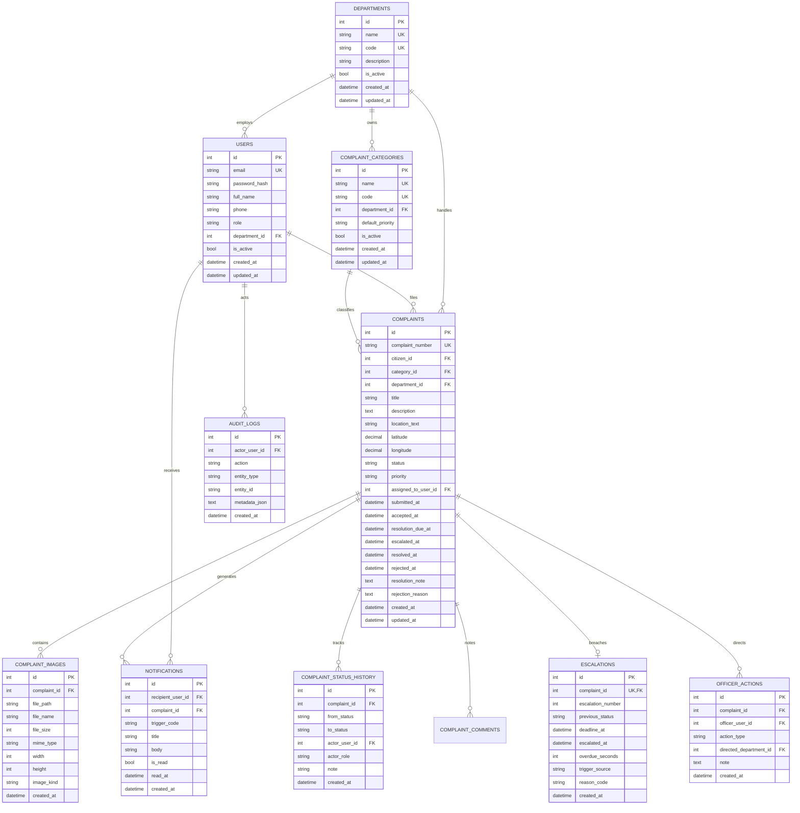

# CivicTrack — Relational Data Model & Schema Specification

> **Document:** `docs/DATA_MODEL.md`  
> **Target Release:** v1.0.0-p0  
> **Status:** Final Baseline  
> **Source Documents:** `docs/TRD.md` (§7), `docs/SRS.md`  

---

## 1. Entity-Relationship Diagram

---

## 2. Table Specifications & Constraints

### 2.1 `users`
- **Primary Key:** `id` (INT, AUTO_INCREMENT)
- **Unique Indexes:** `email` (VARCHAR(190), lowercase enforced)
- **Foreign Keys:** `department_id -> departments.id` (ON DELETE RESTRICT, NULL allowed for CITIZEN, SUPERINTENDENT, ADMIN)
- **Check Constraints & Enums:** `role IN ('CITIZEN', 'DEPARTMENT_OFFICER', 'SUPERINTENDENT_OFFICER', 'PLATFORM_ADMIN')`
- **Performance Indexes:** `(role, is_active)`, `(department_id, role)`

### 2.2 `departments`
- **Primary Key:** `id` (INT, AUTO_INCREMENT)
- **Unique Indexes:** `name` (VARCHAR(120)), `code` (VARCHAR(30))
- **Deactivation Guard (BR-15):** Application layer blocks deactivation if active categories or active officers reference the department.

### 2.3 `complaint_categories`
- **Primary Key:** `id` (INT, AUTO_INCREMENT)
- **Unique Indexes:** `name` (VARCHAR(120)), `code` (VARCHAR(40))
- **Foreign Keys:** `department_id -> departments.id` (ON DELETE RESTRICT)
- **Performance Indexes:** `(department_id, is_active)`

### 2.4 `complaints`
- **Primary Key:** `id` (INT, AUTO_INCREMENT)
- **Unique Indexes:** `complaint_number` (VARCHAR(20), format `CT-YYYYMMDD-XXXX`)
- **Foreign Keys:**
  - `citizen_id -> users.id` (ON DELETE RESTRICT)
  - `category_id -> complaint_categories.id` (ON DELETE RESTRICT)
  - `department_id -> departments.id` (ON DELETE RESTRICT)
  - `assigned_to_user_id -> users.id` (ON DELETE SET NULL)
  - `accepted_by_user_id -> users.id` (ON DELETE SET NULL)
  - `resolved_by_user_id -> users.id` (ON DELETE SET NULL)
  - `rejected_by_user_id -> users.id` (ON DELETE SET NULL)
- **Composite Indexes:**
  - `ix_complaints_dept_status_sub (department_id, status, submitted_at)`: Powers Officer queue queries.
  - `ix_complaints_citizen_sub (citizen_id, submitted_at)`: Powers Citizen tracking list.
  - `ix_complaints_status_due (status, resolution_due_at)`: Powers background escalation query.

### 2.5 `complaint_images`
- **Primary Key:** `id` (INT, AUTO_INCREMENT)
- **Foreign Keys:** `complaint_id -> complaints.id` (ON DELETE CASCADE)
- **Storage Rule:** Max 10 images per complaint (enforced in `image_service`).

### 2.6 `complaint_status_history`
- **Primary Key:** `id` (INT, AUTO_INCREMENT)
- **Immutability:** Append-only table. No `UPDATE` or `DELETE` endpoints exposed.
- **Indexes:** `(complaint_id, created_at, id)`, `(to_status, created_at)`.

### 2.7 `escalations`
- **Primary Key:** `id` (INT, AUTO_INCREMENT)
- **Unique Index:** `complaint_id` (enforces exactly-one escalation record per complaint, preventing duplicates under concurrency).
- **Foreign Keys:** `complaint_id -> complaints.id` (ON DELETE RESTRICT).

### 2.8 `officer_actions`
- **Primary Key:** `id` (INT, AUTO_INCREMENT)
- **Foreign Keys:**
  - `complaint_id -> complaints.id` (ON DELETE RESTRICT)
  - `officer_user_id -> users.id` (ON DELETE RESTRICT)
  - `directed_department_id -> departments.id` (ON DELETE RESTRICT)
- **Action Types:** `INSTRUCTION`, `FOLLOW_UP`, `REASSIGN`, `NOTE`.

### 2.9 `audit_logs`
- **Primary Key:** `id` (INT, AUTO_INCREMENT)
- **Immutability:** Append-only table for administrative, configuration, and security events. No mutation routes exist.
- **Privacy:** `metadata_json` excludes raw passwords, bearer tokens, or citizen personal identifiable information.

