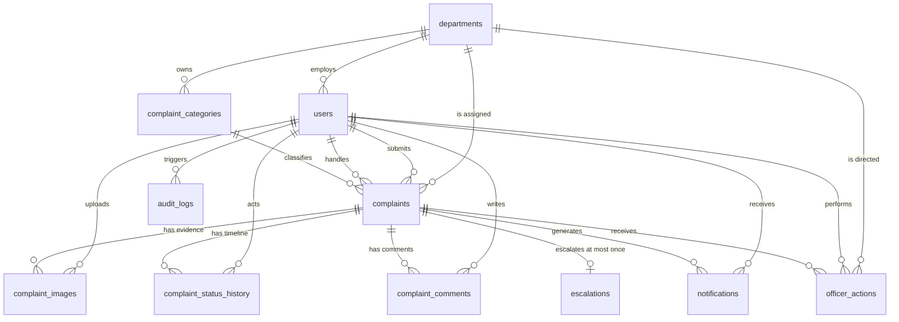

# CivicTrack — Data Model (Final, Phase 20 / DOC-031)

> **Document type:** Phase 4 (DB-021) finalized in Phase 20 (DOC-031)
> **Status:** Final as implemented in this tree
> **Date:** 06 November 2026
> **Authority:** TRD §7, SRS §11, `docs/STATE_MACHINE.md`
> **Implementation:** `backend/app/models/` (11 tables), migrations `0001_initial` -> `0002_full_schema` (head)

---

## 1. Conventions

| Rule | Value |
|---|---|
| Engine | InnoDB, MySQL 8.4 |
| Charset / collation | `utf8mb4` / `utf8mb4_0900_ai_ci` |
| Primary keys | `BIGINT AUTO_INCREMENT` via SQLAlchemy `Integer` PK |
| Timestamps | `DATETIME`, stored naive UTC (`app/core/clock.py`); rendered in `APP_TIMEZONE` |
| Booleans | `TINYINT(1)` |
| Coordinates | `DECIMAL(9,6)` latitude / `DECIMAL(10,6)` longitude |
| Enums | Python `StrEnum` in `app/models/enums.py`, stored as `VARCHAR` (`native_enum=False`) |
| Contract | `docs/API_CONTRACT.md` + `docs/ARCHITECTURE.md` §10 ownership |

All times are UTC at rest. Python models use `Mapped` typed columns.

---

## 2. ER diagram (Mermaid)



---

## 3. Table inventory (11 tables)

| # | Table | Model file | Purpose |
|---|---|---|---|
| 1 | `departments` | `models/department.py` | Municipal departments, queue owners |
| 2 | `users` | `models/user.py` | Citizens, officers, superintendents, admins |
| 3 | `complaint_categories` | `models/category.py` | Category catalogue, routes to one department |
| 4 | `complaints` | `models/complaint.py` | Central complaint + lifecycle timestamps |
| 5 | `complaint_images` | `models/complaint_image.py` | Evidence metadata; files on uploads volume |
| 6 | `complaint_status_history` | `models/complaint_status_history.py` | Status timeline, append-only |
| 7 | `complaint_comments` | `models/complaint_comment.py` | Progress notes, visibility-scoped |
| 8 | `notifications` | `models/notification.py` | NT-01..NT-08 owner-scoped inbox |
| 9 | `escalations` | `models/escalation.py` | One row per SLA breach, append-only |
| 10 | `officer_actions` | `models/officer_action.py` | Superintendent actions, append-only |
| 11 | `audit_logs` | `models/audit.py` | Admin/auth/security audit trail, append-only |

---

## 4. Relationships and delete behavior

Every FK uses `ON UPDATE CASCADE`. `ON DELETE` is `RESTRICT` except
assignment/actor links (`SET NULL`) so history survives.

| Child column | Parent | `ON DELETE` |
|---|---|---|
| `users.department_id` | `departments.id` | `RESTRICT` |
| `complaint_categories.department_id` | `departments.id` | `RESTRICT` |
| `complaints.citizen_id` | `users.id` | `RESTRICT` |
| `complaints.category_id` | `complaint_categories.id` | `RESTRICT` |
| `complaints.department_id` | `departments.id` | `RESTRICT` |
| `complaints.assigned_to_user_id` | `users.id` | `SET NULL` |
| `complaints.accepted_by_user_id` | `users.id` | `SET NULL` |
| `complaints.resolved_by_user_id` | `users.id` | `SET NULL` |
| `complaints.rejected_by_user_id` | `users.id` | `SET NULL` |
| `complaint_images.*` | `complaints.id` / `users.id` | `RESTRICT` |
| `complaint_status_history.complaint_id` | `complaints.id` | `RESTRICT` |
| `complaint_status_history.actor_user_id` | `users.id` | `RESTRICT` (nullable) |
| `complaint_comments.*` | `complaints.id` / `users.id` | `RESTRICT` |
| `notifications.*` | `users.id` / `complaints.id` | `RESTRICT` |
| `escalations.complaint_id` | `complaints.id` | `RESTRICT`, unique |
| `officer_actions.*` | `complaints.id` / `users.id` / `departments.id` | `RESTRICT` / `SET NULL` for directed |
| `audit_logs.actor_user_id` | `users.id` | `SET NULL` |

Retirement is via `is_active = 0`. No endpoint hard-deletes complaints,
history, escalations, actions, or audit rows.

---

## 5. Unique constraints

| Constraint | Table | Columns |
|---|---|---|
| unique | `departments` | `name`, `code` |
| unique | `users` | `email` (collation `utf8mb4_0900_ai_ci` = case-insensitive) |
| unique | `complaint_categories` | `name`, `code` |
| unique | `complaints` | `complaint_number` (tracking number, BR-01) |
| unique | `escalations` | `complaint_id` (at most one escalation per complaint, BR-08) |

---

## 6. Check constraints (implemented)

| Name | Table | Rule |
|---|---|---|
| `ck_complaints_coordinates_paired` | `complaints` | `(latitude IS NULL) = (longitude IS NULL)` |
| `ck_complaints_latitude_range` | `complaints` | `-90 <= latitude <= 90` |
| `ck_complaints_longitude_range` | `complaints` | `-180 <= longitude <= 180` |
| `ck_complaints_deadline_requires_acceptance` | `complaints` | `resolution_due_at IS NULL OR accepted_at IS NOT NULL` (BR-05) |
| `ck_complaint_images_size_nonnegative` | `complaint_images` | `size_bytes >= 0` |
| `ck_escalations_overdue_nonnegative` | `escalations` | `overdue_seconds >= 0` |

There is **no** DB regex check for the tracking format. Uniqueness is
DB-enforced; the `CT-YYYY-NNNNNN` format is produced by the submission
service (Phase 8). Seed rows use canonical numbers such as `CT-2026-100009`.

---

## 7. Indexes

| Table | Index | Columns | Serves |
|---|---|---|---|
| `users` | `ix_users_role_active` | `role, is_active` | Staff lookup |
| `users` | `ix_users_dept_role` | `department_id, role` | Officer lists |
| `complaint_categories` | `ix_complaint_categories_department_active` | `department_id, is_active` | Routing |
| `complaints` | `ix_complaints_dept_status_sub` | `department_id, status, submitted_at` | Department queue |
| `complaints` | `ix_complaints_citizen_sub` | `citizen_id, submitted_at` | Citizen list |
| `complaints` | `ix_complaints_status_due` | `status, resolution_due_at` | Escalation candidates |
| `complaint_images` | `ix_complaint_images_complaint_created` | `complaint_id, created_at` | Evidence |
| `complaint_status_history` | `ix_status_history_complaint_created` | `complaint_id, created_at` | Timeline order |
| `complaint_comments` | `ix_comments_complaint_created` | `complaint_id, created_at` | Comments |
| `notifications` | `ix_notifications_recipient_read` | `recipient_user_id, is_read` | Inbox + unread |
| `notifications` | `ix_notifications_complaint` | `complaint_id` | Per-complaint history |
| `escalations` | `ix_escalations_deadline` | `deadline_at` | Escalation scan |
| `officer_actions` | `ix_officer_actions_complaint_created` | `complaint_id, created_at` | Action trail |
| `audit_logs` | `ix_audit_entity` | `entity_type, entity_id` | Entity audit |
| `audit_logs` | `ix_audit_actor` | `actor_user_id, created_at` | Per-user audit |

---

## 8. Tracking number (BR-01)

`complaints.complaint_number` is `VARCHAR(20) UNIQUE`.
Final form: `CT-{UTC year}-{id:06d}`, e.g. `CT-2026-000042`.
The generator (`app/services/tracking.py`, Phase 8) is **not yet present**
in this tree; `app/seed.py` seeds canonical numbers (`CT-2026-100001..100009`)
so the demo flow can be followed deterministically. Until Phase 8 lands,
programmatic creation must supply an already-unique canonical number;
duplicates fail with `IntegrityError` (proven in
`tests/integration/test_schema_constraints.py`).

---

## 9. Append-only tables (BR-10, FR-050, NFR-008)

`complaint_status_history`, `escalations`, `officer_actions`, `audit_logs`.

**Application guard (implemented):** `backend/app/db/guards.py` registers a
SQLAlchemy `before_flush` listener (`AppendOnlyViolation`) for UPDATE/DELETE
on those four models. It is imported from `app/models/__init__.py`, so
registering models also registers the guard. Proven by
`test_schema_constraints.py` (update/delete rejection).

**Database triggers (optional, not in migration):** no trigger DDL ships
in `0001`/`0002`. The local MySQL 8.4 image runs with binary logging;
the seeded app user lacks `SUPER`/`TRIGGER` privilege on some hosts, so
migrations stay privilege-free. An operator who wants defence-in-depth
can add `BEFORE UPDATE/DELETE` triggers raising SQLSTATE `45000` for each
of the four tables with a privileged account. See `docs/RUNBOOK.md` §9.

---

## 10. Seed and reset (Phase 19)

`backend/app/seed.py` is idempotent, keyed by natural keys
(`departments.code`, user `email`, `complaints.complaint_number`):

- 6 departments: `WATER, ROADS, ELEC, SANI, FIRE, PARKS`
- 7 categories mapped to those departments
- 1 admin, 4 officers, 1 superintendent, 2 citizens
  (`admin@demo.local`, `officer.*@demo.local`, `superintendent@demo.local`,
  `citizen1@demo.local`, `citizen2@demo.local`; password from
  `SEED_PASSWORD`, default `Demo@12345`)
- 8 complaints covering every P0 status + overdue candidate `CT-2026-100009`
  (ACCEPTED, `resolution_due_at` in the past)

```bash
docker compose run --rm seed python -m app.seed
docker compose run --rm seed python -m app.seed --check
```

Reset outside production: `scripts/reset.{sh,ps1}` (see `docs/RUNBOOK.md`).

---

## 11. Migration and verification

```bash
cd backend
# with DATABASE_URL, JWT_SECRET, INTERNAL_TRIGGER_TOKEN set
python -m alembic upgrade head
python -m alembic downgrade base
python -m alembic upgrade head
```

- `0001_initial` creates `departments, users, complaint_categories,
  complaints, audit_logs` (the Phase 3/6 baseline).
- `0002_full_schema` adds `complaint_images, complaint_status_history,
  complaint_comments, notifications, escalations, officer_actions`,
  the complaint check constraints, and remaining indexes.

Constraint proof (needs a MySQL test DB, skipped otherwise):

```bash
python -m pytest tests/integration/test_schema_constraints.py -v
```

Covers duplicate tracking number, duplicate escalation, coordinate
pairing/range, `resolution_due_at` without acceptance, and append-only
rejection. Full suite: `docs/TEST_REPORT.md` (Phase 20, TEST-058).

---

## 12. Phase 20 finalization note (DOC-031)

This file replaces the Phase 4 draft that referenced non-existent
`949e12180162`, `app/services/seed_service.py`, and
`app/services/tracking.py`. The corrected contracts are:

- migration chain `0001_initial -> 0002_full_schema` (head)
- seed entrypoint `python -m app.seed` (not `app.services.seed_service`)
- test oracle `tests/integration/test_schema_constraints.py`
  (not `test_schema.py` / `test_append_only.py`)
- tracking generator pending Phase 8; duplicate/None handling proven by
  the constraint tests above

No schema or migration was changed in Phase 20.
