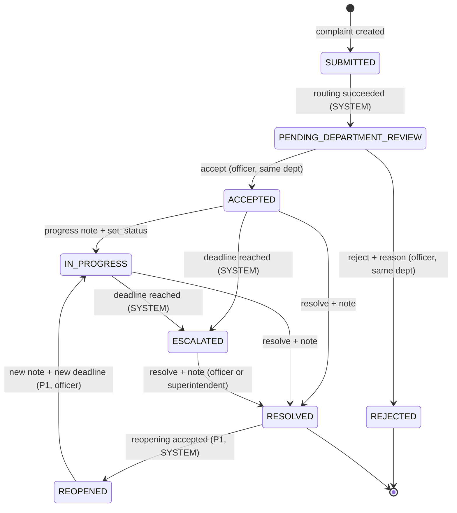

# CivicTrack ΓÇö Complaint State Machine

> **Document type:** Phase 2 deliverable ΓÇö frozen state machine and transition guards  
> **Status:** Approved for implementation  
> **Date:** 06 November 2026  
> **Authority:** SRS §11 (business rules and authoritative transition table), FR-019–FR-030, FR-041; TRD §2.2, §5.3, §13  
> **Companion:** [`ARCHITECTURE.md`](./ARCHITECTURE.md), [`API_CONTRACT.md`](./API_CONTRACT.md)

---

## 1. Statuses

| Status | Meaning | P0 | Terminal |
|---|---|---|---|
| `SUBMITTED` | Complaint row created inside the submission transaction | Yes | No (transient) |
| `PENDING_DEPARTMENT_REVIEW` | Routed to exactly one active department; waiting for decision | Yes | No |
| `ACCEPTED` | Department owns the complaint; resolution clock started | Yes | No |
| `IN_PROGRESS` | Department is actively working | Yes | No |
| `REJECTED` | Department declined with a reason | Yes | **Yes (P0)** |
| `ESCALATED` | Deadline breached; Superintendent owns oversight | Yes | No (until resolved) |
| `RESOLVED` | Resolution recorded with note | Yes | **Yes (P0)** |
| `REOPENED` | Citizen reopening accepted | P1 | No |

`SUBMITTED` exists only within the submission transaction and is immediately followed by `PENDING_DEPARTMENT_REVIEW`; no committed complaint remains in `SUBMITTED`.

**No other status value is legal.** Status is an enum in MySQL and a Python `StrEnum` in the domain layer.

---

## 2. State diagram



---

## 3. Authoritative transition table

| # | From | To | Actor | Guard | Side effects (same transaction) | P0 |
|---|---|---|---|---|---|---|
| T1 | `SUBMITTED` | `PENDING_DEPARTMENT_REVIEW` | `SYSTEM` | Active category mapped to exactly one active department | 2 history rows total for submission; NT-01; image rows | Yes |
| T2 | `PENDING_DEPARTMENT_REVIEW` | `ACCEPTED` | `DEPARTMENT_OFFICER` | Same department; current status matches | `accepted_at`, `accepted_by_user_id`, `sla_seconds`, `resolution_due_at`; history; NT-02 | Yes |
| T3 | `PENDING_DEPARTMENT_REVIEW` | `REJECTED` | `DEPARTMENT_OFFICER` | Same department; reason 10ΓÇô1,000 chars | `rejected_at`, `rejected_by_user_id`, `rejection_reason`; history; NT-03 | Yes |
| T4 | `ACCEPTED` | `IN_PROGRESS` | `DEPARTMENT_OFFICER` | Same department; note 5ΓÇô2,000 chars | progress comment/note; history; NT-04 | Yes |
| T5 | `ACCEPTED` | `RESOLVED` | `DEPARTMENT_OFFICER` | Same department; resolution note 10ΓÇô2,000 chars | `resolved_at`, `resolved_by_user_id`, `resolution_note`; optional evidence link; history; NT-07 | Yes |
| T6 | `IN_PROGRESS` | `RESOLVED` | `DEPARTMENT_OFFICER` | Same department; resolution note 10ΓÇô2,000 chars | same as T5 | Yes |
| T7 | `ACCEPTED` | `ESCALATED` | `SYSTEM` | `now_utc >= resolution_due_at`; no escalation row | `escalated_at`; escalation row; history (`SYSTEM`, `SLA_BREACH`); NT-05 | Yes |
| T8 | `IN_PROGRESS` | `ESCALATED` | `SYSTEM` | `now_utc >= resolution_due_at`; no escalation row | same as T7 | Yes |
| T9 | `ESCALATED` | `RESOLVED` | `DEPARTMENT_OFFICER` or `SUPERINTENDENT_OFFICER` | Resolution note 10ΓÇô2,000 chars; superintendent may resolve; officer must be in responsible department | resolution fields; history; NT-07 | Yes |
| T10 | `RESOLVED` | `REOPENED` | `SYSTEM` | Reopening request accepted | reopening fields; history; NT-08 | P1 |
| T11 | `REOPENED` | `IN_PROGRESS` | `DEPARTMENT_OFFICER` | New note and new deadline | new `sla_seconds`/`resolution_due_at`; history; NT-04 | P1 |

**Single-writer rules**

- Only `escalation_service.run_escalation_check()` writes `ESCALATED`.
- Only `department_service.resolve_complaint()` (including the Superintendent path) writes `RESOLVED`.
- Only `complaint_service.create_complaint()` writes `SUBMITTED` and `PENDING_DEPARTMENT_REVIEW`.
- Routers never assign `complaint.status` directly.

---

## 4. Non-transition operations

These actions never change status and are allowed only in the listed states:

| Operation | Allowed states | Notes |
|---|---|---|
| Assign officer | `PENDING_DEPARTMENT_REVIEW`, `ACCEPTED`, `IN_PROGRESS`, `ESCALATED` | Same department; active assignee; no citizen notification |
| Add progress note (no `set_status`) | `ACCEPTED`, `IN_PROGRESS`, `ESCALATED` | On `ESCALATED`, status stays `ESCALATED` (sticky) |
| Upload `PROGRESS` evidence | `ACCEPTED`, `IN_PROGRESS`, `ESCALATED` | Max 3/request, max 10/complaint |
| Upload `RESOLUTION` evidence | `ACCEPTED`, `IN_PROGRESS`, `ESCALATED` | Linked at resolution |
| Superintendent action | `ESCALATED` | Append-only; no status change |
| Read detail/timeline | any | Scope rules apply |

If a progress request supplies `set_status=IN_PROGRESS` while the complaint is `ESCALATED`, the status remains `ESCALATED`; if the payload implies a different transition, the API returns `409 INVALID_TRANSITION`.

---

## 5. Illegal transitions and 409 behavior

Any transition not listed in §3 returns:

```http
HTTP/1.1 409 Conflict
Content-Type: application/json

{
  "error": {
    "code": "INVALID_TRANSITION",
    "message": "Complaint has already been decided or resolved.",
    "details": {
      "current_status": "ACCEPTED",
      "requested_transition": "PENDING_DEPARTMENT_REVIEW -> REJECTED",
      "allowed_from": ["PENDING_DEPARTMENT_REVIEW"]
    }
  },
  "request_id": "req-..."
}
```

Rules:

1. No database write occurs before the guard passes; on conflict there is **no state change**, no history row, and no notification.
2. The row is locked with `SELECT ... FOR UPDATE` before the guard so two officers cannot both accept.
3. The frontend does not retry state-changing POSTs automatically; it refreshes the complaint and shows the conflict banner.
4. Duplicate escalation is **not** a 409: it is a silent skip inside the worker, guarded by `NOT EXISTS` + unique constraint.

---

## 6. Status-dependent permissions

| Action | Citizen | Department Officer (same dept) | Superintendent | Administrator |
|---|---|---|---|---|
| Create complaint | Yes | No | No | No |
| Read own complaint | Yes | ΓÇö | ΓÇö | ΓÇö |
| Read complaint | Owner only | Yes | Escalated complaints; read-only otherwise | Read-only (all) |
| Accept / reject | No | `PENDING_DEPARTMENT_REVIEW` only | No | No |
| Assign / progress / evidence | No | `ACCEPTED`, `IN_PROGRESS`, `ESCALATED` | No | No |
| Resolve | No | `ACCEPTED`, `IN_PROGRESS`, `ESCALATED` | `ESCALATED` only | No |
| Superintendent action | No | No | `ESCALATED` only | No |
| Configuration / users | No | No | No | Yes |

An Administrator has **no** operational complaint action (separation of duties, PRD A-08).

---

## 7. Invariants

1. Every complaint has exactly one current status and one owning department.
2. `resolution_due_at` is non-null exactly when `accepted_at` is non-null (P0).
3. `sla_seconds` and `resolution_due_at` are immutable after acceptance.
4. At most one escalation row per complaint for its lifetime.
5. `ESCALATED` is sticky until `RESOLVED`; departmental updates never revert it.
6. Every status change appends exactly one `complaint_status_history` row with actor (or `SYSTEM`), from/to status, and UTC timestamp.
7. `REJECTED` and `RESOLVED` are terminal in P0; `REOPENED` is P1 only.
8. Notifications for a transition are committed in the same transaction as the transition.
9. History and audit rows are append-only through the API.

---

## 8. Validation checklist

| Check | Evidence |
|---|---|
| All 8 canonical statuses documented | §1 |
| 11 transitions match SRS §11.1 | §3 |
| P0 transitions separated from P1 | §3 (T10–T11 marked P1) |
| Guard and side effects defined per transition | §3 |
| 409 envelope and no-write rule defined | §5 |
| Sticky escalation and single-writer rules defined | §3–§4 |
| Role matrix excludes Administrator operational actions | §6 |

---

*End of state machine ΓÇö Phase 2, CivicTrack.*
