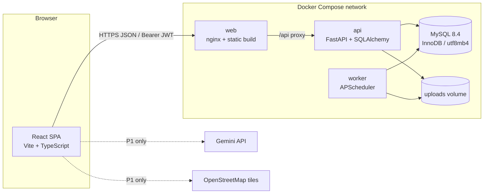
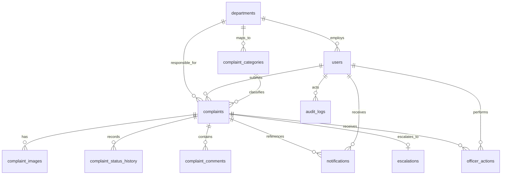
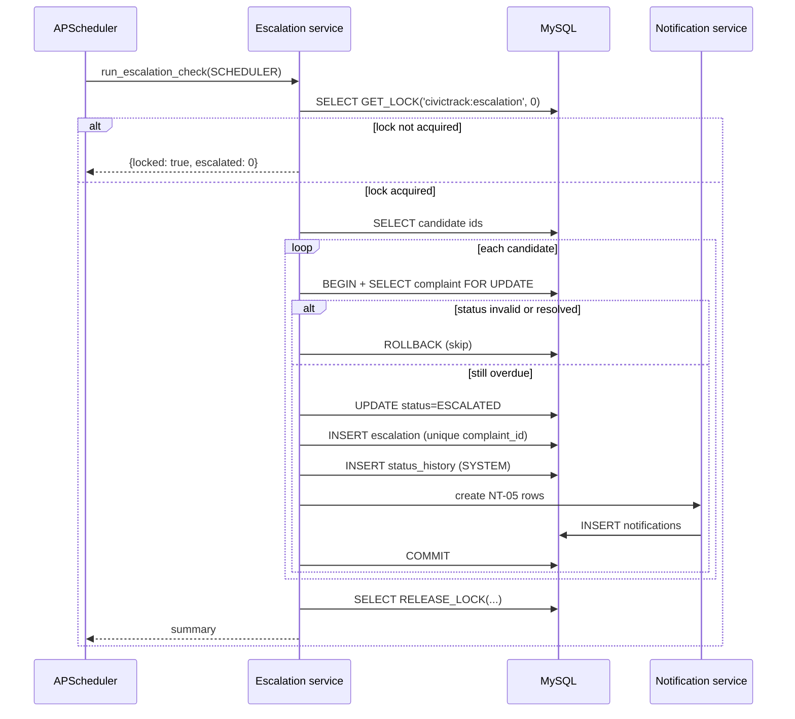

# CivicTrack — Technical Requirements Document (TRD)

| Field | Value |
|---|---|
| Product | CivicTrack — Community Problem Reporting and Resolution Platform |
| Document | Technical Requirements Document |
| Version | 1.0 |
| Date | 06 November 2026 |
| Status | Approved for 10-hour hackathon build |
| Audience | Frontend, backend, DevOps, QA, demo operator |
| Companion documents | `PRD.md`, `SRS.md`, `USER_STORIES.md` |

---

## 1. Technical Overview

### 1.1 Purpose

This TRD describes how CivicTrack will be implemented so that every P0 requirement in SRS §7 and every acceptance criterion in SRS §19 is satisfiable within a ten-hour hackathon. It defines the architecture, stack, data model, API contracts, security model, escalation algorithm, deployment, testing, and build schedule.

### 1.2 Design principles

| Principle | Consequence |
|---|---|
| **Timestamp-derived scheduling** | The escalation decision is computed from `accepted_at` and `resolution_due_at` in the database, never from an in-memory timer or a queued message. A restart cannot lose a pending escalation. |
| **Database as the source of truth** | Status, deadlines, history, escalations, and notifications are rows. No workflow state lives only in the browser. |
| **Exactly-once escalation** | Enforced by a unique constraint, a conditional status update, a scheduler lock, and a candidate query that excludes existing escalations. |
| **Simple modular monolith** | One FastAPI codebase with routers, services, models, and schemas; one worker process; no message broker, no microservices, no websockets. |
| **Server-side authorization** | Every protected route declares required roles; every object access re-checks department or ownership scope in the service layer. |
| **P0 before P1** | Gemini, Leaflet, Recharts, duplicates, feedback, and reopening are isolated behind optional modules and must not be imported by the P0 path. |
| **Demo safety** | The production SLA is a configuration value (10,080 minutes). A shortened demo window requires an explicit guard and is logged at startup. |
| **Truthful lifecycle** | Only the resolution service writes `RESOLVED`. The scheduler writes only `ESCALATED`. |

### 1.3 Runtime topology

| Process | Responsibility | Scaling |
|---|---|---|
| `web` | Serves the built React SPA via nginx (or Vercel in the hosted variant) | Static, horizontally scalable |
| `api` | FastAPI REST API, authentication, all business operations, image serving | One to two Uvicorn workers; P0 requires one for the in-process rate limiter |
| `worker` | APScheduler interval job that runs the escalation check | Exactly one instance; advisory lock protects against accidental overlap |
| `db` | MySQL 8.4 with InnoDB and a persistent volume | Single instance for the demo |

The API and worker share the Python package and the SQLAlchemy models, but they are separate containers so that an API restart never stops scheduling and the scheduler can be monitored independently.

### 1.4 Request and job flows

**Complaint submission**

```
Citizen → POST /api/v1/complaints (multipart)
        → auth dependency → role check CITIZEN
        → service.create_complaint (one transaction)
            → validate category + mapping
            → insert complaint (SUBMITTED)
            → insert history (SUBMITTED)
            → set PENDING_DEPARTMENT_REVIEW + history
            → insert images + metadata
            → insert NT-01 notification
        → 201 {complaint}
```

**Department acceptance**

```
Officer → POST /complaints/{id}/accept
        → role check + department scope
        → one transaction
            → UPDATE ... WHERE status='PENDING_DEPARTMENT_REVIEW'
            → accepted_at, accepted_by, sla_seconds, resolution_due_at
            → history PENDING_DEPARTMENT_REVIEW → ACCEPTED
            → NT-02
        → 200 {complaint}
```

**Escalation**

```
APScheduler (60 s) → run_escalation_check()
        → GET_LOCK('civictrack:escalation')
        → select candidates (ACCEPTED|IN_PROGRESS, deadline <= now, no escalation)
        → per complaint transaction
            → conditional UPDATE status='ESCALATED'
            → INSERT escalation (unique complaint_id)
            → INSERT history (SYSTEM)
            → INSERT NT-05 for Superintendent(s), dept officers, citizen
        → RELEASE_LOCK
        → structured log summary
```

### 1.5 Explicit non-goals

No microservices, service mesh, message queue, event sourcing, CQRS, GraphQL, websockets, Redis, Elasticsearch, Kubernetes, multi-tenancy, external identity provider, or AI dependency in P0. These would add failure modes without improving the demo.

### 1.6 Requirement coverage

SRS §20 maps every FR to an API and test group. Appendix A maps every P0 FR range to concrete modules, tables, and endpoints so no requirement is left without an implementation approach.

Feature names are identical to PRD §10 and SRS §7.0:

| Feature | Priority | Requirements | Primary implementation |
|---|---|---|---|
| Authentication and Access Control | P0 | FR-001–FR-006 | `app/core/security.py`, `auth_service` |
| Complaint Submission | P0 | FR-007–FR-013 | `complaint_service`, `image_service` |
| Photo Evidence | P0 | FR-010, FR-023 | `image_service`, uploads volume |
| Location Capture | P0 | FR-011 | `complaints` schema and validators |
| Category Routing | P0 | FR-012, FR-046, FR-047 | `resolve_department`, admin API |
| Department Review | P0 | FR-017–FR-020 | `department_service` |
| Progress Tracking | P0 | FR-021, FR-022, FR-026 | `department_service`, comments |
| Complaint Timeline | P0 | FR-016, FR-050 | timeline service, history table |
| Automatic Escalation | P0 | FR-027–FR-034 | `escalation_service`, APScheduler worker |
| Superintendent Oversight | P0 | FR-035–FR-041 | `superintendent` router/service |
| Resolution Recording | P0 | FR-024, FR-041 | `resolve_complaint` |
| In-App Notifications | P0 | FR-042–FR-045 | `notification_service` |
| Administration and Configuration | P0 | FR-006, FR-046–FR-049 | `admin_service` |
| Audit Trail | P0 | FR-050 | history + `audit_service` |
| AI Category and Priority Suggestions | P1 | FR-051, FR-054 | optional `ai_service` |
| Duplicate Detection | P1 | FR-052 | optional read query |
| Issue Map | P1 | FR-053 | optional Leaflet component |
| Analytics Dashboard | P1 | FR-055 | optional Recharts component |
| Citizen Feedback and Reopening | P1 | FR-056, FR-057 | optional feedback/reopen service |

---

## 2. Proposed System Architecture

### 2.1 Component diagram



In the hosted variant, `web` is replaced by Vercel, `VITE_API_BASE_URL` points to the API host, and CORS is restricted to the Vercel origin. The worker always runs on a long-lived host.

### 2.2 Layering

```
HTTP layer        FastAPI routers, request validation, response schemas
Application       Services: auth, complaints, department, escalation, notifications, admin
Domain            State machine guards, deadline calculation, RBAC scope rules
Persistence       SQLAlchemy models, repositories/session, Alembic migrations
Infrastructure    MySQL, local file storage, APScheduler, logging
```

**Rules**

1. Routers never contain SQL and never write status directly.
2. Services own transactions and enforce invariants.
3. Only the escalation service writes `ESCALATED`; only the complaint service's `resolve()` writes `RESOLVED`.
4. Notification creation is called inside the caller's transaction, not after commit.
5. No service imports the worker module; the worker imports the escalation service.

### 2.3 Module map

| Python package | Contents |
|---|---|
| `app/main.py` | FastAPI app factory, middleware, exception handlers, router registration |
| `app/core/config.py` | Pydantic settings, demo-mode validation |
| `app/core/security.py` | Password hashing, JWT encode/decode, current-user dependency |
| `app/core/errors.py` | Error codes, `AppError` hierarchy, handlers |
| `app/api/v1/auth.py` | Register, login, logout, me |
| `app/api/v1/complaints.py` | Create, list, detail, timeline, images |
| `app/api/v1/department.py` | Queue, summary, accept, reject, assign, progress, resolve |
| `app/api/v1/superintendent.py` | Escalation queue, actions |
| `app/api/v1/notifications.py` | List, unread count, mark read |
| `app/api/v1/admin.py` | Users, departments, categories, activity, audit |
| `app/api/v1/internal.py` | Guarded escalation trigger, health |
| `app/services/` | Business logic, one module per domain |
| `app/models/` | SQLAlchemy ORM models |
| `app/schemas/` | Pydantic request/response models |
| `app/worker.py` | Scheduler entrypoint and CLI check |
| `app/seed.py` | Idempotent departments, categories, users, demo complaints |
| `app/tests/` | Unit and integration tests |

### 2.4 Frontend to backend boundary

- All API calls go through `src/api/client.ts`, which attaches the bearer token, handles 401 by clearing the session, normalizes errors, and never logs tokens.
- The frontend never computes deadlines for display; it formats server-provided ISO timestamps.
- The frontend never decides whether an action is allowed; it hides unavailable actions for usability but relies on 403/409 responses.
- Role home routes are resolved from `GET /auth/me`, not from a token payload decoded in the browser.

### 2.5 Key architectural decisions

| Decision | Choice | Reason | Alternative rejected |
|---|---|---|---|
| Process model | API + worker + MySQL + static web | Independent scheduling and simpler failure isolation | Serverless API + cron (Vercel cron cannot run every minute on hobby; uploads and locks are awkward) |
| Scheduling | APScheduler interval in a dedicated worker | No extra infrastructure, testable function, timestamps persist | Celery/Redis (extra service for one job) |
| Data access | SQLAlchemy 2.0 sync + PyMySQL | Fast to write, easy transactions, adequate load | Async SQLAlchemy (more complexity, little demo benefit) |
| Auth | JWT bearer, 8-hour expiry | Works across Vercel/API origins without third-party-cookie issues | Cross-site httpOnly cookies (blocked by some browsers) |
| Images | Local persistent volume + authorized file endpoint | No cloud account, no public bucket, simple privacy control | S3/Cloudinary (extra credential and network failure) |
| Notifications | DB rows in the same transaction + 30 s polling | Atomic, no broker, simple UI | WebSockets/email (not needed in P0) |
| IDs | `BIGINT` PK + human-readable tracking number | Compact joins and a citizen-friendly reference | UUID PK (larger indexes, less readable) |

---

## 3. Technology Stack

### 3.1 Frontend

| Concern | Technology | Version | Notes |
|---|---|---|---|
| UI runtime | React | 18.3 | Function components and hooks only |
| Build | Vite | 5.x | Fast dev server, static production build |
| Language | TypeScript | 5.x | `strict: true` |
| Styling | Tailwind CSS | 3.4 | Utility-first, no custom CSS framework |
| Components | shadcn/ui (Radix primitives) | latest | Copy-in components, accessible dialogs/forms |
| Routing | React Router | 6.x | Role-aware route guards |
| Server state | TanStack Query | 5.x | Caching, retries for GETs, polling |
| Forms | react-hook-form + Zod | latest | Client validation mirroring API rules |
| Charts (P1) | Recharts | 2.x | Admin analytics only |
| Map (P1) | Leaflet + react-leaflet | 1.9 / 4.x | OpenStreetMap tiles, lazy-loaded |
| Tests | Vitest + React Testing Library | latest | Component and validation tests |
| E2E | Playwright | latest | One critical-path spec |

### 3.2 Backend

| Concern | Technology | Version | Notes |
|---|---|---|---|
| Language | Python | 3.12 | Type hints throughout |
| Framework | FastAPI | 0.115+ | Dependency injection, OpenAPI generation |
| Validation | Pydantic | 2.x | Request/response schemas with constraints |
| ORM | SQLAlchemy | 2.0 | Declarative models, session per request |
| Driver | PyMySQL | 1.1+ | Pure-Python MySQL driver |
| Migrations | Alembic | 1.13+ | One initial migration |
| Auth | PyJWT | 2.x | HS256 access tokens |
| Passwords | `bcrypt` | 4.x | Direct hashing, cost 12 |
| Uploads | `python-multipart`, Pillow | latest | Parsing and image verification |
| Scheduler | APScheduler | 3.10 | `BlockingScheduler`, interval trigger |
| Config | pydantic-settings | 2.x | `.env` loading and validation |
| Server | Uvicorn | 0.30+ | Single worker in P0 |
| Lint/format | ruff | latest | Lint + format in one tool |
| Tests | pytest, pytest-cov, httpx | latest | Unit + API integration |

### 3.3 Data and infrastructure

| Concern | Technology | Notes |
|---|---|---|
| Database | MySQL 8.4 | InnoDB, `utf8mb4_0900_ai_ci`, UTC session |
| Containers | Docker, Docker Compose | `db`, `api`, `worker`, `web` |
| Web server | nginx Alpine | Static assets + `/api` reverse proxy |
| Version control | Git + GitHub | Feature branches, one integration branch |
| CI (optional) | GitHub Actions | Lint + tests on push; not a demo dependency |
| Frontend hosting | Vercel (alternative) | `VITE_API_BASE_URL` points to API |
| Backend hosting | Render/Railway/Fly or a VM | Must support a long-lived worker and persistent disk |
| AI (P1) | Google Gemini API | Server-side only, feature-flagged |
| Map tiles (P1) | OpenStreetMap | No key; attribution required |

### 3.4 Version pinning

`requirements.txt` pins exact versions; `package-lock.json` is committed. Docker images use explicit tags (`mysql:8.4`, `node:20-alpine`, `python:3.12-slim`, `nginx:1.27-alpine`), never `latest`.

---

## 4. Frontend Architecture

### 4.1 Directory layout

```
frontend/
├─ src/
│  ├─ api/
│  │  ├─ client.ts          # fetch wrapper, auth header, error normalization
│  │  ├─ auth.ts
│  │  ├─ complaints.ts
│  │  ├─ department.ts
│  │  ├─ superintendent.ts
│  │  ├─ notifications.ts
│  │  └─ admin.ts
│  ├─ components/
│  │  ├─ ui/                # shadcn primitives
│  │  ├─ layout/            # AppShell, Sidebar, Header, NotificationBell
│  │  ├─ complaints/        # StatusBadge, Timeline, ImageGallery, ComplaintCard
│  │  └─ forms/             # FormField, ImageUploader, LocationPicker
│  ├─ features/
│  │  ├─ auth/
│  │  ├─ citizen/
│  │  ├─ department/
│  │  ├─ superintendent/
│  │  ├─ admin/
│  │  └─ notifications/
│  ├─ hooks/                # useAuth, useNotifications, useRoleGuard
│  ├─ lib/                  # constants, formatters, status metadata, validators
│  ├─ pages/                # route-level components
│  ├─ router.tsx
│  ├─ App.tsx
│  └─ main.tsx
├─ public/
├─ index.html
├─ tailwind.config.ts
├─ vite.config.ts
└─ package.json
```

### 4.2 Routes and guards

| Route | Page | Allowed roles |
|---|---|---|
| `/login` | Login | Public (redirect if authenticated) |
| `/register` | Citizen registration | Public |
| `/` | Redirect to role home | Authenticated |
| `/complaints` | My complaints | Citizen |
| `/complaints/new` | Report a problem | Citizen |
| `/complaints/:id` | Complaint detail and timeline | Owner; department officer in scope; Superintendent; Administrator (read-only) |
| `/department` | Department queue | Department Officer |
| `/department/summary` | Department counts | Department Officer |
| `/superintendent` | Escalation queue | Superintendent Officer |
| `/superintendent/summary` | Escalation metrics | Superintendent Officer |
| `/admin/users` | User and role management | Platform Administrator |
| `/admin/departments` | Department management | Platform Administrator |
| `/admin/categories` | Category and mapping management | Platform Administrator |
| `/admin/activity` | Activity summary | Platform Administrator |
| `/admin/audit` | Audit log viewer | Platform Administrator |
| `/notifications` | Notification list | All authenticated |
| `/forbidden` | 403 page | All authenticated |
| `*` | Not found | Public |

`RoleRoute` wraps protected routes and redirects to `/login` or `/forbidden`. The guard is a UX convenience only; API authorization is authoritative.

### 4.3 State management

| State | Owner | Persistence |
|---|---|---|
| Session token | `AuthProvider` | `sessionStorage` (`civictrack.token`), cleared on logout/401 |
| Current user | `AuthProvider` via `GET /auth/me` | Memory; refetched on reload |
| Lists/details | TanStack Query keys | In-memory cache; invalidated after mutations |
| Form state | react-hook-form | Memory |
| Notification unread count | `useNotifications` query | Polled every 30 s and on window focus |

**Query keys:** `['me']`, `['complaints', filters]`, `['complaint', id]`, `['timeline', id]`, `['department', filters]`, `['department-summary']`, `['escalations']`, `['notifications']`, `['unread-count']`, `['admin', resource]`.

**Invalidation:** accepting, rejecting, progressing, resolving, escalating (after refresh), and recording a supervisory action invalidate the complaint detail, timeline, relevant queues, and unread count.

### 4.4 Screens and required states

| Screen | Required content | Empty / error states |
|---|---|---|
| Login / Register | Email, password, name, optional phone; inline validation | Invalid credentials; duplicate email |
| My Complaints | Tracking number, title, category, department, status badge, submitted date, deadline | Empty guidance; load error with retry |
| Report a Problem | Category, title, description, image uploader, optional location text/coordinates | Per-field validation; upload progress; submit disabled while pending |
| Complaint Detail | Status header, department, key dates, description, evidence gallery, timeline | Not found/forbidden; no images |
| Department Queue | Status tabs with counts, filters, table/cards, overdue badges | No pending complaints |
| Department Detail | Accept/reject panel, assignee, progress composer, resolution panel, evidence | Action errors (409 conflict) |
| Escalation Queue | Sorted overdue list, overdue duration, department, deadline | No escalations |
| Escalation Detail | Full timeline, supervisor action composer, resolution panel | No actions yet |
| Admin Users | List, role editor, department selector, active toggle | Last-admin protection error |
| Admin Categories | Category form, mapping select, active toggle | Unmapped category warning |
| Activity | Status/department counts, recent events | Zero-state |
| Audit | Filters, table, metadata expansion | No matching events |
| Notifications | List with read state, mark one/all read | No notifications |

### 4.5 Status presentation

| Status | Badge color | Citizen label |
|---|---|---|
| `SUBMITTED` | Slate | Submitted |
| `PENDING_DEPARTMENT_REVIEW` | Amber | Waiting for department review |
| `ACCEPTED` | Blue | Accepted by department |
| `IN_PROGRESS` | Indigo | Work in progress |
| `REJECTED` | Red | Rejected |
| `ESCALATED` | Orange | Escalated to Superintendent |
| `RESOLVED` | Green | Resolved |
| `REOPENED` | Purple | Reopened (P1) |

Labels come from a single `statusMeta` map in `src/lib/status.ts`, so terminology cannot drift between screens.

### 4.6 Forms and validation

- Zod schemas mirror SRS §10 constraints (title 5–150, description 20–2,000, reason 10–1,000, note 5–2,000, resolution 10–2,000).
- The submit button is disabled while a request is pending; no optimistic status changes.
- Image selection validates type and size client-side, shows previews, and caps at three for submission.
- The location field is clearly optional; coordinate entry is hidden behind an "Add exact coordinates" disclosure.
- Server `422` responses map to field errors by `error.details` keys; `409` shows a conflict banner.

### 4.7 Notification polling

`useNotifications` calls `GET /notifications/unread-count` every 30 seconds while the tab is visible and refetches on focus. Opening the notification panel fetches the list. Marking read updates the query cache and invalidates the count. No websocket, SSE, or push service is used in P0.

### 4.8 P1 isolation

| Feature | Isolation |
|---|---|
| AI suggestions | `features/citizen/AiSuggest.tsx`, dynamic import, feature flag `VITE_ENABLE_AI`; failure is non-blocking |
| Map | `features/map/IssueMap.tsx`, lazy import, `VITE_ENABLE_MAP` |
| Analytics | `features/admin/Analytics.tsx`, lazy import; reuses activity endpoint or a dedicated P1 endpoint |
| Feedback/reopen | Hidden behind status `RESOLVED` and `VITE_ENABLE_FEEDBACK` |

No P1 import may appear in the submission, acceptance, escalation, or resolution modules.

---

## 5. Backend Architecture

### 5.1 Directory layout

```
backend/
├─ app/
│  ├─ main.py
│  ├─ core/
│  │  ├─ config.py
│  │  ├─ security.py
│  │  ├─ errors.py
│  │  ├─ logging.py
│  │  └─ clock.py
│  ├─ db/
│  │  ├─ base.py
│  │  ├─ session.py
│  │  └─ naming.py
│  ├─ models/
│  │  ├─ user.py, department.py, category.py, complaint.py,
│  │  ├─ image.py, history.py, comment.py, notification.py,
│  │  ├─ escalation.py, officer_action.py, audit.py
│  ├─ schemas/
│  │  ├─ auth.py, complaint.py, department.py, superintendent.py,
│  │  ├─ notification.py, admin.py, common.py
│  ├─ services/
│  │  ├─ auth_service.py
│  │  ├─ complaint_service.py
│  │  ├─ department_service.py
│  │  ├─ escalation_service.py
│  │  ├─ notification_service.py
│  │  ├─ image_service.py
│  │  ├─ admin_service.py
│  │  └─ audit_service.py
│  ├─ api/
│  │  ├─ deps.py
│  │  └─ v1/
│  │     ├─ auth.py, complaints.py, department.py,
│  │     ├─ superintendent.py, notifications.py,
│  │     ├─ admin.py, internal.py
│  ├─ worker.py
│  └─ seed.py
├─ alembic/
│  ├─ versions/0001_initial.py
│  └─ env.py
├─ tests/
│  ├─ unit/
│  ├─ integration/
│  └─ conftest.py
├─ requirements.txt
├─ Dockerfile
└─ .env.example
```

### 5.2 Request lifecycle

```
Request
  → RequestID middleware (assigns X-Request-ID)
  → CORS middleware
  → route dependency: get_db (session), get_current_user (JWT), require_roles
  → Pydantic request validation
  → service call (owns transaction)
  → Pydantic response serialization
  → exception handler (AppError → error envelope)
```

### 5.3 Transaction pattern

```python
# app/db/session.py
SessionLocal = sessionmaker(bind=engine, autoflush=False, expire_on_commit=False)

def get_db():
    db = SessionLocal()
    try:
        yield db
    finally:
        db.close()
```

```python
# services/department_service.py (illustrative)
def accept_complaint(db: Session, complaint_id: int, officer: User) -> Complaint:
    with db.begin():
        complaint = (
            db.execute(
                select(Complaint)
                .where(Complaint.id == complaint_id)
                .with_for_update()
            ).scalar_one_or_none()
        )
        if complaint is None or complaint.department_id != officer.department_id:
            raise NotFound("Complaint not found")
        if complaint.status != Status.PENDING_DEPARTMENT_REVIEW:
            raise Conflict("INVALID_TRANSITION", "Complaint has already been decided.")

        now = utcnow()
        complaint.status = Status.ACCEPTED
        complaint.accepted_at = now
        complaint.accepted_by_user_id = officer.id
        complaint.sla_seconds = settings.escalation_window_minutes * 60
        complaint.resolution_due_at = now + timedelta(seconds=complaint.sla_seconds)

        add_history(db, complaint, Status.PENDING_DEPARTMENT_REVIEW, Status.ACCEPTED,
                    actor=officer, note="Complaint accepted")
        notification_service.on_accepted(db, complaint)
        return complaint
```

Rules:

- One unit of work per request. A service either commits all writes or raises; no partial commit.
- `with_for_update()` is used for complaint state transitions to serialize competing officers.
- The worker opens a separate session per escalation candidate.
- Read-only endpoints do not begin a transaction explicitly; SQLAlchemy autobegin is acceptable for reads.

### 5.4 Dependency injection and authorization

```python
# app/api/deps.py
def require_roles(*roles: Role):
    def dependency(user: User = Depends(get_current_user)) -> User:
        if user.role not in roles:
            audit_denied(user, request=None)
            raise Forbidden()
        return user
    return dependency
```

- `get_current_user` decodes the JWT, loads the user, and rejects inactive accounts.
- Department scope is checked in services using the authenticated user's `department_id`, never a request parameter.
- Ownership checks for citizens compare `complaint.citizen_id` with `user.id`.

### 5.5 Service responsibilities

| Service | Responsibilities |
|---|---|
| `auth_service` | Register, authenticate, issue token, profile |
| `complaint_service` | Create with routing, list/detail, timeline assembly, image attachment |
| `department_service` | Queue, summary, accept, reject, assign, progress, resolve |
| `escalation_service` | Candidate selection, lock, escalation transaction, idempotency, summary |
| `notification_service` | Recipient resolution, row creation per trigger, list/read |
| `image_service` | Validation, storage, metadata, authorized retrieval |
| `admin_service` | Users/roles, departments, categories, mappings, activity |
| `audit_service` | Append-only audit events, filters |

### 5.6 Configuration

`app/core/config.py` uses `pydantic-settings` with a typed `Settings` object. Startup validation:

```python
if settings.escalation_window_minutes != 10_080 and not settings.allow_demo_escalation:
    logger.error("Non-default escalation window without ALLOW_DEMO_ESCALATION; using 10080")
    settings.escalation_window_minutes = 10_080
if settings.allow_demo_escalation:
    logger.warning("DEMO ESCALATION MODE: window=%s minutes", settings.escalation_window_minutes)
```

The worker logs the effective window on every start. The API exposes the effective window in the admin activity response, labeled as demo when it differs from 10,080 minutes.

### 5.7 Clock abstraction

All timestamps come from `app/core/clock.py`:

```python
def utcnow() -> datetime:
    return datetime.now(timezone.utc).replace(tzinfo=None)
```

MySQL `DATETIME(6)` stores naive UTC; API serialization appends `Z`. Tests can monkeypatch `utcnow` for boundary cases. Application code never uses local time or `datetime.now()` without the clock helper.

### 5.8 Logging

- JSON or key-value structured logs to stdout, collected by Docker.
- Fields: timestamp, level, request_id, user_id (ID only), route, method, status, duration_ms, event.
- Escalation run log: `event=escalation_run`, `evaluated`, `escalated`, `skipped`, `duration_ms`, `trigger_source`, `window_minutes`, `demo_mode`.
- No PII, tokens, passwords, emails, phone numbers, coordinates, or note bodies in logs.
- Exceptions log a stack trace server-side with the request ID, never in the API response.

### 5.9 Health endpoints

| Endpoint | Purpose | Response |
|---|---|---|
| `GET /health` | Liveness | `{"status":"ok","version":"1.0.0"}` |
| `GET /health/ready` | Readiness | Checks `SELECT 1`; returns 200 or 503 |
| `GET /api/v1/internal/escalation-status` | Demo/ops check (token) | Effective window, demo flag, last run summary if available |

The worker does not expose HTTP. Its liveness is the container process; its output is the structured log and the escalations table.

---

## 6. Database Architecture

### 6.1 Platform configuration

| Setting | Value |
|---|---|
| Engine | InnoDB |
| Version | MySQL 8.4 |
| Character set / collation | `utf8mb4` / `utf8mb4_0900_ai_ci` |
| Timezone | `+00:00` for every session; all `DATETIME(6)` values are UTC |
| Transaction isolation | `READ COMMITTED` (set per session) |
| Primary keys | `BIGINT UNSIGNED AUTO_INCREMENT` |
| Foreign keys | Enforced; `RESTRICT` on core references |
| Naming | `snake_case`, plural table names, singular ORM classes |
| Migrations | Alembic, one initial revision, applied at container start |
| Seed | Idempotent Python script, safe to re-run |
| Backups | `mysqldump` before the demo; daily in a real deployment |

**Why `READ COMMITTED`:** it avoids gap-lock surprises in the escalation candidate query and is sufficient because all state transitions use explicit row locks and conditional updates.

### 6.2 Connection and pool settings

| Parameter | Value | Reason |
|---|---|---|
| `pool_size` | 10 | Demo concurrency |
| `max_overflow` | 20 | Burst tolerance |
| `pool_recycle` | 1800 s | Avoid MySQL `wait_timeout` drops |
| `pool_pre_ping` | true | Recover from restarts |
| `connect_timeout` | 5 s | Fail fast |
| `charset` | `utf8mb4` | Full Unicode |

### 6.3 Migration strategy

1. `0001_initial.py` creates all eleven tables, indexes, checks, and foreign keys.
2. `alembic upgrade head` runs in the API entrypoint before Uvicorn starts.
3. The worker waits for the API health check or retries the database connection; it does not run migrations.
4. Rolling back is `alembic downgrade base` in development only; production rollback would restore a dump.
5. Schema changes after Hour 7 are prohibited except for a P0 defect, because reseeding and retesting cost more than the change is worth.

### 6.4 Seed data (idempotent)

| Entity | Seed |
|---|---|
| Departments | Road Maintenance, Electrical, Sanitation, Drainage, Water Supply, Public Works |
| Categories | Pothole / Damaged Road, Broken Streetlight, Garbage Overflow, Blocked Drainage, Water Leakage, Damaged Public Infrastructure, Other Community Issue |
| Users | `citizen@demo.local`, `roads@demo.local`, `electrical@demo.local`, `superintendent@demo.local`, `admin@demo.local` (passwords from `SEED_PASSWORD`, default `Demo@12345`) |
| Demo complaints | One pending road complaint, one resolved complaint, one accepted complaint backdated past the window (guaranteed escalation), one rejected complaint |
| Notifications | Generated by the normal services during seeding, not inserted blindly |

The seed script never creates a complaint directly in `ESCALATED`; the backdated complaint is created through the acceptance service and then escalated by the first worker run, proving the real path. If a guaranteed escalation is needed immediately, the seed also invokes the escalation service once after backdating.

### 6.5 Data lifecycle

- Complaints, history, escalations, officer actions, notifications, and audit logs are never hard-deleted.
- Users and configuration are deactivated.
- Images are retained with the complaint; a P1 cleanup job may remove orphans from failed uploads.
- A future retention policy is out of scope for the MVP.

---

## 7. Database Entities and Relationships

### 7.1 Entity-relationship diagram



### 7.2 `users`

| Column | Type | Constraints / notes |
|---|---|---|
| `id` | BIGINT UNSIGNED | PK, auto-increment |
| `full_name` | VARCHAR(120) | NOT NULL |
| `email` | VARCHAR(190) | NOT NULL, UNIQUE (case-insensitive collation) |
| `password_hash` | VARCHAR(255) | NOT NULL, bcrypt |
| `phone` | VARCHAR(20) | NULL |
| `role` | ENUM | NOT NULL: `CITIZEN`, `DEPARTMENT_OFFICER`, `SUPERINTENDENT_OFFICER`, `PLATFORM_ADMIN` |
| `department_id` | BIGINT UNSIGNED | NULL, FK → `departments.id`; required for Department Officer (application-enforced) |
| `is_active` | TINYINT(1) | NOT NULL, default 1 |
| `created_at` | DATETIME(6) | NOT NULL, default current UTC |
| `updated_at` | DATETIME(6) | NOT NULL, on update |

Indexes: `UNIQUE(email)`, `(role, is_active)`, `(department_id, role)`.

### 7.3 `departments`

| Column | Type | Constraints / notes |
|---|---|---|
| `id` | BIGINT UNSIGNED | PK |
| `name` | VARCHAR(120) | NOT NULL, UNIQUE |
| `code` | VARCHAR(30) | NOT NULL, UNIQUE (for example `ROADS`) |
| `description` | VARCHAR(500) | NULL |
| `is_active` | TINYINT(1) | NOT NULL, default 1 |
| `created_at` / `updated_at` | DATETIME(6) | NOT NULL |

### 7.4 `complaint_categories`

| Column | Type | Constraints / notes |
|---|---|---|
| `id` | BIGINT UNSIGNED | PK |
| `name` | VARCHAR(120) | NOT NULL, UNIQUE |
| `code` | VARCHAR(40) | NOT NULL, UNIQUE |
| `description` | VARCHAR(500) | NULL |
| `department_id` | BIGINT UNSIGNED | NOT NULL, FK → `departments.id` |
| `default_priority` | ENUM(`LOW`,`MEDIUM`,`HIGH`) | NOT NULL, default `MEDIUM`; display/AI baseline |
| `is_active` | TINYINT(1) | NOT NULL, default 1 |
| `created_at` / `updated_at` | DATETIME(6) | NOT NULL |

Indexes: `UNIQUE(name)`, `UNIQUE(code)`, `(department_id, is_active)`.

### 7.5 `complaints`

| Column | Type | Constraints / notes |
|---|---|---|
| `id` | BIGINT UNSIGNED | PK |
| `complaint_number` | VARCHAR(20) | NOT NULL, UNIQUE, format `CT-YYYY-NNNNNN` |
| `citizen_id` | BIGINT UNSIGNED | NOT NULL, FK → `users.id` |
| `category_id` | BIGINT UNSIGNED | NOT NULL, FK → `complaint_categories.id` |
| `department_id` | BIGINT UNSIGNED | NOT NULL, FK → `departments.id` |
| `title` | VARCHAR(150) | NOT NULL |
| `description` | TEXT | NOT NULL |
| `location_text` | VARCHAR(255) | NULL |
| `latitude` | DECIMAL(9,6) | NULL |
| `longitude` | DECIMAL(9,6) | NULL |
| `status` | ENUM | NOT NULL: `SUBMITTED`, `PENDING_DEPARTMENT_REVIEW`, `ACCEPTED`, `IN_PROGRESS`, `REJECTED`, `ESCALATED`, `RESOLVED`, `REOPENED` |
| `priority` | ENUM(`LOW`,`MEDIUM`,`HIGH`) | NOT NULL, default `MEDIUM` |
| `assigned_to_user_id` | BIGINT UNSIGNED | NULL, FK → `users.id` |
| `assigned_at` | DATETIME(6) | NULL |
| `submitted_at` | DATETIME(6) | NOT NULL |
| `accepted_at` | DATETIME(6) | NULL |
| `accepted_by_user_id` | BIGINT UNSIGNED | NULL, FK → `users.id` |
| `sla_seconds` | INT UNSIGNED | NULL; snapshot of the window applied at acceptance |
| `resolution_due_at` | DATETIME(6) | NULL; `accepted_at + sla_seconds` |
| `escalated_at` | DATETIME(6) | NULL |
| `resolved_at` | DATETIME(6) | NULL |
| `resolved_by_user_id` | BIGINT UNSIGNED | NULL, FK → `users.id` |
| `resolution_note` | TEXT | NULL |
| `rejected_at` | DATETIME(6) | NULL |
| `rejected_by_user_id` | BIGINT UNSIGNED | NULL, FK → `users.id` |
| `rejection_reason` | TEXT | NULL |
| `reopened_at` | DATETIME(6) | NULL (P1) |
| `created_at` / `updated_at` | DATETIME(6) | NOT NULL |

Indexes: `UNIQUE(complaint_number)`, `(department_id, status, submitted_at)`, `(citizen_id, submitted_at)`, `(status, resolution_due_at)`, `(category_id)`, `(assigned_to_user_id)`, `(accepted_at)`.

Checks:
- `(latitude IS NULL AND longitude IS NULL) OR (latitude IS NOT NULL AND longitude IS NOT NULL)`
- `latitude BETWEEN -90 AND 90`; `longitude BETWEEN -180 AND 180`
- `resolution_due_at IS NULL OR accepted_at IS NOT NULL`

### 7.6 `complaint_images`

| Column | Type | Constraints / notes |
|---|---|---|
| `id` | BIGINT UNSIGNED | PK |
| `complaint_id` | BIGINT UNSIGNED | NOT NULL, FK → `complaints.id` |
| `uploaded_by_user_id` | BIGINT UNSIGNED | NOT NULL, FK → `users.id` |
| `kind` | ENUM | NOT NULL: `SUBMISSION`, `PROGRESS`, `RESOLUTION`, `REOPEN` |
| `storage_path` | VARCHAR(500) | NOT NULL, relative to `UPLOAD_DIR` |
| `original_filename` | VARCHAR(255) | NOT NULL, sanitized for display only |
| `mime_type` | VARCHAR(100) | NOT NULL: `image/jpeg`, `image/png`, `image/webp` |
| `size_bytes` | INT UNSIGNED | NOT NULL |
| `created_at` | DATETIME(6) | NOT NULL |

Indexes: `(complaint_id, kind, created_at)`.

### 7.7 `complaint_status_history`

| Column | Type | Constraints / notes |
|---|---|---|
| `id` | BIGINT UNSIGNED | PK |
| `complaint_id` | BIGINT UNSIGNED | NOT NULL, FK → `complaints.id` |
| `from_status` | ENUM | NULL (first event) |
| `to_status` | ENUM | NOT NULL |
| `actor_user_id` | BIGINT UNSIGNED | NULL, FK → `users.id`; null means `SYSTEM` |
| `actor_role` | VARCHAR(40) | NOT NULL; `SYSTEM` for automation |
| `note` | VARCHAR(1000) | NULL |
| `created_at` | DATETIME(6) | NOT NULL |

Indexes: `(complaint_id, created_at, id)`, `(to_status, created_at)`.

### 7.8 `complaint_comments`

| Column | Type | Constraints / notes |
|---|---|---|
| `id` | BIGINT UNSIGNED | PK |
| `complaint_id` | BIGINT UNSIGNED | NOT NULL, FK → `complaints.id` |
| `author_user_id` | BIGINT UNSIGNED | NOT NULL, FK → `users.id` |
| `comment_type` | ENUM(`PROGRESS_NOTE`,`CITIZEN_FEEDBACK`) | NOT NULL, default `PROGRESS_NOTE` |
| `visibility` | ENUM(`CITIZEN_VISIBLE`,`INTERNAL`) | NOT NULL, default `CITIZEN_VISIBLE` |
| `body` | TEXT | NOT NULL |
| `created_at` | DATETIME(6) | NOT NULL |

Indexes: `(complaint_id, created_at)`, `(author_user_id)`.

`CITIZEN_FEEDBACK` is used only by P1. Internal notes are excluded from citizen timeline responses.

### 7.9 `notifications`

| Column | Type | Constraints / notes |
|---|---|---|
| `id` | BIGINT UNSIGNED | PK |
| `recipient_user_id` | BIGINT UNSIGNED | NOT NULL, FK → `users.id` |
| `complaint_id` | BIGINT UNSIGNED | NULL, FK → `complaints.id` |
| `trigger_code` | VARCHAR(10) | NOT NULL: `NT-01`–`NT-08` |
| `title` | VARCHAR(150) | NOT NULL |
| `body` | VARCHAR(1000) | NOT NULL |
| `is_read` | TINYINT(1) | NOT NULL, default 0 |
| `read_at` | DATETIME(6) | NULL |
| `created_at` | DATETIME(6) | NOT NULL |

Indexes: `(recipient_user_id, is_read, created_at)`, `(complaint_id, created_at)`.

### 7.10 `escalations`

| Column | Type | Constraints / notes |
|---|---|---|
| `id` | BIGINT UNSIGNED | PK |
| `complaint_id` | BIGINT UNSIGNED | NOT NULL, **UNIQUE**, FK → `complaints.id` |
| `escalation_number` | TINYINT UNSIGNED | NOT NULL, default 1 |
| `previous_status` | ENUM | NOT NULL (`ACCEPTED` or `IN_PROGRESS`) |
| `deadline_at` | DATETIME(6) | NOT NULL, copied from `resolution_due_at` |
| `escalated_at` | DATETIME(6) | NOT NULL |
| `overdue_seconds` | INT UNSIGNED | NOT NULL, `max(0, escalated_at - deadline_at)` |
| `trigger_source` | ENUM(`SCHEDULER`,`MANUAL_TRIGGER`,`DEMO_SEED`) | NOT NULL |
| `reason_code` | VARCHAR(40) | NOT NULL, default `SLA_BREACH` |
| `created_at` | DATETIME(6) | NOT NULL |

Indexes: `UNIQUE(complaint_id)`, `(escalated_at)`, `(trigger_source)`.

The unique key is the last line of defence for idempotency. `escalation_number` exists for forward compatibility but is always 1 in P0.

### 7.11 `officer_actions`

| Column | Type | Constraints / notes |
|---|---|---|
| `id` | BIGINT UNSIGNED | PK |
| `complaint_id` | BIGINT UNSIGNED | NOT NULL, FK → `complaints.id` |
| `officer_user_id` | BIGINT UNSIGNED | NOT NULL, FK → `users.id` |
| `action_type` | ENUM(`INSTRUCTION`,`FOLLOW_UP`,`REASSIGN`,`NOTE`) | NOT NULL |
| `directed_department_id` | BIGINT UNSIGNED | NULL, FK → `departments.id` |
| `note` | TEXT | NOT NULL |
| `created_at` | DATETIME(6) | NOT NULL |

Indexes: `(complaint_id, created_at)`, `(officer_user_id, created_at)`, `(directed_department_id)`.

### 7.12 `audit_logs`

| Column | Type | Constraints / notes |
|---|---|---|
| `id` | BIGINT UNSIGNED | PK |
| `actor_user_id` | BIGINT UNSIGNED | NULL, FK → `users.id` (null for anonymous/login failure) |
| `actor_role` | VARCHAR(40) | NULL |
| `action` | VARCHAR(80) | NOT NULL (for example `AUTH_LOGIN_FAILED`, `RBAC_DENIED`, `ROLE_CHANGED`, `CATEGORY_MAPPED`, `COMPLAINT_ACCEPTED`) |
| `entity_type` | VARCHAR(60) | NOT NULL |
| `entity_id` | VARCHAR(64) | NULL |
| `ip_address` | VARCHAR(45) | NULL |
| `user_agent` | VARCHAR(255) | NULL |
| `metadata` | JSON | NULL; no PII, passwords, or tokens |
| `created_at` | DATETIME(6) | NOT NULL |

Indexes: `(entity_type, entity_id)`, `(actor_user_id, created_at)`, `(action, created_at)`.

### 7.13 Relationship summary

| Parent | Child | Cardinality | Delete behaviour |
|---|---|---|---|
| `departments` | `users` | 1:N | RESTRICT |
| `departments` | `complaint_categories` | 1:N | RESTRICT |
| `departments` | `complaints` | 1:N | RESTRICT |
| `complaint_categories` | `complaints` | 1:N | RESTRICT |
| `users` | `complaints` (citizen) | 1:N | RESTRICT |
| `users` | `complaints` (assignee/acceptor/resolver/rejecter) | 1:N | RESTRICT / SET NULL for optional roles |
| `complaints` | `complaint_images` | 1:N | RESTRICT |
| `complaints` | `complaint_status_history` | 1:N | RESTRICT |
| `complaints` | `complaint_comments` | 1:N | RESTRICT |
| `complaints` | `notifications` | 1:N | RESTRICT |
| `complaints` | `escalations` | 1:0..1 | RESTRICT |
| `complaints` | `officer_actions` | 1:N | RESTRICT |
| `users` | `audit_logs` | 1:N | SET NULL on user removal (not exposed in P0) |

### 7.14 Tracking number generation

- Format: `CT-{YYYY}-{sequence:06d}`, for example `CT-2026-000042`.
- Implementation: a MySQL sequence table is not in the required entity list, so the service uses the complaint's auto-increment id after insert in the same transaction:
  1. Insert the complaint with a temporary collision-resistant placeholder of exactly 20 characters, for example `TMP-` plus 16 hex characters from `uuid4().hex[:16]` (the column is `VARCHAR(20)` and unique).
  2. Flush to obtain `id`.
  3. Set `complaint_number = f"CT-{year}-{id:06d}"`.
  4. Commit.
- The unique constraint on `complaint_number` and the id-derived value guarantee uniqueness without retry loops.
- The placeholder is never visible to users because it is replaced before commit.
- Year is the UTC year of submission.

---

## 8. API Design

### 8.1 Conventions

| Convention | Value |
|---|---|
| Base path | `/api/v1` |
| Format | JSON, except multipart uploads and image streaming |
| Authentication | `Authorization: Bearer <jwt>` |
| Timestamps | ISO 8601 UTC, for example `2026-11-06T10:00:00Z` |
| IDs | Integers in JSON; tracking numbers as strings |
| Pagination | `?page=1&page_size=20`; response includes `items`, `page`, `page_size`, `total`, `total_pages` |
| Sorting | Server-defined; new items first unless documented |
| Errors | `{"error":{"code","message","details?"},"request_id"}` |
| Request ID | `X-Request-ID` echoed in responses |
| Idempotency | `POST /internal/escalations/run` is naturally idempotent; state transitions are guarded by status and return 409 |
| OpenAPI | Automatically available at `/docs` in non-production; schema export committed for the team |

### 8.2 Endpoint index

| Method | Path | Roles | Purpose |
|---|---|---|---|
| POST | `/auth/register` | Public | Citizen registration |
| POST | `/auth/login` | Public | Login |
| POST | `/auth/logout` | Authenticated | Client-side token disposal acknowledgment |
| GET | `/auth/me` | Authenticated | Current profile |
| GET | `/categories` | Authenticated | Active category catalogue |
| POST | `/complaints` | Citizen | Submit complaint (multipart) |
| GET | `/complaints` | Citizen | Own complaints |
| GET | `/complaints/{id}` | Owner / dept / superintendent / admin | Complaint detail |
| GET | `/complaints/{id}/timeline` | Same as detail | Unified timeline |
| POST | `/complaints/{id}/images` | Department Officer | Upload progress or resolution evidence |
| GET | `/complaints/{id}/images/{image_id}/file` | Scoped | Stream image |
| GET | `/department/complaints` | Department Officer | Department queue |
| GET | `/department/summary` | Department Officer | Status counts |
| POST | `/complaints/{id}/accept` | Department Officer | Accept |
| POST | `/complaints/{id}/reject` | Department Officer | Reject with reason |
| POST | `/complaints/{id}/assign` | Department Officer | Assign staff |
| POST | `/complaints/{id}/progress` | Department Officer | Add note / move to IN_PROGRESS |
| POST | `/complaints/{id}/resolve` | Department Officer / Superintendent | Record resolution |
| GET | `/superintendent/escalations` | Superintendent | Escalation queue |
| GET | `/superintendent/summary` | Superintendent | Escalation metrics |
| POST | `/complaints/{id}/superintendent-actions` | Superintendent | Record instruction/follow-up |
| GET | `/notifications` | Authenticated | Own notifications |
| GET | `/notifications/unread-count` | Authenticated | Unread badge |
| POST | `/notifications/{id}/read` | Authenticated | Mark one read |
| POST | `/notifications/read-all` | Authenticated | Mark all read |
| GET | `/admin/users` | Administrator | User list |
| POST | `/admin/users` | Administrator | Create officer/admin |
| PATCH | `/admin/users/{id}` | Administrator | Role, department, active state |
| GET | `/admin/departments` | Administrator | Department list |
| POST | `/admin/departments` | Administrator | Create department |
| PATCH | `/admin/departments/{id}` | Administrator | Update/deactivate |
| GET | `/admin/categories` | Administrator | Category list with mapping |
| POST | `/admin/categories` | Administrator | Create category |
| PATCH | `/admin/categories/{id}` | Administrator | Update/deactivate/mapping |
| GET | `/admin/activity` | Administrator | Counts and recent events |
| GET | `/admin/audit-logs` | Administrator | Filtered audit log |
| POST | `/internal/escalations/run` | Internal token | Manual escalation trigger |
| GET | `/internal/escalation-status` | Internal token | Effective window and last run |
| GET | `/health`, `/health/ready` | Public | Liveness/readiness |
| POST | `/ai/suggest-category` | Citizen (P1) | Gemini suggestion |
| GET | `/complaints/{id}/duplicates` | Citizen/Dept (P1) | Duplicate candidates |
| GET | `/map/complaints` | Scoped (P1) | Map points |
| POST | `/complaints/{id}/feedback` | Citizen (P1) | Rating |
| POST | `/complaints/{id}/reopen-requests` | Citizen (P1) | Reopening request |

### 8.3 Authentication contracts

**POST `/api/v1/auth/register`**

```json
{
  "full_name": "Priya Sharma",
  "email": "priya@example.com",
  "password": "Citizen123",
  "phone": "+91 98765 43210"
}
```

```json
// 201
{
  "token": "eyJhbGciOiJIUzI1NiIsInR5cCI6IkpXVCJ9...",
  "token_type": "bearer",
  "expires_in": 28800,
  "user": {
    "id": 12,
    "full_name": "Priya Sharma",
    "email": "priya@example.com",
    "phone": "+91 98765 43210",
    "role": "CITIZEN",
    "department": null,
    "is_active": true
  }
}
```

Errors: `409 EMAIL_ALREADY_REGISTERED`, `422 VALIDATION_ERROR`.

**POST `/api/v1/auth/login`**

```json
{ "email": "roads@demo.local", "password": "Demo@12345" }
```

```json
// 200
{
  "token": "eyJ...",
  "token_type": "bearer",
  "expires_in": 28800,
  "user": {
    "id": 3,
    "full_name": "Arjun Rao",
    "email": "roads@demo.local",
    "role": "DEPARTMENT_OFFICER",
    "department": { "id": 1, "name": "Road Maintenance Department", "code": "ROADS" },
    "is_active": true
  }
}
```

Errors: `401 INVALID_CREDENTIALS`, `429 RATE_LIMITED`.

**GET `/api/v1/auth/me`**

```json
{
  "id": 3,
  "full_name": "Arjun Rao",
  "email": "roads@demo.local",
  "phone": null,
  "role": "DEPARTMENT_OFFICER",
  "department": { "id": 1, "name": "Road Maintenance Department", "code": "ROADS" },
  "is_active": true
}
```

### 8.4 Complaint submission and listing

**GET `/api/v1/categories`**

```json
{
  "items": [
    { "id": 1, "name": "Pothole / Damaged Road", "code": "POTHOLE",
      "department": { "id": 1, "name": "Road Maintenance Department", "code": "ROADS" } },
    { "id": 2, "name": "Broken Streetlight", "code": "STREETLIGHT",
      "department": { "id": 2, "name": "Electrical Department", "code": "ELECTRICAL" } }
  ]
}
```

**POST `/api/v1/complaints`** — `multipart/form-data`

| Part | Type | Required |
|---|---|---|
| `title` | text | Yes |
| `description` | text | Yes |
| `category_id` | text (integer) | Yes |
| `location_text` | text | No |
| `latitude` | text (decimal) | No |
| `longitude` | text (decimal) | No |
| `images` | file, repeated (0–3) | No |

```json
// 201
{
  "id": 42,
  "complaint_number": "CT-2026-000042",
  "title": "Large pothole near the school gate",
  "description": "A deep pothole has formed across the left lane...",
  "status": "PENDING_DEPARTMENT_REVIEW",
  "priority": "MEDIUM",
  "category": { "id": 1, "name": "Pothole / Damaged Road", "code": "POTHOLE" },
  "department": { "id": 1, "name": "Road Maintenance Department", "code": "ROADS" },
  "location": {
    "text": "Near Gate 2, Market Road",
    "latitude": 12.971598,
    "longitude": 77.594562
  },
  "images": [
    { "id": 7, "kind": "SUBMISSION", "mime_type": "image/jpeg", "size_bytes": 348221,
      "url": "/api/v1/complaints/42/images/7/file" }
  ],
  "submitted_at": "2026-11-06T10:00:00Z",
  "accepted_at": null,
  "resolution_due_at": null,
  "escalated_at": null,
  "resolved_at": null,
  "resolution_note": null,
  "is_verified": false
}
```

`is_verified` is always `false` for a citizen report. It is display metadata, not a stored verification flag.

Errors: `422 CATEGORY_NOT_MAPPED`, `422 VALIDATION_ERROR`, `413 UPLOAD_TOO_LARGE`, `422 UNSUPPORTED_MEDIA_TYPE`.

**GET `/api/v1/complaints?status=ESCALATED&page=1&page_size=20`**

```json
{
  "items": [
    {
      "id": 42,
      "complaint_number": "CT-2026-000042",
      "title": "Large pothole near the school gate",
      "status": "ESCALATED",
      "category": "Pothole / Damaged Road",
      "department": "Road Maintenance Department",
      "submitted_at": "2026-11-06T10:00:00Z",
      "accepted_at": "2026-11-06T10:30:00Z",
      "resolution_due_at": "2026-11-13T10:30:00Z",
      "overdue": false
    }
  ],
  "page": 1,
  "page_size": 20,
  "total": 1,
  "total_pages": 1
}
```

**GET `/api/v1/complaints/{id}`** — detail shape as the create response plus:

```json
{
  "resolution": {
    "note": "Pothole filled and asphalt compacted.",
    "resolved_at": "2026-11-08T09:15:00Z",
    "resolved_by": { "id": 3, "full_name": "Arjun Rao" },
    "evidence": [
      { "id": 9, "kind": "RESOLUTION", "url": "/api/v1/complaints/42/images/9/file" }
    ]
  },
  "timeline_url": "/api/v1/complaints/42/timeline"
}
```

**GET `/api/v1/complaints/{id}/timeline`**

```json
{
  "items": [
    {
      "id": "hist-1",
      "event_type": "STATUS_CHANGE",
      "from_status": null,
      "to_status": "SUBMITTED",
      "actor": { "id": 12, "display_name": "Priya Sharma", "role": "CITIZEN" },
      "note": "Complaint submitted",
      "created_at": "2026-11-06T10:00:00Z"
    },
    {
      "id": "hist-2",
      "event_type": "STATUS_CHANGE",
      "from_status": "SUBMITTED",
      "to_status": "PENDING_DEPARTMENT_REVIEW",
      "actor": { "id": null, "display_name": "SYSTEM", "role": "SYSTEM" },
      "note": "Routed to Road Maintenance Department",
      "created_at": "2026-11-06T10:00:00Z"
    },
    {
      "id": "comment-5",
      "event_type": "PROGRESS_NOTE",
      "actor": { "id": 3, "display_name": "Arjun Rao", "role": "DEPARTMENT_OFFICER" },
      "note": "Crew assigned; materials requested.",
      "created_at": "2026-11-06T12:00:00Z"
    },
    {
      "id": "esc-1",
      "event_type": "ESCALATION",
      "actor": { "id": null, "display_name": "SYSTEM", "role": "SYSTEM" },
      "note": "Deadline exceeded; escalated to Superintendent Officer.",
      "created_at": "2026-11-13T10:31:12Z"
    }
  ]
}
```

Timeline ordering is ascending by `created_at` then a stable event ID. Event IDs are namespaced strings (`hist-`, `comment-`, `esc-`, `action-`, `image-`).

### 8.5 Department contracts

**GET `/api/v1/department/complaints?status=PENDING_DEPARTMENT_REVIEW`**

```json
{
  "items": [
    {
      "id": 42,
      "complaint_number": "CT-2026-000042",
      "title": "Large pothole near the school gate",
      "status": "PENDING_DEPARTMENT_REVIEW",
      "category": "Pothole / Damaged Road",
      "submitted_at": "2026-11-06T10:00:00Z",
      "assigned_to": null,
      "is_overdue": false
    }
  ],
  "counts": {
    "PENDING_DEPARTMENT_REVIEW": 4,
    "ACCEPTED": 2,
    "IN_PROGRESS": 3,
    "ESCALATED": 1,
    "RESOLVED": 12,
    "REJECTED": 2
  },
  "page": 1,
  "page_size": 20,
  "total": 4,
  "total_pages": 1
}
```

**POST `/api/v1/complaints/42/accept`**

```json
// 200
{
  "id": 42,
  "complaint_number": "CT-2026-000042",
  "status": "ACCEPTED",
  "department": { "id": 1, "name": "Road Maintenance Department", "code": "ROADS" },
  "accepted_at": "2026-11-06T10:30:00Z",
  "accepted_by": { "id": 3, "full_name": "Arjun Rao" },
  "sla_seconds": 604800,
  "resolution_due_at": "2026-11-13T10:30:00Z",
  "notifications_created": ["NT-02"]
}
```

Errors: `409 INVALID_TRANSITION` with current status, `403 FORBIDDEN`, `404 NOT_FOUND`.

**POST `/api/v1/complaints/42/reject`**

```json
{ "reason": "The reported location is outside the municipal road boundary." }
```

```json
// 200
{
  "id": 42,
  "status": "REJECTED",
  "rejected_at": "2026-11-06T10:35:00Z",
  "rejected_by": { "id": 3, "full_name": "Arjun Rao" },
  "rejection_reason": "The reported location is outside the municipal road boundary.",
  "notifications_created": ["NT-03"]
}
```

Errors: `422 VALIDATION_ERROR` (reason length), `409 INVALID_TRANSITION`.

**POST `/api/v1/complaints/42/assign`**

```json
{ "assignee_user_id": 8 }
```

```json
// 200
{ "id": 42, "assigned_to": { "id": 8, "full_name": "Suresh Kumar" }, "assigned_at": "2026-11-06T11:00:00Z" }
```

**POST `/api/v1/complaints/42/progress`**

```json
{ "note": "Crew dispatched; barricades placed for safety.", "set_status": "IN_PROGRESS" }
```

```json
// 200
{
  "id": 42,
  "status": "IN_PROGRESS",
  "timeline_event": {
    "event_type": "PROGRESS_NOTE",
    "note": "Crew dispatched; barricades placed for safety.",
    "actor": { "id": 3, "display_name": "Arjun Rao" },
    "created_at": "2026-11-06T12:00:00Z"
  },
  "notifications_created": ["NT-04"]
}
```

`set_status` is optional; omitting it keeps the current status and records only a note. On an `ESCALATED` complaint it is ignored (or rejected if it differs), and the status stays `ESCALATED`.

**POST `/api/v1/complaints/42/images`** — `multipart/form-data` with `kind=PROGRESS|RESOLUTION` and 1–3 `images`.

```json
// 201
{
  "items": [
    { "id": 9, "kind": "PROGRESS", "mime_type": "image/jpeg", "size_bytes": 401233,
      "url": "/api/v1/complaints/42/images/9/file" }
  ]
}
```

**POST `/api/v1/complaints/42/resolve`**

```json
{
  "resolution_note": "Pothole filled, compacted, and the surface levelled. Area cleaned.",
  "evidence_image_ids": [9]
}
```

```json
// 200
{
  "id": 42,
  "status": "RESOLVED",
  "resolved_at": "2026-11-08T09:15:00Z",
  "resolved_by": { "id": 3, "full_name": "Arjun Rao", "role": "DEPARTMENT_OFFICER" },
  "resolution_note": "Pothole filled, compacted, and the surface levelled. Area cleaned.",
  "resolution_due_at": "2026-11-13T10:30:00Z",
  "was_escalated": false,
  "notifications_created": ["NT-07"]
}
```

Errors: `409 INVALID_TRANSITION`, `422 VALIDATION_ERROR`, `403 FORBIDDEN`.

### 8.6 Superintendent contracts

**GET `/api/v1/superintendent/escalations`**

```json
{
  "items": [
    {
      "id": 42,
      "complaint_number": "CT-2026-000042",
      "title": "Large pothole near the school gate",
      "department": { "id": 1, "name": "Road Maintenance Department" },
      "accepted_at": "2026-11-06T10:30:00Z",
      "resolution_due_at": "2026-11-13T10:30:00Z",
      "escalated_at": "2026-11-13T10:31:12Z",
      "overdue_seconds": 72,
      "current_overdue_seconds": 86400,
      "status": "ESCALATED",
      "last_action_at": null
    }
  ],
  "summary": { "open": 1, "oldest_overdue_seconds": 86400 },
  "page": 1,
  "page_size": 20,
  "total": 1,
  "total_pages": 1
}
```

**POST `/api/v1/complaints/42/superintendent-actions`**

```json
{
  "action_type": "FOLLOW_UP",
  "note": "Complete the repair within 48 hours and upload after-work evidence.",
  "directed_department_id": 1
}
```

```json
// 201
{
  "id": 5,
  "complaint_id": 42,
  "action_type": "FOLLOW_UP",
  "note": "Complete the repair within 48 hours and upload after-work evidence.",
  "directed_department": { "id": 1, "name": "Road Maintenance Department" },
  "officer": { "id": 4, "full_name": "Meera Iyer" },
  "created_at": "2026-11-13T12:00:00Z",
  "notifications_created": ["NT-06"]
}
```

Errors: `409 INVALID_TRANSITION` if the complaint is not `ESCALATED`, `422 VALIDATION_ERROR`.

**POST `/api/v1/internal/escalations/run`** — header `X-Internal-Token: <INTERNAL_TRIGGER_TOKEN>`

```json
// 200
{
  "evaluated": 3,
  "escalated": 1,
  "skipped": 2,
  "duration_ms": 84,
  "trigger_source": "MANUAL_TRIGGER",
  "window_minutes": 2,
  "demo_mode": true
}
```

A second call returns `{"evaluated":0,"escalated":0,"skipped":0}` because no candidate remains. Errors: `401`/`403` for a bad token.

### 8.7 Notification contracts

**GET `/api/v1/notifications?unread_only=false`**

```json
{
  "items": [
    {
      "id": 101,
      "trigger_code": "NT-05",
      "title": "Complaint escalated",
      "body": "CT-2026-000042 (Road Maintenance) exceeded its deadline by 1 day and is now with the Superintendent Officer.",
      "complaint_id": 42,
      "complaint_number": "CT-2026-000042",
      "is_read": false,
      "created_at": "2026-11-13T10:31:12Z"
    }
  ],
  "unread_count": 1,
  "page": 1,
  "page_size": 20,
  "total": 1,
  "total_pages": 1
}
```

**GET `/api/v1/notifications/unread-count`**

```json
{ "unread_count": 3 }
```

**POST `/api/v1/notifications/101/read`** → `200 {"id":101,"is_read":true,"read_at":"2026-11-13T12:05:00Z"}`

**POST `/api/v1/notifications/read-all`** → `200 {"updated":3}`

### 8.8 Admin contracts

**POST `/api/v1/admin/categories`**

```json
{
  "name": "Broken Streetlight",
  "code": "STREETLIGHT",
  "description": "A streetlight is out, flickering, or damaged.",
  "department_id": 2,
  "default_priority": "MEDIUM",
  "is_active": true
}
```

```json
// 201
{ "id": 2, "name": "Broken Streetlight", "code": "STREETLIGHT",
  "department": { "id": 2, "name": "Electrical Department" }, "is_active": true }
```

**PATCH `/api/v1/admin/categories/2`**

```json
{ "department_id": 6 }
```

```json
// 200
{ "id": 2, "department": { "id": 6, "name": "Public Works Department" },
  "updated_at": "2026-11-06T13:00:00Z",
  "note": "Affects new complaints only." }
```

**GET `/api/v1/admin/activity`**

```json
{
  "by_status": { "PENDING_DEPARTMENT_REVIEW": 4, "ACCEPTED": 2, "IN_PROGRESS": 3,
                 "ESCALATED": 1, "RESOLVED": 12, "REJECTED": 2 },
  "by_department": [
    { "id": 1, "name": "Road Maintenance Department", "open": 6, "escalated": 1 }
  ],
  "escalations_total": 1,
  "escalation_window_minutes": 10080,
  "demo_mode": false,
  "recent_events": [
    { "complaint_number": "CT-2026-000042", "event_type": "STATUS_CHANGE",
      "to_status": "ACCEPTED", "actor": "Arjun Rao", "created_at": "2026-11-06T10:30:00Z" }
  ]
}
```

**GET `/api/v1/admin/audit-logs?action=RBAC_DENIED&from=2026-11-01&to=2026-11-30`**

```json
{
  "items": [
    { "id": 900, "actor_user_id": 12, "actor_role": "CITIZEN", "action": "RBAC_DENIED",
      "entity_type": "COMPLAINT", "entity_id": "42", "created_at": "2026-11-06T14:00:00Z",
      "metadata": { "method": "POST", "path": "/api/v1/complaints/42/accept" } }
  ],
  "page": 1, "page_size": 20, "total": 1, "total_pages": 1
}
```

### 8.9 Health

**GET `/health`** → `200 {"status":"ok","version":"1.0.0"}`

**GET `/health/ready`** → `200 {"status":"ready","database":"ok"}` or `503 {"status":"not_ready","database":"unavailable"}`

---

## 9. Authentication and Authorization

### 9.1 Registration and provisioning

- Public registration creates `CITIZEN` only. A client-supplied `role` is rejected or ignored, and the service always sets `CITIZEN`.
- Department Officers, Superintendents, and Administrators are created by the seed script or by an Administrator through `POST /admin/users`.
- Email uniqueness is enforced by the database collation and a pre-check for a friendly 409.
- Password policy: 8–72 characters, at least one letter and one digit, bcrypt cost 12.
- Phone is optional and stored as text; it is never used for authentication in P0.

### 9.2 JWT design

| Claim | Value |
|---|---|
| `sub` | User ID as a string |
| `role` | Current role code |
| `dept` | Department ID or null |
| `iat` | Issued at (UTC) |
| `exp` | `iat + 8 hours` |
| `jti` | Random UUID for future revocation |
| `iss` | `civictrack` |
| `aud` | `civictrack-web` |

- Algorithm: HS256.
- Secret: `JWT_SECRET`, minimum 32 bytes, from the environment.
- The API loads the user on every request and uses the database role, not only the token claim, so a role change or deactivation takes effect immediately.
- `POST /auth/logout` returns 204; revocation is client-side. A future denylist is out of scope.

### 9.3 Token storage and transport

Implemented: `sessionStorage` + `Authorization: Bearer`. Justification: the hosted frontend and API may be on different origins, where cross-site cookies are blocked by some browsers, which would break the demo. Mitigations: 8-hour expiry, no token in URLs, no token logging, React escaping, dependency hygiene, and a strict CSP where the host permits. This is an explicit MVP tradeoff documented in SRS §16.

### 9.4 Authorization enforcement

```python
# role gate
@router.post("/complaints/{complaint_id}/accept")
def accept(
    complaint_id: int,
    officer: User = Depends(require_roles(Role.DEPARTMENT_OFFICER)),
    db: Session = Depends(get_db),
):
    return department_service.accept_complaint(db, complaint_id, officer)
```

Service-level object scope:

```python
def get_visible_complaint(db, complaint_id, user) -> Complaint:
    complaint = db.get(Complaint, complaint_id)
    if complaint is None:
        raise NotFound()
    if user.role == Role.CITIZEN and complaint.citizen_id != user.id:
        raise NotFound()              # do not reveal existence
    if user.role == Role.DEPARTMENT_OFFICER and complaint.department_id != user.department_id:
        raise Forbidden()
    if user.role == Role.SUPERINTENDENT_OFFICER and complaint.status != Status.ESCALATED:
        # read-only oversight remains allowed; action methods check escalated separately
        pass
    return complaint
```

Rules:

1. Route dependencies enforce role classes.
2. Services enforce ownership and department scope.
3. Supervisory actions require `status == ESCALATED`.
4. Admin operational actions are denied by role even for Administrators.
5. Denied requests produce `RBAC_DENIED` audit entries.
6. The frontend never receives a list of endpoints it cannot use.

### 9.5 Login protection

- In-memory fixed-window limiter: 5 failed attempts per `(ip, email)` per 60 seconds; returns 429 with `Retry-After`.
- Successful login resets the counter.
- Limiter is per API process; the demo runs one API process. A multi-process deployment would move this to the database or a shared cache (P2).
- Failed attempts are audit-logged by email hash or user ID if known; plaintext email is not logged.

### 9.6 CORS and headers

- `CORS_ORIGINS` is a comma-separated allowlist; `allow_credentials=false` because bearer tokens are used.
- Allowed headers: `Authorization`, `Content-Type`, `X-Request-ID`, `X-Internal-Token` (internal route only).
- Allowed methods: `GET, POST, PATCH, DELETE, OPTIONS`.
- Security headers at nginx/proxy: `X-Content-Type-Options: nosniff`, `X-Frame-Options: DENY`, `Referrer-Policy: no-referrer`, `Content-Security-Policy` allowing self, API origin, and OSM tiles only when the map is enabled.

### 9.7 RBAC test matrix (12 cases)

| # | Actor | Attempt | Expected |
|---|---|---|---|
| 1 | Citizen | `POST /complaints/{id}/accept` | 403 |
| 2 | Citizen | `POST /complaints/{id}/reject` | 403 |
| 3 | Citizen | `GET /department/complaints` | 403 |
| 4 | Citizen | `GET /superintendent/escalations` | 403 |
| 5 | Citizen | `GET /admin/users` | 403 |
| 6 | Department Officer | Read another department's complaint | 403 |
| 7 | Department Officer | Accept another department's complaint | 403 |
| 8 | Department Officer | `POST /superintendent-actions` | 403 |
| 9 | Superintendent | `POST /admin/categories` | 403 |
| 10 | Administrator | `POST /complaints/{id}/accept` | 403 |
| 11 | Department Officer | Resolve another department's complaint | 403 |
| 12 | Anonymous | Any protected route | 401 |

All cases are automated in `tests/integration/test_rbac.py`; the demo narrator can show cases 1–2 live.

---

## 10. Image Storage Strategy

### 10.1 Upload flow

1. Client validates type and size and shows a preview.
2. Client sends `multipart/form-data` with 0–3 files.
3. API enforces the request body limit before parsing (nginx `client_max_body_size 20m`).
4. For each file, `image_service` checks:
   - Size ≤ 5 MiB (5,242,880 bytes).
   - Content type in `image/jpeg`, `image/png`, `image/webp`.
   - Pillow `Image.open(...).verify()` succeeds and the detected format matches the allowed set.
   - Dimensions ≤ 10,000 × 10,000 to prevent decompression bombs.
5. Files are written to a temporary file, then moved atomically to the final path. If any file fails, the whole request fails and temporary files are removed.
6. Database metadata is written in the same transaction as the complaint or update.

### 10.2 Path scheme

```
{UPLOAD_DIR}/{yyyy}/{mm}/{complaint_id}/{uuid4}.{jpg|png|webp}
```

Example: `/app/uploads/2026/11/42/3f2b9c1e-...jpg`

- The original filename is stored for display only and never used as a path.
- Directory creation uses `os.makedirs(exist_ok=True)`.
- Path traversal is impossible because the stored name is generated server-side.

### 10.3 Serving

`GET /api/v1/complaints/{complaint_id}/images/{image_id}/file`:

1. Authenticate and authorize against the complaint (owner, responsible department, Superintendent, Administrator).
2. Look up the image row and ensure it belongs to the complaint.
3. Resolve the path under `UPLOAD_DIR`, verify it does not escape the base directory.
4. Stream with the stored MIME type, `Content-Disposition: inline; filename="..."`, and `Cache-Control: private, max-age=300`.

No image is ever served from a public directory or a predictable unauthenticated URL.

### 10.4 Limits and lifecycle

| Limit | Value |
|---|---|
| Max file size | 5 MiB |
| Max files per request | 3 |
| Max images per complaint | 10 (all kinds) |
| Allowed formats | JPEG, PNG, WebP |
| Max dimensions | 10,000 × 10,000 |

- Originals are kept (no server-side resizing in P0) to avoid CPU spikes during the demo.
- A failed complaint transaction leaves no database rows; the service deletes any files written for that request in a `finally` block.
- Docker volume `civictrack_uploads` is mounted at `/app/uploads` in both `api` and `worker` (the worker only needs it if it ever reads images; mounting keeps the option open).
- Backup: copy the volume before the demo; images are small.
- P2: object storage (S3-compatible) with signed URLs, thumbnails, and malware scanning.

### 10.5 Privacy

- EXIF is not stripped in P0 because Pillow re-saving is not performed; this is a documented risk. The uploader is told not to include personal data in photos, and images are not public.
- P1/P2 should strip EXIF GPS metadata before storage.
- Image URLs require authorization; no signed public links exist.

---

## 11. Notification Architecture

### 11.1 Model

Notifications are database rows created by `notification_service` inside the caller's transaction:

```python
def on_escalated(db: Session, complaint: Complaint) -> None:
    recipients = (
        active_superintendents(db)
        + active_department_officers(db, complaint.department_id)
        + [complaint.citizen]
    )
    for user in dedupe(recipients):
        create(
            db,
            recipient=user,
            complaint=complaint,
            trigger_code="NT-05",
            title="Complaint escalated",
            body=(
                f"{complaint.complaint_number} ({complaint.department.name}) exceeded its "
                f"deadline by {format_duration(overdue)} and is now with the Superintendent Officer."
            ),
        )
```

If a recipient list is empty (no active Superintendent), the service falls back to active Administrators and writes an audit event.

### 11.2 Trigger map

| Trigger | Recipients | Source service | Body template |
|---|---|---|---|
| NT-01 | Citizen | `complaint_service.create` | Tracking number, category, department |
| NT-02 | Citizen | `department_service.accept` | Department, acceptance time, deadline |
| NT-03 | Citizen | `department_service.reject` | Rejection reason |
| NT-04 | Citizen | `department_service.progress` | New status + note |
| NT-05 | Superintendents + department officers + citizen | `escalation_service.escalate` | Deadline + overdue duration |
| NT-06 | Department officers + citizen | `superintendent_service.record_action` | Action type + note summary |
| NT-07 | Citizen | `department_service.resolve` / `superintendent_service.resolve` | Resolution note + resolver |
| NT-08 (P1) | Department officers + citizen | `reopen_service` | Reopened status + reason |

### 11.3 Transaction and failure semantics

- Notification inserts share the transaction of the triggering action.
- If a notification insert fails, the action rolls back; the user can retry and the timeline cannot claim a change that was never announced.
- No external provider is called in P0, so there is no network failure surface.
- A future email/SMS adapter would introduce an outbox table and a retry worker; this is explicitly P2 and must not be added in the hackathon.

### 11.4 Delivery and read state

- Polling: unread count every 30 s while the tab is visible, plus on focus.
- The list is fetched on demand, newest first, 20 per page.
- Marking read sets `is_read=1` and `read_at`; idempotent.
- Unread count is `COUNT(*) WHERE recipient_user_id = :me AND is_read = 0`.
- No notification digest, no email, no push.

### 11.5 Content rules

- Always include the tracking number and the resulting status.
- Never include another citizen's PII.
- Use plain text, not HTML; the frontend renders it as text.
- Template strings are built server-side and stored, so later changes to the complaint do not rewrite history.
- A notification references the complaint by ID and number; if the complaint is inaccessible, the link is hidden.

### 11.6 Operational checks

- After each demo action, the moderator can show the citizen inbox.
- The admin activity view counts notifications only indirectly; a mismatch between a committed status and its notification is treated as a P0 defect.
- The seed script generates notifications through services, not by direct inserts, so notification logic is exercised during setup.

---

## 12. Department Routing Logic

### 12.1 Rule

Routing is a single lookup at submission time:

```
complaint.department_id = complaint_categories.department_id
where complaint_categories.id = complaint.category_id
  and complaint_categories.is_active = 1
  and departments.is_active = 1
```

There is no geospatial routing, no round-robin, no manual triage queue, and no AI decision in P0.

### 12.2 Implementation

```python
# services/complaint_service.py
def resolve_department(db: Session, category_id: int) -> tuple[ComplaintCategory, Department]:
    row = db.execute(
        select(ComplaintCategory)
        .join(Department, ComplaintCategory.department_id == Department.id)
        .where(
            ComplaintCategory.id == category_id,
            ComplaintCategory.is_active.is_(True),
            Department.is_active.is_(True),
        )
    ).scalar_one_or_none()
    if row is None:
        raise Unprocessable("CATEGORY_NOT_MAPPED",
                            "This category is unavailable. Please choose another category.")
    return row, row.department
```

The complaint service calls this inside the submission transaction before inserting the complaint. If the mapping is missing, no complaint row and no image files remain.

### 12.3 Seed mapping

| Category code | Category name | Department code |
|---|---|---|
| `POTHOLE` | Pothole / Damaged Road | `ROADS` |
| `STREETLIGHT` | Broken Streetlight | `ELECTRICAL` |
| `GARBAGE` | Garbage Overflow | `SANITATION` |
| `DRAINAGE` | Blocked Drainage | `DRAINAGE` |
| `WATER_LEAK` | Water Leakage | `WATER` |
| `PUBLIC_INFRA` | Damaged Public Infrastructure | `PUBLIC_WORKS` |
| `OTHER` | Other Community Issue | `PUBLIC_WORKS` |

Water Leakage → Water Supply and Public Infrastructure/Other → Public Works are explicit assumptions (PRD A-03). Administrators can change them.

### 12.4 Invariants

| ID | Invariant | Enforcement |
|---|---|---|
| RT-01 | Every complaint has a non-null department | `NOT NULL` FK + service validation |
| RT-02 | Every active category has exactly one active department | Admin validation + FK |
| RT-03 | Existing complaints never change department when a mapping changes | Routing is copied at insert; admin update does not touch `complaints` |
| RT-04 | The citizen cannot choose a department | API accepts only `category_id` |
| RT-05 | A department officer sees only their department | Service scope check |
| RT-06 | An inactive department cannot receive new complaints | Join filter on `is_active` |
| RT-07 | Routing failure aborts submission | Transaction rollback + file cleanup |

### 12.5 Administration

- `PATCH /admin/categories/{id}` accepts `department_id` and validates the target is active.
- The change is audited with `old_department_id` and `new_department_id` in `metadata`.
- The API response includes a note that the change affects new complaints only.
- No cache is used; the lookup is a single indexed join, so changes take effect immediately for new submissions.

### 12.6 Why not automatic reassignment

Reassignment would rewrite accountability and complicate the timeline. The Superintendent's `REASSIGN` action is recorded as a directive with `directed_department_id`; the original department remains responsible in P0. A real transfer workflow would require acceptance by both departments and is out of scope (PRD §20).

---

## 13. Seven-Day Escalation Architecture

### 13.1 Overview

Escalation is a deterministic function of persisted state, executed by the worker:

```
candidate = accepted_at IS NOT NULL
            AND status IN (ACCEPTED, IN_PROGRESS)
            AND resolution_due_at <= now_utc
            AND no escalation row exists
```

The default window is **10,080 minutes (seven calendar days)**. At acceptance, the service snapshots the window into `complaints.sla_seconds` and computes `resolution_due_at`. Later configuration changes do not alter existing deadlines.

### 13.2 Deadline example

| Event | Timestamp (UTC) | Stored value |
|---|---|---|
| Submitted | 2026-06-01 08:00 | `submitted_at` |
| Accepted | 2026-06-01 10:00 | `accepted_at`, `sla_seconds=604800` |
| Deadline | 2026-06-08 10:00 | `resolution_due_at` |
| First check at or after deadline | 2026-06-08 10:00:42 | `escalated_at`, `overdue_seconds=42` |

Submission time is irrelevant to the deadline. A complaint submitted on 20 May but accepted on 1 June escalates from 1 June, not 20 May.

### 13.3 Algorithm

```python
LOCK_NAME = "civictrack:escalation"

def run_escalation_check(
    trigger_source: TriggerSource,
    now: datetime | None = None,
) -> EscalationRunSummary:
    now = now or utcnow()
    started = monotonic()
    summary = EscalationRunSummary(
        evaluated=0, escalated=0, skipped=0,
        trigger_source=trigger_source, window_minutes=settings.effective_window_minutes,
        demo_mode=settings.demo_mode,
    )

    lock_conn = engine.connect()
    try:
        acquired = lock_conn.execute(
            text("SELECT GET_LOCK(:name, 0)"), {"name": LOCK_NAME}
        ).scalar()
        if acquired != 1:
            summary.lock_skipped = True
            return summary

        candidate_ids = lock_conn.execute(
            text("""
                SELECT c.id
                FROM complaints c
                WHERE c.status IN ('ACCEPTED', 'IN_PROGRESS')
                  AND c.accepted_at IS NOT NULL
                  AND c.resolution_due_at IS NOT NULL
                  AND c.resolution_due_at <= :now
                  AND NOT EXISTS (
                      SELECT 1 FROM escalations e WHERE e.complaint_id = c.id
                  )
                ORDER BY c.resolution_due_at ASC
                LIMIT :batch
            """),
            {"now": now, "batch": settings.escalation_batch_size},
        ).scalars().all()

        summary.evaluated = len(candidate_ids)

        for complaint_id in candidate_ids:
            try:
                with SessionLocal.begin() as tx:
                    complaint = tx.execute(
                        select(Complaint)
                        .where(Complaint.id == complaint_id)
                        .with_for_update()
                    ).scalar_one_or_none()

                    if complaint is None:
                        summary.skipped += 1
                        continue
                    if complaint.status not in (Status.ACCEPTED, Status.IN_PROGRESS):
                        summary.skipped += 1
                        continue
                    if complaint.resolution_due_at is None or complaint.resolution_due_at > now:
                        summary.skipped += 1
                        continue

                    previous = complaint.status
                    complaint.status = Status.ESCALATED
                    complaint.escalated_at = now
                    complaint.updated_at = now

                    overdue = max(0, int((now - complaint.resolution_due_at).total_seconds()))
                    tx.add(Escalation(
                        complaint_id=complaint.id,
                        escalation_number=1,
                        previous_status=previous,
                        deadline_at=complaint.resolution_due_at,
                        escalated_at=now,
                        overdue_seconds=overdue,
                        trigger_source=trigger_source,
                        reason_code="SLA_BREACH",
                    ))
                    add_history(
                        tx, complaint, previous, Status.ESCALATED,
                        actor=None, actor_role="SYSTEM",
                        note="Automatic escalation: resolution deadline exceeded.",
                    )
                    notification_service.on_escalated(tx, complaint)
                    # commit on context exit

                summary.escalated += 1
            except IntegrityError:
                # Another runner won the race; the unique complaint_id is the guard.
                summary.skipped += 1
                logger.info("escalation_skip_duplicate", complaint_id=complaint_id)
            except Exception:
                summary.skipped += 1
                logger.exception("escalation_candidate_failed", complaint_id=complaint_id)

    finally:
        try:
            lock_conn.execute(text("SELECT RELEASE_LOCK(:name)"), {"name": LOCK_NAME})
        finally:
            lock_conn.close()
        summary.duration_ms = int((monotonic() - started) * 1000)
        logger.info("escalation_run", **summary.as_log())

    return summary
```

### 13.4 Why each guard exists

| Guard | Failure it prevents |
|---|---|
| `GET_LOCK` | Two scheduler instances processing the same batch simultaneously |
| Conditional status re-check inside the row lock | A complaint resolved or rejected between selection and update |
| `NOT EXISTS` in candidate query | Re-processing an already escalated complaint |
| `UNIQUE(escalations.complaint_id)` | Any residual race or a rogue manual process creating a duplicate |
| `resolution_due_at <= :now` | Premature escalation |
| One transaction per complaint | One bad row does not roll back the whole batch |
| `IntegrityError` → skip | A duplicate key is a benign race, not a batch failure |

### 13.5 SQL detail

The unique index created by Alembic:

```sql
ALTER TABLE escalations
  ADD CONSTRAINT uq_escalations_complaint UNIQUE (complaint_id);
```

The status transition is protected by the row lock and the service re-check. An equivalent single-statement update is:

```sql
UPDATE complaints
SET status = 'ESCALATED', escalated_at = :now, updated_at = :now
WHERE id = :id
  AND status IN ('ACCEPTED', 'IN_PROGRESS')
  AND resolution_due_at <= :now;
```

If `ROW_COUNT() = 0`, the candidate is skipped. The implementation may use either the ORM lock-and-check or this conditional update, but not both in a way that hides the affected-row check.

### 13.6 Sequence



### 13.7 Configuration and demo mode

| Variable | Production | Demo | Validation |
|---|---|---|---|
| `ESCALATION_WINDOW_MINUTES` | `10080` | `2` | Integer 1–525600 |
| `ALLOW_DEMO_ESCALATION` | `false` | `true` | Boolean |
| `ESCALATION_CHECK_SECONDS` | `60` | `30` | Integer 5–3600 |
| `ESCALATION_BATCH_SIZE` | `100` | `100` | Integer 1–1000 |

Startup behavior:

1. Read settings.
2. If the window is not 10,080 and the guard is false, log `ESCALATION_WINDOW_OVERRIDE_BLOCKED`, set the window to 10,080, and continue.
3. If the guard is true, log a prominent `DEMO_ESCALATION_MODE` warning with the effective window.
4. Persist the effective window in every acceptance (`sla_seconds`), so the demo value is visible in the data and the UI.
5. The admin activity response includes `escalation_window_minutes` and `demo_mode` for transparency.

**Never** compute the deadline as `accepted_at + 7 days` in code; always read the configured window and store it.

### 13.8 Manual trigger

`POST /api/v1/internal/escalations/run` with `X-Internal-Token` calls the exact same `run_escalation_check(TriggerSource.MANUAL_TRIGGER)`. It is intended for tests and the live demo when a shorter window is not practical. It:

- Requires a constant-time comparison of the token.
- Is rate-limited to 10 calls per minute per token.
- Returns counts and duration.
- Cannot force a specific complaint and cannot bypass the candidate conditions.
- Creates no duplicate escalations.

The trigger is not exposed in the UI. The demo operator calls it from a terminal or a hidden admin action; the narration must state that the scheduler performs the same operation automatically.

### 13.9 Recovery semantics

| Situation | Behavior |
|---|---|
| Worker down for hours or days | On restart, the first run (executed at startup) escalates every due candidate; `escalated_at` is the actual run time and `overdue_seconds` reflects the full delay |
| Worker crashes mid-batch | Committed complaints remain escalated; uncommitted ones are rolled back and retried next run |
| Database restarts | The pool pre-ping reconnects; the next run processes remaining candidates |
| Clock moves backwards | No escalation until `now >= deadline`; stored deadlines are absolute UTC |
| Clock moves forwards | Due candidates escalate on the next run; overdue seconds remain non-negative |
| Configuration changed | Existing `sla_seconds`/`resolution_due_at` remain unchanged; new acceptances use the new value |
| Complaint resolved just before the run | Candidate query excludes it (status `RESOLVED`) |
| Complaint resolved during the run | Row lock and status re-check cause a skip |
| Duplicate escalation row exists from a prior version | `NOT EXISTS` and unique key prevent a second transition |

### 13.10 Observability

Every run logs:

```json
{
  "event": "escalation_run",
  "trigger_source": "SCHEDULER",
  "evaluated": 3,
  "escalated": 1,
  "skipped": 2,
  "duration_ms": 84,
  "window_minutes": 2,
  "demo_mode": true,
  "lock_skipped": false
}
```

Failure logs include the complaint ID and exception, never the complaint description or location. A run that escalates one complaint also produces NT-05 rows, which the admin can verify.

### 13.11 Escalation test matrix

| ID | Setup | Expected |
|---|---|---|
| T-ESC-01 | Accepted 6 days 23 h ago, production window | No escalation |
| T-ESC-02 | Accepted exactly at deadline | Escalated (inclusive) |
| T-ESC-03 | Accepted 8 days ago, unresolved | Escalated once |
| T-ESC-04 | Accepted 8 days ago, resolved yesterday | Not escalated |
| T-ESC-05 | Pending review for 30 days | Not escalated |
| T-ESC-06 | Rejected after acceptance attempt | Not escalated |
| T-ESC-07 | 20 consecutive runs on one overdue complaint | Exactly one escalation row and one history row |
| T-ESC-08 | 5 parallel trigger calls | Exactly one escalation row |
| T-ESC-09 | Resolve after deadline, then run | Not escalated |
| T-ESC-10 | Demo window 2 min, guard true | Deadline is 120 s after acceptance |
| T-ESC-11 | Demo window 2 min, guard false | Startup falls back to 10,080 min and logs an error |
| T-ESC-12 | No active Superintendent | Escalation exists; admins notified; audit event |
| T-ESC-13 | Department has no active officers | Escalation exists; citizen and Superintendent notified |
| T-ESC-14 | Manual trigger after scheduled run | `escalated=0` |
| T-ESC-15 | Escalated complaint receives progress | Status unchanged; NT-04 created |

### 13.12 What escalation does not do

- It does not reassign the department.
- It does not notify external authorities.
- It does not pause or reset the deadline.
- It does not mark anything resolved.
- It does not repeat in P0.

---

## 14. Scheduled/Background Job Design

### 14.1 Scheduler

```python
# app/worker.py
from apscheduler.schedulers.blocking import BlockingScheduler
from apscheduler.triggers.interval import IntervalTrigger

def main() -> None:
    settings = get_settings()
    validate_demo_configuration(settings)
    wait_for_database()
    log_startup_banner(settings)

    scheduler = BlockingScheduler(
        timezone="UTC",
        job_defaults={
            "coalesce": True,
            "max_instances": 1,
            "misfire_grace_time": 30,
        },
    )
    scheduler.add_job(
        lambda: run_escalation_check(TriggerSource.SCHEDULER),
        trigger=IntervalTrigger(seconds=settings.escalation_check_seconds),
        id="escalation_check",
        replace_existing=True,
        next_run_time=utcnow(),  # run once at startup
    )

    signal.signal(signal.SIGTERM, lambda *_: scheduler.shutdown(wait=False))
    scheduler.start()

if __name__ == "__main__":
    main()
```

### 14.2 Operational characteristics

| Property | Design |
|---|---|
| Concurrency | `max_instances=1`, `coalesce=True`; the advisory lock protects against a second container |
| Startup | Runs immediately, then every interval; this recovers any escalations missed while down |
| Misfires | `misfire_grace_time=30`; a missed run does not queue up multiple executions |
| Shutdown | SIGTERM triggers a graceful scheduler shutdown |
| Timezone | Scheduler uses UTC; display timezone is a frontend concern |
| Logging | One structured `escalation_run` line per execution |
| Failure isolation | A per-candidate exception is logged and skipped; the batch continues |
| Scaling | Exactly one worker replica in P0; the lock makes a second replica safe but does not make it useful |
| Deployment | Never run the worker in a serverless/request-driven environment |
| Persistence | No job store; the schedule is derived from the database, so no missed-job table is needed |

### 14.3 Startup sequence

1. Load and validate environment; refuse to start without `DATABASE_URL`, `JWT_SECRET`, and `INTERNAL_TRIGGER_TOKEN`.
2. Wait for MySQL with exponential backoff (max 60 s) and log each retry.
3. Validate the demo window and log the banner.
4. Start the scheduler with an immediate first run.
5. Keep the process alive; log a heartbeat at startup and on each run.

### 14.4 Health and monitoring

- Container `restart: unless-stopped` for the worker.
- The API exposes `GET /internal/escalation-status` (token) returning the effective window, demo flag, and `latest_escalation_at` from the database.
- The admin activity screen shows the escalation count and the effective window.
- During the demo, the operator checks the worker log once before starting.
- A future version should add a `worker_heartbeat` table or metrics endpoint; it is not worth a table in the 10-hour build.

### 14.5 Manual invocation

| Caller | Mechanism | Notes |
|---|---|---|
| Scheduler | `BlockingScheduler` interval | Primary path |
| Tests | Direct function call with an injected `now` | No HTTP dependency |
| Demo operator | `POST /internal/escalations/run` | Same function, internal token |
| Seed script | Direct service call after backdating acceptance | Guarantees a seeded escalation scenario |

### 14.6 Job safety checklist

- [x] No in-memory timer holds the deadline.
- [x] Candidate query uses persisted timestamps.
- [x] Unique escalation constraint exists.
- [x] Status re-checked under a row lock.
- [x] Advisory lock acquired and released in `finally`.
- [x] Per-candidate transaction.
- [x] Notification creation is inside the transaction.
- [x] Duplicate key treated as a skip.
- [x] Startup run recovers missed work.
- [x] Manual trigger shares the same code path.
- [x] Demo window guarded and logged.
- [x] Tests cover boundary, duplicate, and concurrency cases.

---

## 15. Audit Logging

### 15.1 Two complementary records

| Record | Purpose | Mutability |
|---|---|---|
| `complaint_status_history` | Citizen-visible lifecycle truth: every status transition | Append-only |
| `audit_logs` | Security and administrative accountability: logins, denials, role/config changes | Append-only |

`officer_actions` records supervisory interventions; `complaint_comments` records progress notes. The timeline merges all four sources plus images and escalations.

### 15.2 Events to audit

| Category | Action codes | Actor |
|---|---|---|
| Authentication | `AUTH_LOGIN_SUCCEEDED`, `AUTH_LOGIN_FAILED`, `AUTH_LOGOUT` | User or anonymous |
| Authorization | `RBAC_DENIED` | Authenticated user |
| User administration | `USER_CREATED`, `ROLE_CHANGED`, `DEPARTMENT_ASSIGNED`, `USER_DEACTIVATED` | Administrator |
| Configuration | `DEPARTMENT_CREATED`, `DEPARTMENT_DEACTIVATED`, `CATEGORY_CREATED`, `CATEGORY_MAPPED`, `CATEGORY_DEACTIVATED` | Administrator |
| Complaints | `COMPLAINT_SUBMITTED`, `COMPLAINT_ACCEPTED`, `COMPLAINT_REJECTED`, `COMPLAINT_RESOLVED` | Citizen/Officer |
| Escalation | `ESCALATION_CREATED`, `ESCALATION_FALLBACK_NO_SUPERINTENDENT` | System |
| Supervisory | `SUPERVISORY_ACTION_RECORDED` | Superintendent |
| Internal | `ESCALATION_TRIGGER_CALLED`, `ESCALATION_TRIGGER_DENIED` | Operator |

Status changes are written to `complaint_status_history` as the authoritative record and optionally mirrored to `audit_logs` for the admin view; the timeline reads history, not audit logs.

### 15.3 Write semantics

- **Business action audit** (accept, reject, resolve, role/config change): written in the same transaction as the action, so the audit cannot claim an action that rolled back.
- **Denied/failed authentication audit**: best-effort in a separate short transaction; a failure to write must never change the 401/403 response. Failures are logged.
- The audit service accepts no user-controlled HTML and stores metadata as JSON.
- No update or delete method exists in the repository or API.

### 15.4 Data minimization

| Allowed in audit metadata | Never allowed |
|---|---|
| Complaint ID, tracking number, old/new status | Password or password hash |
| Old/new role, old/new department | JWT or internal token |
| Method, path template (not query string with PII) | Email, phone, coordinates, location text |
| Request ID, IP address | Complaint description or note bodies |
| Trigger source and counts | Image bytes or file paths outside the base |

IP addresses are stored for security review and are not shown to non-administrators. A production deployment should define a retention period and access policy; the hackathon keeps them for the demo.

### 15.5 Read API

`GET /api/v1/admin/audit-logs?actor_user_id=&action=&entity_type=&from=&to=&page=`

- Administrator only.
- Newest first, 20 per page, maximum 100.
- `from`/`to` are ISO dates interpreted as UTC.
- The response never includes secrets or PII beyond the fields listed above.

### 15.6 Timeline assembly

The `GET /complaints/{id}/timeline` service merges:

| Source | Event type | Visibility |
|---|---|---|
| `complaint_status_history` | `STATUS_CHANGE` | Owner, dept, Superintendent, admin |
| `complaint_comments` | `PROGRESS_NOTE` | `CITIZEN_VISIBLE` for owner; `INTERNAL` only for dept/Superintendent/admin |
| `officer_actions` | `SUPERVISORY_ACTION` | Owner (summary), dept, Superintendent, admin |
| `escalations` | `ESCALATION` | Owner, dept, Superintendent, admin |
| `complaint_images` | `IMAGE_ADDED` | Same as the parent complaint; may be omitted from the timeline and shown in a gallery |

Ordering is by `created_at` ascending, then source priority, then ID. The API returns a stable `id` such as `hist-12`, `comment-5`, `action-3`, `esc-1`.

### 15.7 Verification during the demo

The moderator can open the admin audit view and show:

1. The citizen's denied accept attempt (`RBAC_DENIED`).
2. The role or mapping change made during setup.
3. The escalation event and the resolution history.

This demonstrates accountability without exposing PII.

---

## 16. Error Handling

### 16.1 Backend error hierarchy

```python
class AppError(Exception):
    code = "INTERNAL_ERROR"
    status_code = 500
    message = "An unexpected error occurred."

    def __init__(self, message: str | None = None, details: dict | None = None):
        self.message = message or self.message
        self.details = details or {}

class ValidationError(AppError): code = "VALIDATION_ERROR"; status_code = 422
class Unauthorized(AppError): code = "TOKEN_INVALID"; status_code = 401
class Forbidden(AppError): code = "FORBIDDEN"; status_code = 403
class NotFound(AppError): code = "NOT_FOUND"; status_code = 404
class Conflict(AppError): code = "INVALID_TRANSITION"; status_code = 409
class Unprocessable(AppError): code = "VALIDATION_ERROR"; status_code = 422
```

Handlers:

```python
@app.exception_handler(AppError)
def handle_app_error(request: Request, exc: AppError):
    return JSONResponse(
        status_code=exc.status_code,
        content={
            "error": {"code": exc.code, "message": exc.message, "details": exc.details},
            "request_id": request.state.request_id,
        },
    )
```

Unhandled exceptions return `INTERNAL_ERROR` with the request ID, log the stack trace, and never expose SQL or file paths.

### 16.2 HTTP status decisions

| Situation | Status | Code |
|---|---|---|
| Body fails Pydantic validation | 422 | `VALIDATION_ERROR` |
| Wrong email/password | 401 | `INVALID_CREDENTIALS` |
| Missing/expired token | 401 | `TOKEN_INVALID` |
| Correct role but wrong department | 403 | `FORBIDDEN` |
| Resource absent or outside citizen scope | 404 | `NOT_FOUND` |
| Accept an already accepted complaint | 409 | `INVALID_TRANSITION` |
| Duplicate email | 409 | `EMAIL_ALREADY_REGISTERED` |
| Category inactive/unmapped | 422 | `CATEGORY_NOT_MAPPED` |
| File over 5 MiB | 413 | `UPLOAD_TOO_LARGE` |
| Wrong file signature | 422 | `UNSUPPORTED_MEDIA_TYPE` |
| Too many login attempts | 429 | `RATE_LIMITED` |
| Database down | 503 | `SERVICE_UNAVAILABLE` |

### 16.3 Transaction and retry rules

1. Validate before writing.
2. One transaction per command; on exception, roll back and remove temporary files.
3. The frontend retries only idempotent GET requests, with exponential backoff (max 2 retries).
4. It does not automatically retry POST actions that change state; the user sees the error and decides.
5. A network timeout after a successful server commit can leave the client unsure; the UI refetches the complaint before offering a retry, and the API's 409 prevents a duplicate transition.
6. Escalation is safe to retry because of the unique constraint and status guard.

### 16.4 User-facing messages

| API code | UI message |
|---|---|
| `INVALID_TRANSITION` | "This complaint has already been decided or resolved. Refresh to see the latest status." |
| `FORBIDDEN` | "You do not have permission to perform this action." |
| `CATEGORY_NOT_MAPPED` | "This category is temporarily unavailable. Please choose another category." |
| `EMAIL_ALREADY_REGISTERED` | "An account with this email already exists. Try signing in." |
| `UPLOAD_TOO_LARGE` | "Each photo must be 5 MB or smaller." |
| `RATE_LIMITED` | "Too many attempts. Please wait a minute and try again." |
| `INTERNAL_ERROR` | "Something went wrong. Please try again. Reference: {request_id}" |

### 16.5 Scheduler errors

- Lock unavailable → informational skip, not an error.
- Candidate failure → log with complaint ID, continue.
- Database unavailable → log, release lock if held, retry next interval.
- Notification failure inside a candidate transaction → roll back that candidate; the next run retries.
- A run never throws into APScheduler; the job wrapper catches and logs so the scheduler stays alive.

### 16.6 Frontend error boundary

- A React error boundary around route content shows a recoverable page with a reload action.
- API errors are normalized into `{code, message, details, requestId}` and shown in an alert or field error.
- 401 triggers logout and redirect once, avoiding redirect loops.
- 403 navigates to `/forbidden` for page-level access or shows an inline permission message for an action.

---

## 17. Security Considerations

### 17.1 Threat model (MVP)

| Threat | Example | Control | Residual risk |
|---|---|---|---|
| Broken access control | Citizen calls accept endpoint | Server-side role and object-scope checks; 12-case test matrix | Low |
| IDOR | Citizen guesses another complaint ID | Owner/department scope; 404 for out-of-scope citizens | Low |
| Credential stuffing | Repeated login attempts | Rate limit 5/min per IP+email; generic errors | Medium (no MFA in MVP) |
| Token theft via XSS | Malicious script reads `sessionStorage` | React escaping, no `dangerouslySetInnerHTML`, CSP, dependency review, 8-hour expiry | Medium; documented tradeoff |
| SQL injection | Malicious category filter | SQLAlchemy parameterized queries; no raw string concatenation | Low |
| Malicious upload | Polyglot or oversized file | Extension + MIME + Pillow verification, size limit, random names, authorized serving | Low/Medium |
| CSRF | Cross-site form POST | Bearer header is not sent automatically by browsers; no cookie auth | Low |
| PII leakage | Location in logs or URLs | Log allowlist, no coordinates in query strings, privacy rules | Low |
| Insider misuse | Admin changes roles | Audit trail, last-admin protection, separation of duties | Medium |
| Denial of service | Large uploads or login flood | Body size limit, rate limit, pagination caps | Medium (single VM) |
| Secret leakage | Committed `.env` | `.gitignore`, `.env.example`, environment injection | Low if followed |

### 17.2 Controls

**Authentication**
- bcrypt cost 12; passwords never logged.
- JWT HS256, 32+ byte secret, 8-hour expiry, issuer/audience validation.
- Inactive users rejected per request.

**Authorization**
- Declarative role dependencies plus service-layer object scope.
- Department ID always from the authenticated user.
- Administrators have no operational complaint actions.
- Supervisory actions require `ESCALATED`.

**Input and output**
- Pydantic validation with length, enum, and numeric bounds.
- React escapes all text; no raw HTML rendering.
- Errors are generic; request IDs correlate logs.
- Pagination capped at 100.

**Files**
- 5 MiB / 3 files per request / 10 per complaint.
- Signature verification, not just extension.
- Randomized storage names; path resolved under `UPLOAD_DIR`; no directory listing.
- Authorized streaming endpoint with private cache headers.

**Transport and headers**
- HTTPS at the proxy; HSTS in production.
- CORS allowlist; no wildcard with credentials.
- `X-Content-Type-Options`, `X-Frame-Options`, `Referrer-Policy`, CSP.
- JSON only for non-upload routes.

**Secrets and configuration**
- `.env` not committed; `.env.example` documents names without values.
- `JWT_SECRET` and `INTERNAL_TRIGGER_TOKEN` generated with at least 32 random bytes.
- Gemini key is backend-only (P1) and never packaged into the frontend build.
- Demo credentials are clearly labeled and changed or disabled after the hackathon.

**Privacy**
- Email/phone: owner + administrators only.
- Location/coordinates: owner, responsible department officers, Superintendent, administrators.
- No public complaint pages, no public API, no export in P0.
- Seed data uses fictional names and non-personal addresses.
- The UI displays a prototype disclaimer.

**Audit and monitoring**
- Denied access and admin changes are audited.
- Escalation runs are logged with counts.
- Logs exclude PII and secrets.

### 17.3 Deliberate limitations

- No MFA, password reset, email verification, or account lockout beyond rate limiting.
- No encryption at rest beyond the hosting provider's disk; a production system should enable MySQL encryption and encrypted volumes.
- No malware scanning of uploads; images are only served to authenticated users.
- No third-party penetration test; security claims are limited to the controls implemented and tested.
- Token revocation is client-side only; a stolen token remains valid until expiry.

These limitations are stated so the demo does not overclaim security.

---

## 18. Deployment Architecture

### 18.1 Docker Compose (primary)

```yaml
services:
  db:
    image: mysql:8.4
    environment:
      MYSQL_DATABASE: civictrack
      MYSQL_USER: civictrack
      MYSQL_PASSWORD: ${MYSQL_PASSWORD}
      MYSQL_ROOT_PASSWORD: ${MYSQL_ROOT_PASSWORD}
      TZ: UTC
    command: >
      --character-set-server=utf8mb4
      --collation-server=utf8mb4_0900_ai_ci
      --default-time-zone=+00:00
    volumes:
      - civictrack_db:/var/lib/mysql
    healthcheck:
      test: ["CMD", "mysqladmin", "ping", "-h", "localhost", "-p${MYSQL_ROOT_PASSWORD}"]
      interval: 5s
      timeout: 5s
      retries: 20
    ports:
      - "3306:3306"

  api:
    build: ./backend
    environment:
      DATABASE_URL: mysql+pymysql://civictrack:${MYSQL_PASSWORD}@db:3306/civictrack
      JWT_SECRET: ${JWT_SECRET}
      INTERNAL_TRIGGER_TOKEN: ${INTERNAL_TRIGGER_TOKEN}
      CORS_ORIGINS: ${CORS_ORIGINS}
      ESCALATION_WINDOW_MINUTES: ${ESCALATION_WINDOW_MINUTES:-10080}
      ALLOW_DEMO_ESCALATION: ${ALLOW_DEMO_ESCALATION:-false}
      SEED_DEMO_DATA: ${SEED_DEMO_DATA:-true}
      UPLOAD_DIR: /app/uploads
      APP_TIMEZONE: ${APP_TIMEZONE:-Asia/Kolkata}
    command: >
      sh -c "alembic upgrade head &&
             python -m app.seed &&
             uvicorn app.main:app --host 0.0.0.0 --port 8000 --workers 1"
    volumes:
      - civictrack_uploads:/app/uploads
    depends_on:
      db:
        condition: service_healthy
    ports:
      - "8000:8000"
    healthcheck:
      test: ["CMD", "python", "-c", "import urllib.request; urllib.request.urlopen('http://localhost:8000/health')"]
      interval: 10s
      timeout: 5s
      retries: 10

  worker:
    build: ./backend
    environment:
      DATABASE_URL: mysql+pymysql://civictrack:${MYSQL_PASSWORD}@db:3306/civictrack
      JWT_SECRET: ${JWT_SECRET}
      INTERNAL_TRIGGER_TOKEN: ${INTERNAL_TRIGGER_TOKEN}
      ESCALATION_WINDOW_MINUTES: ${ESCALATION_WINDOW_MINUTES:-10080}
      ALLOW_DEMO_ESCALATION: ${ALLOW_DEMO_ESCALATION:-false}
      ESCALATION_CHECK_SECONDS: ${ESCALATION_CHECK_SECONDS:-60}
      UPLOAD_DIR: /app/uploads
      APP_TIMEZONE: ${APP_TIMEZONE:-Asia/Kolkata}
    command: python -m app.worker
    volumes:
      - civictrack_uploads:/app/uploads
    depends_on:
      db:
        condition: service_healthy
      api:
        condition: service_healthy
    restart: unless-stopped

  web:
    build: ./frontend
    depends_on:
      api:
        condition: service_started
    ports:
      - "8080:80"

volumes:
  civictrack_db:
  civictrack_uploads:
```

### 18.2 nginx configuration (web)

```nginx
server {
    listen 80;
    server_name _;
    root /usr/share/nginx/html;
    index index.html;
    client_max_body_size 20m;

    location /api/ {
        proxy_pass http://api:8000;
        proxy_set_header Host $host;
        proxy_set_header X-Real-IP $remote_addr;
        proxy_set_header X-Request-ID $request_id;
        proxy_read_timeout 60s;
    }

    location / {
        try_files $uri $uri/ /index.html;
    }

    add_header X-Content-Type-Options nosniff always;
    add_header X-Frame-Options DENY always;
    add_header Referrer-Policy no-referrer always;
}
```

The SPA calls `/api/v1/...` on the same origin in the Docker topology, so no CORS is needed locally. The Vercel variant sets `VITE_API_BASE_URL` to the API origin and uses CORS.

### 18.3 Hosted variant

| Component | Host | Notes |
|---|---|---|
| `web` | Vercel | Static build; `VITE_API_BASE_URL` set at build time |
| `api` | Render/Railway/Fly | Uvicorn, one worker; HTTPS; environment variables |
| `worker` | Same host, separate service | Must be a long-lived process, not a cron job with a 1-minute minimum |
| `db` | Managed MySQL 8.4 | UTC; backups; private network |
| uploads | Persistent disk or S3-compatible bucket | Local disk only if the host provides a persistent volume |

**Do not deploy the API or worker to a serverless function platform.** The escalation job requires a persistent process, and local image storage requires a persistent disk. Vercel is used for the frontend only.

### 18.4 Startup and migration sequence

1. Copy `.env.example` to `.env`; set database passwords, `JWT_SECRET`, `INTERNAL_TRIGGER_TOKEN`, and the demo escalation values (`ESCALATION_WINDOW_MINUTES=2`, `ALLOW_DEMO_ESCALATION=true`).
2. `db` starts and passes its healthcheck.
3. `api` runs `alembic upgrade head`.
4. `api` runs `python -m app.seed` (idempotent).
5. `api` starts Uvicorn.
6. `worker` waits for the database and the API healthcheck, then runs an immediate escalation check.
7. `web` serves the SPA.
8. Operator verifies `/health/ready` and logs in with the seeded accounts.

### 18.5 Seed and demo data

`python -m app.seed`:

- Creates departments and categories if absent, updates mappings if the seed version changes.
- Creates demo users if absent (never resets passwords on re-run).
- Creates demo complaints only when `SEED_DEMO_DATA=true` and the marker complaint does not exist.
- Creates one backdated accepted complaint for guaranteed escalation, using the normal service path.
- Is safe to run on every boot; it never duplicates data.

### 18.6 Backups and recovery

- Before the demo: `mysqldump` the database and copy the uploads volume.
- After a failed demo step: restore the dump, restart `api` and `worker`, and re-run the seed only if necessary.
- Logs are ephemeral; capture `docker compose logs > demo.log` before the presentation.
- The demo does not depend on external services except optional P1 features.

### 18.7 Demo-day checklist

| Check | Command / action |
|---|---|
| Containers healthy | `docker compose ps` |
| API ready | `curl http://localhost:8000/health/ready` |
| Worker running | `docker compose logs worker --tail 50` |
| Effective window | Check startup banner or `/internal/escalation-status` |
| Seed accounts | Log in as each role once |
| Guaranteed escalation | Confirm the seeded overdue complaint is `ESCALATED` |
| Uploads writable | Submit a test complaint with an image |
| Notifications visible | Check the citizen inbox |
| Reset plan | Snapshot database and volume |

---

## 19. Environment Variables

| Variable | Required | Default | Secret | Used by | Description |
|---|---|---|---|---|---|
| `ENVIRONMENT` | No | `development` | No | API/worker | `development`, `demo`, `production`; controls docs exposure and banners |
| `DATABASE_URL` | Yes | — | Yes | API/worker | SQLAlchemy URL, for example `mysql+pymysql://user:pass@db:3306/civictrack` |
| `MYSQL_PASSWORD` | Yes (compose) | — | Yes | db/api/worker | Database user password |
| `MYSQL_ROOT_PASSWORD` | Yes (compose) | — | Yes | db | Root password, local only |
| `JWT_SECRET` | Yes | — | Yes | API | HS256 signing secret, ≥32 random bytes |
| `JWT_EXPIRES_MINUTES` | No | `480` | No | API | Token lifetime (8 hours) |
| `CORS_ORIGINS` | Yes in hosted variant | `http://localhost:8080` | No | API | Comma-separated allowed origins |
| `ESCALATION_WINDOW_MINUTES` | No | `10080` | No | API/worker | Resolution window; production must remain 10,080 |
| `ALLOW_DEMO_ESCALATION` | No | `false` | No | API/worker | Enables a non-default window; demo only |
| `ESCALATION_CHECK_SECONDS` | No | `60` | No | Worker | Scheduler interval |
| `ESCALATION_BATCH_SIZE` | No | `100` | No | Worker | Candidates per run |
| `INTERNAL_TRIGGER_TOKEN` | Yes | — | Yes | API/worker | Token for the manual escalation endpoint; ≥32 random bytes |
| `UPLOAD_DIR` | No | `/app/uploads` | No | API | Image storage root |
| `MAX_UPLOAD_MB` | No | `5` | No | API | Per-file limit |
| `MAX_IMAGES_PER_COMPLAINT` | No | `10` | No | API | Lifetime limit |
| `APP_TIMEZONE` | No | `Asia/Kolkata` | No | API/frontend | Display timezone; storage is always UTC |
| `SEED_DEMO_DATA` | No | `false` | No | API/seed | Creates demo complaints; the demo compose sets `true` |
| `SEED_PASSWORD` | No | `Demo@12345` | Yes | Seed | Initial password for seeded accounts |
| `LOG_LEVEL` | No | `INFO` | No | API/worker | Logging threshold |
| `GEMINI_API_KEY` | No (P1) | — | Yes | API | Gemini key; feature disabled when absent |
| `GEMINI_MODEL` | No (P1) | `gemini-1.5-flash` | No | API | Model name; verify availability at build time |
| `VITE_API_BASE_URL` | Yes (frontend build) | `/api/v1` | No | Frontend | API base; `/api/v1` in Docker, full URL on Vercel |
| `VITE_ENABLE_AI` | No | `false` | No | Frontend | P1 AI UI flag |
| `VITE_ENABLE_MAP` | No | `false` | No | Frontend | P1 map flag |
| `VITE_ENABLE_FEEDBACK` | No | `false` | No | Frontend | P1 feedback flag |

**Rules**

- Secrets are never committed; `.env.example` lists names and safe examples.
- The frontend build contains only `VITE_*` values, which must be non-secret.
- Changing `ESCALATION_WINDOW_MINUTES` does not affect existing complaints.
- The API validates that `JWT_SECRET` and `INTERNAL_TRIGGER_TOKEN` are at least 32 characters and refuses to start otherwise in production.

---

## 20. Testing Strategy

### 20.1 Test pyramid

| Layer | Tool | Scope | Target |
|---|---|---|---|
| Unit | pytest | Deadline math, state guards, routing, validators, notification templates | 25+ tests |
| Integration | pytest + httpx + MySQL test schema | API flows, transactions, RBAC, escalation idempotency | 20+ tests |
| Component | Vitest + RTL | Forms, status badges, timeline rendering | 10+ tests |
| End-to-end | Playwright | One full lifecycle + RBAC redirect | 1–2 specs |
| Manual | Checklist | Responsive layout, demo script, browser matrix | Hour 9–10 |

### 20.1.1 Mapping to SRS test groups

SRS §7 and §8 label each requirement with a test group. The concrete test IDs are:

| SRS group | TRD tests |
|---|---|
| T-AUTH | T-UNIT-09, T-INT-01, T-INT-15 |
| T-COMP | T-INT-02, T-INT-03, T-INT-04, T-INT-05, T-INT-06, T-INT-07, T-INT-08 |
| T-DEPT | T-INT-04–T-INT-08, T-INT-17 |
| T-SUP | T-INT-13, T-INT-20 |
| T-ESC | T-ESC-01–T-ESC-15, T-INT-09–T-INT-12 |
| T-NOTIF | T-INT-02, T-INT-04, T-INT-06, T-INT-07, T-INT-09, T-INT-13, T-INT-14 |
| T-RBAC | T-INT-15, T-INT-16 |
| T-UPLOAD | T-INT-02, T-INT-03, T-INT-16 |
| T-ADMIN | T-INT-17, T-INT-18, T-INT-19 |
| T-PERF | Timed tests in §21.1 |
| T-E2E | Playwright `e2e/lifecycle.spec.ts`; §20.6 manual checklist |
| T-P1 | Optional; outside the P0 gate |

### 20.2 Unit tests

| ID | Test | Expected |
|---|---|---|
| T-UNIT-01 | `resolution_due_at` for a 7-day window | `accepted_at + 604800 s` |
| T-UNIT-02 | Deadline is independent of `submitted_at` | Changing submission time does not change the deadline |
| T-UNIT-03 | Deadline for a 2-minute demo window | `accepted_at + 120 s` |
| T-UNIT-04 | Escalation predicate at deadline − 1 s | False |
| T-UNIT-05 | Escalation predicate exactly at deadline | True |
| T-UNIT-06 | Escalation predicate for `RESOLVED` | False |
| T-UNIT-07 | Legal/illegal transitions | Full transition table |
| T-UNIT-08 | Routing for each seeded category | Expected department |
| T-UNIT-09 | Password policy and hash verification | Pass/fail matrix |
| T-UNIT-10 | Notification body includes tracking number and status | True |
| T-UNIT-11 | Overdue seconds never negative | 0 when clock skew |
| T-UNIT-12 | Config fallback when demo guard is false | 10,080 minutes |

Example:

```python
def test_deadline_uses_acceptance_time():
    accepted = datetime(2026, 6, 1, 10, 0, 0)
    sla = 7 * 24 * 60 * 60
    assert accepted + timedelta(seconds=sla) == datetime(2026, 6, 8, 10, 0, 0)
```

### 20.3 Integration tests

| ID | Scenario | Assertions |
|---|---|---|
| T-INT-01 | Register → login → me | 201, 200, role `CITIZEN`, no hash |
| T-INT-02 | Submit with image | 201, complaint + image rows + NT-01, correct department |
| T-INT-03 | Submit with bad category | 422, zero complaints, zero files |
| T-INT-04 | Accept | Status, accepted_at, sla_seconds, deadline, history, NT-02 |
| T-INT-05 | Duplicate accept | 409, deadline unchanged |
| T-INT-06 | Reject without reason | 422; with reason → `REJECTED`, NT-03 |
| T-INT-07 | Progress + resolve | `IN_PROGRESS`, comment, `RESOLVED`, NT-04/NT-07 |
| T-INT-08 | Resolve from pending | 409, no resolution fields |
| T-INT-09 | Escalate overdue | One escalation, `ESCALATED`, history, NT-05 recipients |
| T-INT-10 | Run 20 times | One escalation row |
| T-INT-11 | Five parallel triggers | One escalation row |
| T-INT-12 | Resolve before escalation | No escalation |
| T-INT-13 | Superintendent action | Row, history, NT-06, status unchanged |
| T-INT-14 | Notifications owner-only | 404 for another user |
| T-INT-15 | RBAC 12-case matrix | All 403/401 |
| T-INT-16 | Image authorization | Owner/dept 200; other citizen 404/403 |
| T-INT-17 | Admin mapping change | Existing complaint unchanged; new complaint uses new department |
| T-INT-18 | Last admin protection | 409 |
| T-INT-19 | Audit immutability | No update/delete routes; entries persist |
| T-INT-20 | Timeline ordering and visibility | Ascending; internal note hidden from citizen |

### 20.4 Escalation concurrency test

```python
def test_escalation_is_exactly_once(db, overdue_complaint):
    results = []
    with ThreadPoolExecutor(max_workers=5) as pool:
        futures = [
            pool.submit(run_escalation_check, TriggerSource.MANUAL_TRIGGER)
            for _ in range(5)
        ]
        results = [f.result() for f in futures]

    assert db.query(Escalation).filter_by(complaint_id=overdue_complaint.id).count() == 1
    assert db.query(ComplaintStatusHistory).filter_by(
        complaint_id=overdue_complaint.id, to_status=Status.ESCALATED
    ).count() == 1
    assert sum(r.escalated for r in results) == 1
```

Also run the single-thread 20-iteration test from T-INT-10. Both are mandatory before the demo.

### 20.5 End-to-end test

Playwright spec `e2e/lifecycle.spec.ts`:

1. Register a new citizen.
2. Submit a pothole complaint with an image.
3. Log out; log in as the Road Maintenance officer.
4. Accept, add a progress note, log out.
5. Force the demo window to elapse (test configuration) or call the internal trigger.
6. Log in as the Superintendent; verify the queue, timeline, and record an action.
7. Log in as the officer; resolve with a note.
8. Log in as the citizen; verify NT-02, NT-04, NT-05, NT-06, NT-07 and the final timeline.
9. Assert a citizen token gets 403 on the department queue.

The spec runs against the Docker stack with a 2-minute window or a backdated complaint fixture.

### 20.6 Manual acceptance checklist

| Check | Pass condition |
|---|---|
| Mobile layout at 360 px | Form usable, no horizontal scroll |
| Login for all four roles | Correct landing page |
| Citizen cannot see department nav | No links, direct URL shows forbidden |
| Complaint submission with 3 images | All uploaded and viewable |
| Oversized image rejected | Clear message, no complaint created |
| Accept → citizen notification | Badge and content correct |
| Reject → reason visible | Notification and timeline |
| Escalation after demo window | Queue shows the complaint with overdue duration |
| Repeat trigger | No duplicate |
| Superintendent action visible | Identity + timestamp |
| Resolution visible | Citizen notification and timeline |
| Admin mapping change | New complaint routes to new department, old unchanged |
| Audit entries | Denied access and config change present |

### 20.7 Commands

```bash
# Backend
cd backend
ruff check app tests
pytest -q
pytest -q --cov=app --cov-report=term-missing

# Frontend
cd frontend
npm run lint
npm run test
npm run build

# End-to-end
cd frontend
npx playwright test

# Full stack
docker compose up --build -d
docker compose logs -f api worker
```

### 20.8 Timebox and definition of done

- Hour 9 is reserved for testing and bug fixing; no new features after Hour 8.
- A P0 test failure blocks the demo claim; a P1 failure is acceptable.
- Definition of done: all SRS §19 criteria pass, the automated suites are green, the demo runs twice without manual database edits, and the README documents setup.
- Bugs are triaged: P0 (demo blocker) → fix immediately; P1 (cosmetic/minor) → fix only if time remains; P2 → defer.

---

## 21. Performance Considerations

### 21.1 Targets

| Operation | Target | Measurement |
|---|---|---|
| Complaint list (20 items) | p95 < 1 s | Timed API test at 500 complaints |
| Complaint detail + timeline | p95 < 2 s | Timed API test with 50 events |
| Department queue | p95 < 1 s | Timed API test with 200 department complaints |
| Accept / reject / progress / resolve | p95 < 1.5 s | Timed integration test |
| Escalation run (100 candidates) | < 5 s | Worker log `duration_ms` |
| Notification unread count | p95 < 300 ms | Timed API test |
| Image upload (5 MB) | < 5 s on local network | Manual test |

### 21.2 Expected demo volume

| Entity | Volume |
|---|---|
| Users | 100 |
| Complaints | 500 |
| Images | 1,000 (≤2 GB) |
| Status history | 5,000 |
| Notifications | 5,000 |
| Escalations | 50 |

MySQL on a small container handles this without tuning.

### 21.3 Query design

- List endpoints select only summary columns and join category/department with `selectinload` or a single join.
- Detail uses `selectinload` for images, category, department, citizen, and resolver to avoid N+1.
- Timeline uses separate indexed queries per source and merges in memory (bounded by the complaint's event count), or a UNION ALL view; either is acceptable at demo volume.
- Pagination is mandatory; no endpoint returns an unbounded list.
- `count(*)` queries are acceptable at demo volume; if slow, cache counts for 30 s in the admin summary.
- Escalation candidate query uses `(status, resolution_due_at)` and the `NOT EXISTS` correlated subquery on the unique `complaint_id` index.

### 21.4 Index coverage

| Query | Index |
|---|---|
| Citizen list | `(citizen_id, submitted_at)` |
| Department queue | `(department_id, status, submitted_at)` |
| Escalation candidates | `(status, resolution_due_at)` + `UNIQUE(escalations.complaint_id)` |
| Timeline | `(complaint_id, created_at, id)` |
| Notifications | `(recipient_user_id, is_read, created_at)` |
| Audit filters | `(actor_user_id, created_at)`, `(action, created_at)` |
| Tracking number lookup | `UNIQUE(complaint_number)` |

### 21.5 Frontend performance

- Vite code splitting per role area; Leaflet and Recharts are lazy-loaded and P1-only.
- TanStack Query caches lists for 30 s and details briefly; mutations invalidate only affected keys.
- Images are rendered with fixed aspect containers to avoid layout shift; no client-side compression in P0 (documented as a possible improvement).
- Polling is limited to the unread count every 30 s and pauses when the tab is hidden.

### 21.6 Scaling path (beyond the hackathon)

1. Move rate limiting and sessions to Redis if the API scales beyond one process.
2. Add read replicas for list/reporting queries.
3. Move images to object storage with signed URLs and thumbnails.
4. Add a notification outbox and workers for email/SMS.
5. Partition `audit_logs` and `complaint_status_history` by month if volume grows.
6. Add caching for department/category configuration.

None of these are implemented in the 10-hour build.

---

## 22. Hackathon Implementation Plan

### 22.1 Team assumptions

The plan assumes up to four contributors; roles can be combined for a smaller team.

| Role | Owner responsibilities |
|---|---|
| **Tech lead / backend** | Architecture, schema, migrations, auth, escalation, integration |
| **Frontend** | Layout, citizen flow, status badges, forms, notifications, responsive design |
| **Full-stack** | Department dashboard, Superintendent dashboard, admin screens, API glue |
| **QA / demo** | Seed data, RBAC matrix, escalation tests, deployment, rehearsal script |

If only two people: one owns backend + deployment, the other owns frontend + demo; the full-stack and QA tasks are absorbed into both.

### 22.2 Hour-by-hour plan

| Hour | Goal | Backend | Frontend | Deliverable / checkpoint |
|---|---|---|---|---|
| **1** | Planning and project setup | Freeze ERD, status machine, FR IDs, env contract; scaffold FastAPI, SQLAlchemy, Alembic; Docker Compose skeleton | Scaffold Vite + TS + Tailwind + shadcn; router and role layout; API client stub | Repo boots; `/health` responds; login page renders; schema agreed; no feature code after the freeze without a P0 reason |
| **2** | Citizen reporting and database integration (part 1) | Migrations for 11 tables; auth register/login/me; category seed; complaint create service with routing | Register/login pages; complaint form; category selector; validation | A citizen can register, log in, and submit a complaint; rows and initial history exist |
| **3** | Citizen reporting and database integration (part 2) | Image upload + validation + serving; complaint list/detail/timeline; NT-01 | Image uploader, my complaints list, detail page with timeline; empty/error states | End-to-end submission with photo; citizen sees tracking number and timeline; checkpoint demo |
| **4** | Department dashboard and acceptance (part 1) | Department queue + summary; scoped detail; accept with deadline + NT-02 | Department queue, filters, detail, accept panel; role guard | Officer sees only the correct department; acceptance records timestamp and deadline |
| **5** | Department dashboard and acceptance (part 2) | Reject with reason + NT-03; assign; progress + NT-04; history/timeline integration | Reject dialog, assign control, progress composer, status badges | Accept/reject/progress work; citizen timeline and notifications update; checkpoint demo |
| **6** | Escalation and Superintendent dashboard (part 1) | Escalation service + APScheduler worker + unique constraint + manual trigger; demo config validation | Superintendent queue, delay display, drill-down; worker status note on admin | Overdue complaint escalates automatically; exactly-once verified with 20 runs |
| **7** | Escalation and Superintendent dashboard (part 2) | Superintendent actions + NT-06; resolution service + NT-07; queue filtering; audit writes | Superintendent action form, resolution panel, audit/activity stubs | Superintendent can instruct and resolve; full history visible; checkpoint demo |
| **8** | Notifications and resolution workflow | Notification list/count/read; admin users/departments/categories/activity/audit; seed polish | Notification center, admin screens, role-based nav, responsive polish | All P0 screens reachable; all notification triggers fire; optional P1 only if P0 green |
| **9** | Testing and bug fixing | Unit tests, integration suite, RBAC 12 cases, concurrency test, error handling review | Component tests, Playwright lifecycle, mobile layout, accessibility pass | Test suite green; critical defects fixed; no new features |
| **10** | Deployment and demonstration | Deploy, migrate, seed, verify health/worker, snapshot database | Production build, Vercel deploy if used, final copy and demo login | Working demo on the target environment; two clean rehearsals; backup snapshot |

### 22.3 Parallel work and integration points

| Time | Integration checkpoint |
|---|---|
| End of Hour 1 | API contract and status machine frozen; both apps boot |
| End of Hour 3 | Citizen submission + list + detail integrated |
| End of Hour 5 | Department accept/reject/progress integrated |
| End of Hour 7 | Escalation + Superintendent integrated |
| End of Hour 8 | Feature freeze; all P0 screens connected |
| Hour 9 | Bug fixing only; no new migrations |
| Hour 10 | Deploy and rehearse |

**Branching:** `main` is protected; feature branches `feat/auth`, `feat/submission`, `feat/department`, `feat/escalation`, `feat/superintendent`, `feat/admin`. Merge at checkpoints. One person owns migrations to avoid conflicts.

### 22.4 Cut lines

| If behind | Cut | Never cut |
|---|---|---|
| Hour 3 | Fancy image previews, drag-and-drop, filters beyond status | Submission persistence, routing, tracking number |
| Hour 5 | Assignment UI (keep API), department summary charts | Accept/reject, deadline calculation, notifications |
| Hour 7 | Superintendent summary metrics, action types beyond INSTRUCTION/FOLLOW_UP | Automatic escalation, idempotency, Superintendent queue |
| Hour 8 | All P1 features, analytics, map, AI | Resolution, notification center, RBAC |
| Hour 9 | Visual polish, animations, dark mode | Tests for escalation, RBAC, deadline |

**P1 drop order:** analytics → map → duplicates → AI. P1 work starts only after every SRS §19 criterion passes.

### 22.5 Demo data strategy

- Seed six departments, seven categories, one citizen, two department officers (Roads, Electrical), one Superintendent, one Administrator.
- Seed one pending complaint, one rejected, one resolved, and one backdated accepted complaint that escalates on the first worker run.
- Keep the demo complaint title and description realistic but fictional; no real addresses.
- Reset the database and uploads before the final rehearsal.

### 22.6 Demo script (6–7 minutes)

1. **Problem (30 s):** one sentence on unreported and untracked civic issues.
2. **Citizen submits (90 s):** log in as Priya, submit a pothole with a photo and location, show the tracking number and department.
3. **Department accepts (60 s):** switch to Arjun, show the scoped queue, accept, show the deadline; switch back to Priya to show the acknowledgement.
4. **Progress (30 s):** Arjun adds a note and marks in progress.
5. **Escalation (60 s):** show the seeded overdue complaint in Meera's queue, or start the 2-minute timer and run the trigger; explain that the scheduler does the same automatically.
6. **Supervision (60 s):** Meera opens the timeline, records a follow-up instruction; show it in the citizen timeline.
7. **Resolution (60 s):** Arjun resolves with a note and after-photo; Priya sees NT-07 and the complete history.
8. **Security (30 s):** attempt `/department` as Priya; show 403; open the admin audit log.
9. **Close (30 s):** state the production rule (7 calendar days), the demo configuration, and what is explicitly out of scope.

### 22.7 Risk buffers

- Keep 30 minutes inside Hour 9 for an unexpected defect.
- Pre-seed the escalation case so a live timer failure does not break the narrative.
- Keep a local Docker fallback if the hosted demo has cold starts.
- Do not modify the schema after Hour 7.
- Record a screen capture of the successful run as a last-resort backup, clearly labeled as a recording if shown.

---

## Appendix A — P0 Implementation Map

Every P0 requirement has a concrete implementation location. Requirement-level detail is in SRS §20; this table maps ranges to modules.

| Requirements | Implementation | Tables | Endpoints / jobs | Tests |
|---|---|---|---|---|
| FR-001–FR-003 | `auth_service`, `core/security.py`, bcrypt, JWT | `users` | `/auth/register`, `/auth/login`, `/auth/logout` | T-AUTH, T-INT-01 |
| FR-004 | `require_roles`, service scope checks, route guards | `users` | All protected routes | T-RBAC, T-INT-15 |
| FR-005 | `GET /auth/me` with public user schema | `users` | `/auth/me` | T-AUTH |
| FR-006 | `admin_service` user/role management, last-admin guard | `users` | `/admin/users`, `/admin/users/{id}` | T-ADMIN, T-INT-18 |
| FR-007 | Category catalogue service | `complaint_categories`, `departments` | `GET /categories` | T-COMP |
| FR-008–FR-009 | `complaint_service.create`, tracking number generation | `complaints` | `POST /complaints` | T-COMP, T-INT-02 |
| FR-010 | `image_service.validate_and_store` | `complaint_images` | `POST /complaints` | T-UPLOAD, T-INT-03 |
| FR-011 | Coordinate pair validator and Pydantic schema | `complaints` | `POST /complaints` | T-COMP |
| FR-012 | `resolve_department` join + mapping | `complaint_categories`, `departments` | `POST /complaints` | T-COMP, T-INT-02 |
| FR-013 | Submission transaction with two history rows | `complaints`, `complaint_status_history` | `POST /complaints` | T-COMP |
| FR-014–FR-015 | Citizen list and scoped detail services | `complaints` | `GET /complaints`, `GET /complaints/{id}` | T-COMP |
| FR-016 | Timeline assembly across history, comments, actions, escalation | All event tables | `GET /complaints/{id}/timeline` | T-COMP, T-INT-20 |
| FR-017 | Department queue query with counts | `complaints` | `GET /department/complaints` | T-DEPT |
| FR-018 | Department scope in `get_visible_complaint` | `complaints` | Detail endpoints | T-RBAC, T-INT-15 |
| FR-019 | `accept_complaint` with deadline and NT-02 | `complaints`, history, notifications | `POST /complaints/{id}/accept` | T-DEPT, T-INT-04 |
| FR-020 | `reject_complaint` with reason and NT-03 | Same | `POST /complaints/{id}/reject` | T-DEPT, T-INT-06 |
| FR-021 | `assign_complaint` | `complaints`, users | `POST /complaints/{id}/assign` | T-DEPT |
| FR-022 | `add_progress` + optional transition + NT-04 | Comments, history, notifications | `POST /complaints/{id}/progress` | T-DEPT, T-INT-07 |
| FR-023 | Evidence upload with `kind` | `complaint_images` | `POST /complaints/{id}/images` | T-UPLOAD |
| FR-024 | `resolve_complaint` with note and NT-07 | Complaints, history, notifications | `POST /complaints/{id}/resolve` | T-DEPT, T-INT-07 |
| FR-025 | Department summary aggregate | `complaints` | `GET /department/summary` | T-DEPT |
| FR-026 | Progress allowed on `ESCALATED` without status change | Comments, notifications | Progress endpoint | T-DEPT, T-ESC-15 |
| FR-027 | Deadline calculation in `accept_complaint` | `complaints` | Acceptance | T-UNIT-01–03, T-ESC |
| FR-028 | APScheduler worker loop | — | `app.worker` | T-ESC, T-INT-09 |
| FR-029 | Advisory lock, status re-check, unique index | `escalations` | Worker / trigger | T-INT-10, T-INT-11 |
| FR-030 | Status transition and system history | `complaints`, history | Worker | T-ESC, T-INT-09 |
| FR-031 | Escalation row with deadline/overdue | `escalations` | Worker | T-ESC |
| FR-032 | NT-05 recipient resolution and inserts | `notifications` | Worker | T-INT-09 |
| FR-033 | Settings validation, demo guard, startup banner | — | API/worker startup | T-UNIT-12, T-ESC-10/11 |
| FR-034 | Internal trigger endpoint calling the same service | — | `POST /internal/escalations/run` | T-ESC-14 |
| FR-035 | Superintendent escalation queue query | `escalations`, `complaints` | `GET /superintendent/escalations` | T-SUP |
| FR-036 | Detail includes overdue computation | `complaints`, `escalations` | Detail endpoint | T-SUP |
| FR-037 | Timeline read for escalated complaints | Event tables | Timeline endpoint | T-SUP |
| FR-038 | `record_superintendent_action` + NT-06 | `officer_actions`, history, notifications | `POST /complaints/{id}/superintendent-actions` | T-SUP, T-INT-13 |
| FR-039 | Directed follow-up without ownership change | `officer_actions` | Same endpoint | T-SUP |
| FR-040 | Queue keeps escalated until resolved | `complaints` | Queue/detail | T-SUP |
| FR-041 | Superintendent resolution path | `complaints`, history, notifications | Resolve endpoint | T-SUP, T-INT-07 |
| FR-042 | `notification_service` inside transactions | `notifications` | All action endpoints | T-NOTIF, T-INT-02/04/07/09 |
| FR-043–FR-044 | Notification list, unread count, mark read | `notifications` | `/notifications` | T-NOTIF, T-INT-14 |
| FR-045 | Trigger-specific templates | `notifications` | All triggers | T-UNIT-10 |
| FR-046 | Department CRUD/deactivation guards | `departments` | `/admin/departments` | T-ADMIN |
| FR-047 | Category CRUD and mapping | `complaint_categories` | `/admin/categories` | T-ADMIN, T-INT-17 |
| FR-048 | Activity aggregates and recent events | All tables | `GET /admin/activity` | T-ADMIN |
| FR-049 | Audit query and filters | `audit_logs` | `GET /admin/audit-logs` | T-ADMIN |
| FR-050 | History writes in every transition; append-only reads | `complaint_status_history` | All actions + timeline | T-ESC, T-DEPT, T-SUP |

### A.1 P1 implementation map

| Requirements | Implementation | Isolation |
|---|---|---|
| FR-051, FR-054 | `ai_service` calls Gemini with title/description; returns suggested category/priority; frontend confirms | Feature flag, 5 s timeout, manual fallback |
| FR-052 | SQL query on category + coordinates + 7-day window | Read-only; no auto-merge |
| FR-053 | `GET /map/complaints` scoped points + lazy Leaflet component | Feature flag |
| FR-055 | Activity data or a dedicated aggregate endpoint + Recharts | Read-only, admin only |
| FR-056 | Feedback row in `complaint_comments` (`CITIZEN_FEEDBACK`) | Resolved complaints only |
| FR-057 | Reopening request/accept flow and `REOPENED` transition | Feature flag |

### A.2 P2

FR-058–FR-064 are documented as future work in PRD §20 and SRS §7.10. No code, tables, or dependencies are created for them in the hackathon.

---

## Appendix B — Demo Runbook

### B.1 Pre-flight (30 minutes before)

| Step | Action | Expected |
|---|---|---|
| 1 | `docker compose up --build -d` | All four containers up |
| 2 | `docker compose ps` | `db`, `api`, `worker`, `web` healthy/running |
| 3 | Open `/health/ready` | `{"status":"ready","database":"ok"}` |
| 4 | Check worker startup log | Effective window and demo banner |
| 5 | Log in as each seeded role | Correct dashboard |
| 6 | Confirm the seeded overdue complaint is escalated | Superintendent queue non-empty |
| 7 | Submit a throwaway complaint with an image | Upload works |
| 8 | Clear the throwaway data or reset from snapshot | Clean demo state |
| 9 | Snapshot DB and uploads | Recovery point |
| 10 | Open the demo script and RBAC notes | Ready |

### B.2 Accounts

| Role | Email | Password |
|---|---|---|
| Citizen | `citizen@demo.local` | `Demo@12345` |
| Department Officer (Roads) | `roads@demo.local` | `Demo@12345` |
| Department Officer (Electrical) | `electrical@demo.local` | `Demo@12345` |
| Superintendent | `superintendent@demo.local` | `Demo@12345` |
| Administrator | `admin@demo.local` | `Demo@12345` |

Passwords come from `SEED_PASSWORD`; change them for any public deployment.

### B.3 Live escalation fallback

1. Ensure the acceptance was made with the demo window (2 minutes).
2. Wait for the worker interval (30 s) or call:

```bash
curl -X POST http://localhost:8000/api/v1/internal/escalations/run \
  -H "X-Internal-Token: $INTERNAL_TRIGGER_TOKEN"
```

3. Expect `{"evaluated":1,"escalated":1,"skipped":0,"demo_mode":true}`.
4. Immediately call it again and show `escalated: 0` to prove idempotency.

### B.4 Narration guardrails

- Say "prototype", not "the city's official system".
- Say "seven calendar days in production; two minutes in this demo because of the hackathon".
- Say "the scheduler did this automatically; the manual trigger calls the same function".
- Do not claim verification, municipal partnership, or real-world adoption.
- Do not show real personal data; all seed data is fictional.

### B.5 If something fails

| Failure | Recovery |
|---|---|
| Worker not running | Restart the worker; show the log and explain the persisted-deadline design |
| Hosted API cold | Switch to the local Docker stack |
| Upload fails | Continue without an image; the complaint remains valid |
| Escalation does not appear | Use the manual trigger and then show the unique constraint / repeat call |
| UI error | Refresh; if persistent, show the API response and continue with the pre-seeded data |
| Total failure | Show the recorded rehearsal, clearly labeled as a recording |

---

## Appendix C — Decisions and Assumptions

| ID | Decision | Rationale |
|---|---|---|
| D-01 | One municipality, one timezone | Matches the brief and avoids tenancy work |
| D-02 | Seven calendar days = 168 hours | Explicit in the brief; simpler than a calendar engine |
| D-03 | Deadline snapshotted per complaint | Changing configuration must not move existing deadlines |
| D-04 | `REJECTED` is a first-class terminal status | The brief's lifecycle requires rejection and notification |
| D-05 | Reopening and `REOPENED` are P1 | Secondary feature; must not risk P0 |
| D-06 | Superintendent read access is broad; actions are limited to escalated complaints | Oversight without operational overreach |
| D-07 | Reassignment is a directive, not an ownership transfer | Preserves accountability and history in P0 |
| D-08 | In-app notifications only | No external provider setup in the timebox |
| D-09 | Images on local persistent storage | No cloud credentials; privacy via authorization |
| D-10 | Bearer token in `sessionStorage` | Cross-origin hosting compatibility; documented tradeoff |
| D-11 | Worker in a separate container | Scheduling must not stop when the API restarts |
| D-12 | Exactly-once enforced in the database | Application checks alone are race-prone |
| D-13 | Demo window guarded by an explicit flag | Prevents a shortened SLA from becoming the default |
| D-14 | No AI, map, or analytics in P0 | All are optional; none are dependencies |
| D-15 | Timeline read model is assembled on demand | Simpler than a materialized event table at demo volume |
| D-16 | Admin has no operational complaint actions | Separation of duties |
| D-17 | Soft deactivation, no hard deletes | Preserves history and referential integrity |
| D-18 | P1 starts only after all P0 criteria pass | Protects the demo critical path |

---

## Appendix D — Document Consistency Checklist

| Check | Location |
|---|---|
| Roles are identical | PRD A.1, SRS §5/§12, TRD §9 |
| Statuses and transitions are identical | PRD A.2–A.3, SRS §11.1, TRD §7.5/§13 |
| Notification triggers NT-01–NT-08 are identical | PRD A.4, SRS §13, TRD §11 |
| Seven-day rule and demo guard are identical | PRD §11.7/A.5, SRS §14, TRD §13 |
| FR IDs FR-001–FR-064 are identical | SRS §7, SRS §20, TRD Appendix A |
| P0/P1/P2 split is identical | PRD §16, SRS §7, USER_STORIES priority labels, TRD §22 |
| Department routing defaults are identical | PRD §11.4, SRS §7.2, TRD §12.3 |
| Every P0 FR has a story | USER_STORIES §9 |
| Every P0 FR has an implementation | TRD Appendix A |
| Every P0 acceptance criterion is testable | SRS §19, TRD §20 |
| No document claims real municipal adoption | PRD §1/§3.4, TRD Appendix B.4 |

---

*End of TRD.*

